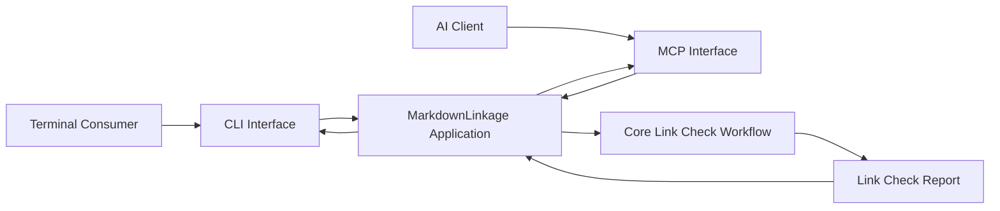

# MD Linkage Application Layer Implementation Plan

> **For agentic workers:** REQUIRED SUB-SKILL: Use superpowers:subagent-driven-development (recommended) or superpowers:executing-plans to implement this plan task-by-task. Steps use checkbox (`- [ ]`) syntax for tracking.

**Goal:** Add a `MarkdownLinkage` application facade that owns the core scheduler and let the CLI and MCP handlers construct that facade themselves.

**Architecture:** `MarkdownLinkage` is the application-layer boundary above the existing dependency-injection composition module and core workflow. It privately resolves `LinkCheckWorkflowScheduler` and exposes `checkSpecificationLinks`, while interface handlers own independent facade instances and the entry point only wires Commander commands.

**Tech Stack:** TypeScript, Inversify, Commander, Model Context Protocol SDK, Vitest, pnpm, tsdown

**Spec:** `docs/superpowers/specs/2026-10-23-md-linkage-application-layer-design.md`

## Global Constraints

- Name the new application facade `MarkdownLinkage`.
- Expose `checkSpecificationLinks(delegation: LinkCheckDelegation): Promise<LinkCheckReport>` and keep the container and scheduler private.
- `CheckHandler` and `McpHandler` must each construct their own `MarkdownLinkage` instance.
- Do not change link-check behavior, report semantics, traversal modes, CLI syntax, or MCP schemas.
- Do not expose the dependency-injection container as public API.
- Do not add a general-purpose capability registry.
- Preserve extensionless relative TypeScript imports and explicit Vitest imports.

---

### Task 1: Add the `MarkdownLinkage` Application Facade

**Files:**
- Create: `mcps/md-linkage/src/application/markdown-linkage.ts`
- Test: `mcps/md-linkage/src/application/markdown-linkage.test.ts`

**Interfaces:**
- Consumes: `createApplicationContainer(): Container` and `LinkCheckWorkflowScheduler.run(delegation: LinkCheckDelegation): Promise<LinkCheckReport>`.
- Produces: `MarkdownLinkage.checkSpecificationLinks(delegation: LinkCheckDelegation): Promise<LinkCheckReport>` and `MarkdownLinkageCapabilities = Pick<MarkdownLinkage, "checkSpecificationLinks">`.

- [ ] **Step 1: Write the failing application-facade test**

```typescript
import { join } from "node:path";
import { describe, expect, it } from "vitest";
import { LinkCheckDelegation } from "../core/model/link-check-delegation";
import { MarkdownLinkage } from "./markdown-linkage";

const projectRoot = join(
  import.meta.dirname,
  "../../tests/e2e/__fixtures__/project",
);

describe("MarkdownLinkage", () => {
  it("checks specification links through the composed core workflow", async () => {
    const markdownLinkage = new MarkdownLinkage();

    const report = await markdownLinkage.checkSpecificationLinks(
      new LinkCheckDelegation(projectRoot, ["clean.md"]),
    );

    expect(report.delegation.root).toBe(projectRoot);
    expect(report.scope.files).toEqual(["clean.md"]);
    expect(report.deadLinks).toEqual([]);
  });
});
```

- [ ] **Step 2: Run the test and verify the missing facade causes failure**

Run:

```bash
corepack pnpm --filter @bluey/md-linkage exec vitest run src/application/markdown-linkage.test.ts
```

Expected: FAIL because `./markdown-linkage` does not exist.

- [ ] **Step 3: Implement the minimal application facade**

```typescript
import { createApplicationContainer } from "../composition/create-application-container";
import type { LinkCheckDelegation } from "../core/model/link-check-delegation";
import type { LinkCheckReport } from "../core/model/link-check-report";
import { LinkCheckWorkflowScheduler } from "../core/workflow/link-check-workflow-scheduler";

export class MarkdownLinkage {
  private readonly scheduler: LinkCheckWorkflowScheduler;

  public constructor() {
    this.scheduler = createApplicationContainer().get(
      LinkCheckWorkflowScheduler,
    );
  }

  public async checkSpecificationLinks(
    delegation: LinkCheckDelegation,
  ): Promise<LinkCheckReport> {
    return this.scheduler.run(delegation);
  }
}

export type MarkdownLinkageCapabilities = Pick<
  MarkdownLinkage,
  "checkSpecificationLinks"
>;
```

- [ ] **Step 4: Run the focused test and type checker**

Run:

```bash
corepack pnpm --filter @bluey/md-linkage exec vitest run src/application/markdown-linkage.test.ts
corepack pnpm --filter @bluey/md-linkage typecheck
```

Expected: the focused test passes and TypeScript reports no errors.

- [ ] **Step 5: Commit the application facade**

```bash
git add mcps/md-linkage/src/application/markdown-linkage.ts mcps/md-linkage/src/application/markdown-linkage.test.ts
git commit -m "feat(md-linkage): add application facade"
```

---

### Task 2: Route the MCP Adapter Through the Application Capability

**Files:**
- Modify: `mcps/md-linkage/src/mcp/tools/check-specification-links.ts`
- Modify: `mcps/md-linkage/src/mcp/tools/check-specification-links.test.ts`
- Modify: `mcps/md-linkage/src/mcp/server.ts`
- Modify: `mcps/md-linkage/src/mcp/server.test.ts`

**Interfaces:**
- Consumes: `MarkdownLinkageCapabilities.checkSpecificationLinks(delegation)` from Task 1.
- Produces: `createCheckSpecificationLinksTool(capabilities: MarkdownLinkageCapabilities)` and `setupMcpServer(capabilities: MarkdownLinkageCapabilities)`.

- [ ] **Step 1: Change tool and server tests to use the new capability method**

In `check-specification-links.test.ts`, construct the tool with:

```typescript
const tool = createCheckSpecificationLinksTool({
  async checkSpecificationLinks(delegation) {
    return new LinkCheckReport(
      delegation,
      new LinkCheckScope(delegation.files, []),
      [],
    );
  },
});
```

In all three `server.test.ts` collaborators, rename `run` to
`checkSpecificationLinks` while preserving their existing return values and
errors. For example:

```typescript
const server = setupMcpServer({
  async checkSpecificationLinks(delegation) {
    return new LinkCheckReport(
      delegation,
      new LinkCheckScope(delegation.files, []),
      [],
    );
  },
});
```

- [ ] **Step 2: Run the MCP unit tests and verify they fail at the old scheduler boundary**

Run:

```bash
corepack pnpm --filter @bluey/md-linkage exec vitest run src/mcp/tools/check-specification-links.test.ts src/mcp/server.test.ts
```

Expected: FAIL because the production code still invokes `run`.

- [ ] **Step 3: Replace scheduler-shaped parameters with the application capability**

In `check-specification-links.ts`, replace the scheduler type import and update
the factory and invocation:

```typescript
import type { MarkdownLinkageCapabilities } from "../../application/markdown-linkage";

export function createCheckSpecificationLinksTool(
  capabilities: MarkdownLinkageCapabilities,
) {
  return {
    // Keep the existing name, title, description, and schemas unchanged.
    async callback(input: CheckSpecificationLinksInput) {
      const parsed = CheckSpecificationLinksInputSchema.parse(input);
      const delegation = new LinkCheckDelegation(
        parsed.root,
        parsed.files,
        parsed.mode,
      );
      const report = LinkCheckReportOutputSchema.parse(
        await capabilities.checkSpecificationLinks(delegation),
      );
      return {
        report,
        summary: [
          `Documents: ${report.scope.files.length}`,
          `scope issues: ${report.scope.issues.length}`,
          `dead links: ${report.deadLinks.length}`,
        ].join("; "),
      };
    },
  };
}
```

In `server.ts`, update the narrow dependency without changing registration or
error mapping:

```typescript
import type { MarkdownLinkageCapabilities } from "../application/markdown-linkage";

export function setupMcpServer(
  capabilities: MarkdownLinkageCapabilities,
): McpServer {
  const server = new McpServer({ name: "bluey-md-linkage", version: "0.1.0" });
  const tool = createCheckSpecificationLinksTool(capabilities);
  // Keep the existing registerTool callback unchanged.
  return server;
}
```

- [ ] **Step 4: Run the MCP unit tests and type checker**

Run:

```bash
corepack pnpm --filter @bluey/md-linkage exec vitest run src/mcp/tools/check-specification-links.test.ts src/mcp/server.test.ts
corepack pnpm --filter @bluey/md-linkage typecheck
```

Expected: both test files pass and TypeScript reports no errors.

- [ ] **Step 5: Commit the MCP capability boundary**

```bash
git add mcps/md-linkage/src/mcp/tools/check-specification-links.ts mcps/md-linkage/src/mcp/tools/check-specification-links.test.ts mcps/md-linkage/src/mcp/server.ts mcps/md-linkage/src/mcp/server.test.ts
git commit -m "refactor(md-linkage): use application capability in MCP"
```

---

### Task 3: Make `CheckHandler` Own Its Application Facade

**Files:**
- Modify: `mcps/md-linkage/src/facade/check.ts`
- Modify: `mcps/md-linkage/src/facade/check.test.ts`

**Interfaces:**
- Consumes: `new MarkdownLinkage()` and `checkSpecificationLinks(delegation)` from Task 1.
- Produces: `new CheckHandler({ cwd, stdout })`; `CheckHandlerDependencies` no longer contains a workflow or scheduler.

- [ ] **Step 1: Rewrite the handler tests around real application behavior**

Remove imports used only by the workflow stub. Define a real fixture root and
keep only environment dependencies:

```typescript
import { join } from "node:path";
import { describe, expect, it } from "vitest";
import { LinkCheckMode } from "../core/model/link-check-delegation";
import { CheckHandler, type CheckHandlerDependencies } from "./check";

const projectRoot = join(
  import.meta.dirname,
  "../../tests/e2e/__fixtures__/project",
);

function dependenciesFor(
  output: { stdout: string[] },
  cwd = projectRoot,
): CheckHandlerDependencies {
  return {
    cwd: () => cwd,
    stdout: (text) => output.stdout.push(text),
  };
}
```

Update the existing cases as follows:

```typescript
it("maps parsed defaults into the JSON report", async () => {
  const output = captureOutput();
  const handler = new CheckHandler(dependenciesFor(output));

  await handler.run(["clean.md"], { json: true });

  expect(JSON.parse(output.stdout.join("")).delegation).toEqual({
    root: projectRoot,
    files: ["clean.md"],
    mode: LinkCheckMode.Shallow,
  });
});

it("maps an explicit root and mode into the workflow delegation", async () => {
  const output = captureOutput();
  const handler = new CheckHandler(dependenciesFor(output));

  await handler.run(["next.md"], {
    root: "nested",
    mode: LinkCheckMode.Recursive,
    json: true,
  });

  expect(JSON.parse(output.stdout.join("")).delegation).toMatchObject({
    root: join(projectRoot, "nested"),
    files: ["next.md"],
    mode: LinkCheckMode.Recursive,
  });
});

it("writes human output for a completed report with findings", async () => {
  const output = captureOutput();
  const handler = new CheckHandler(dependenciesFor(output));

  await handler.run(["missing.md"], {});

  expect(output.stdout.join("")).toContain("Scope issues: 1");
});

it("propagates a workflow failure when no report is produced", async () => {
  const output = captureOutput();
  const missingRoot = join(projectRoot, "missing");
  const handler = new CheckHandler(dependenciesFor(output, missingRoot));

  await expect(handler.run(["spec.md"], {})).rejects.toThrow(
    "Invalid project root",
  );
  expect(output.stdout).toEqual([]);
});
```

Keep the invalid concrete-path case, but construct the handler with the new
`dependenciesFor(output)` helper.

- [ ] **Step 2: Run the handler test and verify it fails because the workflow dependency is absent**

Run:

```bash
corepack pnpm --filter @bluey/md-linkage exec vitest run src/facade/check.test.ts
```

Expected: FAIL because the current handler still reads
`dependencies.workflow`.

- [ ] **Step 3: Let the handler construct and invoke `MarkdownLinkage`**

Update `check.ts` to remove the scheduler import and workflow dependency:

```typescript
import { resolve } from "node:path";
import { MarkdownLinkage } from "../application/markdown-linkage";
import {
  LinkCheckDelegation,
  LinkCheckMode,
} from "../core/model/link-check-delegation";
import { formatHumanReport, formatJsonReport } from "./report-formatter";

export interface CheckHandlerDependencies {
  readonly cwd: () => string;
  readonly stdout: (text: string) => void;
}

export class CheckHandler {
  private readonly markdownLinkage = new MarkdownLinkage();

  public constructor(private readonly dependencies: CheckHandlerDependencies) {}

  public async run(
    files: readonly string[],
    options: CheckOptions,
  ): Promise<void> {
    const root = resolve(
      this.dependencies.cwd(),
      options.root ?? this.dependencies.cwd(),
    );
    const delegation = new LinkCheckDelegation(root, files, options.mode);
    const report = await this.markdownLinkage.checkSpecificationLinks(delegation);
    const output = options.json ? formatJsonReport(report) : formatHumanReport(report);

    this.dependencies.stdout(`${output}\n`);
  }
}
```

Retain the existing `CheckOptions` declaration unchanged.

- [ ] **Step 4: Run the handler test and type checker**

Run:

```bash
corepack pnpm --filter @bluey/md-linkage exec vitest run src/facade/check.test.ts
corepack pnpm --filter @bluey/md-linkage typecheck
```

Expected: the handler tests pass and TypeScript reports no errors.

- [ ] **Step 5: Commit handler ownership**

```bash
git add mcps/md-linkage/src/facade/check.ts mcps/md-linkage/src/facade/check.test.ts
git commit -m "refactor(md-linkage): let check handler own application"
```

---

### Task 4: Make `McpHandler` Own Its Application Facade and Simplify Startup

**Files:**
- Modify: `mcps/md-linkage/src/facade/mcp.ts`
- Create: `mcps/md-linkage/src/facade/mcp.test.ts`
- Modify: `mcps/md-linkage/src/index.ts`

**Interfaces:**
- Consumes: `new MarkdownLinkage()` from Task 1 and `setupMcpServer(capabilities)` from Task 2.
- Produces: zero-argument `new McpHandler()` and an entry point with no container or scheduler knowledge.

- [ ] **Step 1: Add a failing constructor-contract test**

```typescript
import { describe, expect, it } from "vitest";
import { McpHandler } from "./mcp";

describe("McpHandler", () => {
  it("constructs without an external scheduler", () => {
    expect(McpHandler.length).toBe(0);
    expect(new McpHandler()).toBeInstanceOf(McpHandler);
  });
});
```

- [ ] **Step 2: Run the test and verify the existing constructor contract fails**

Run:

```bash
corepack pnpm --filter @bluey/md-linkage exec vitest run src/facade/mcp.test.ts
```

Expected: FAIL because the existing `McpHandler` constructor has one declared
parameter.

- [ ] **Step 3: Move application construction into `McpHandler`**

```typescript
import { StdioServerTransport } from "@modelcontextprotocol/sdk/server/stdio.js";
import { MarkdownLinkage } from "../application/markdown-linkage";
import { setupMcpServer } from "../mcp/server";

export class McpHandler {
  private readonly markdownLinkage = new MarkdownLinkage();

  public async run(): Promise<void> {
    const server = setupMcpServer(this.markdownLinkage);
    await server.connect(new StdioServerTransport());
  }
}
```

- [ ] **Step 4: Remove core composition from the CLI entry point**

Keep `reflect-metadata`, Commander, mode, and handler imports. Replace the old
container, workflow, and handler construction with:

```typescript
const check = new CheckHandler({
  cwd: () => process.cwd(),
  stdout: (text) => process.stdout.write(text),
});
const mcp = new McpHandler();
```

Delete imports of `createApplicationContainer` and
`LinkCheckWorkflowScheduler`. Keep command definitions and actions unchanged.

- [ ] **Step 5: Run the facade tests, type checker, and build**

Run:

```bash
corepack pnpm --filter @bluey/md-linkage exec vitest run src/facade
corepack pnpm --filter @bluey/md-linkage typecheck
corepack pnpm --filter @bluey/md-linkage build
```

Expected: all facade tests pass, TypeScript reports no errors, and tsdown
creates `dist/index.mjs` successfully.

- [ ] **Step 6: Commit simplified startup**

```bash
git add mcps/md-linkage/src/facade/mcp.ts mcps/md-linkage/src/facade/mcp.test.ts mcps/md-linkage/src/index.ts
git commit -m "refactor(md-linkage): let MCP handler own application"
```

---

### Task 5: Align End-to-End Coverage and Architecture Documentation

**Files:**
- Modify: `mcps/md-linkage/tests/e2e/mcp.test.ts`
- Modify: `specs/md-linkage/interfaces/spec.md`

**Interfaces:**
- Consumes: `MarkdownLinkage` and `setupMcpServer(capabilities)` from earlier tasks.
- Produces: end-to-end verification through the application boundary and documentation of the final dependency direction.

- [ ] **Step 1: Route the MCP equivalence test through `MarkdownLinkage`**

Replace the composition-container and scheduler imports with:

```typescript
import { MarkdownLinkage } from "../../src/application/markdown-linkage";
```

Replace direct scheduler resolution with:

```typescript
const markdownLinkage = new MarkdownLinkage();
const server = setupMcpServer(markdownLinkage);
```

Keep the CLI invocation, MCP request, and semantic-equivalence assertion
unchanged.

- [ ] **Step 2: Update the interface architecture diagram and boundary text**

Replace the Mermaid flow in `specs/md-linkage/interfaces/spec.md` with:



Replace the paragraph after the diagram with:

```markdown
The CLI and MCP interfaces are sibling adapters. Each handler constructs its
own `MarkdownLinkage` application facade, which owns core composition and
exposes the shared link-check capability. Neither interface invokes the other,
and neither contains link-checking or scope-building rules.
```

- [ ] **Step 3: Build before running the complete package suite**

Run:

```bash
corepack pnpm --filter @bluey/md-linkage build
```

Expected: tsdown completes successfully and refreshes the executable used by
CLI end-to-end tests.

- [ ] **Step 4: Run all package verification**

Run:

```bash
corepack pnpm --filter @bluey/md-linkage test
corepack pnpm --filter @bluey/md-linkage typecheck
git diff --check
```

Expected: every md-linkage unit and end-to-end test passes, TypeScript reports
no errors, and Git reports no whitespace errors.

- [ ] **Step 5: Confirm the final dependency boundary**

Run:

```bash
rg -n "createApplicationContainer|LinkCheckWorkflowScheduler" mcps/md-linkage/src/index.ts mcps/md-linkage/src/facade mcps/md-linkage/src/mcp
```

Expected: no matches in `src/index.ts` or `src/facade`; MCP files may refer only
to `MarkdownLinkageCapabilities`, not `LinkCheckWorkflowScheduler`.

- [ ] **Step 6: Commit end-to-end coverage and documentation**

```bash
git add mcps/md-linkage/tests/e2e/mcp.test.ts specs/md-linkage/interfaces/spec.md
git commit -m "docs(md-linkage): document application boundary"
```

---

### Task 6: Final Review and Repository Verification

**Files:**
- Review: all files changed by Tasks 1-5

**Interfaces:**
- Consumes: the completed application, interface, entry-point, tests, and documentation changes.
- Produces: verified implementation ready for branch integration.

- [ ] **Step 1: Review the complete branch diff against the design**

Run:

```bash
git diff 549863e..HEAD -- mcps/md-linkage specs/md-linkage/interfaces/spec.md
```

Expected: the diff contains only the approved application-layer ownership
change, its tests, and its documentation update.

- [ ] **Step 2: Run the repository-level checks**

Run:

```bash
corepack pnpm check
```

Expected: skill checks, builds, and all workspace test suites pass.

- [ ] **Step 3: Confirm a clean working tree**

Run:

```bash
git status --short
```

Expected: no output.
