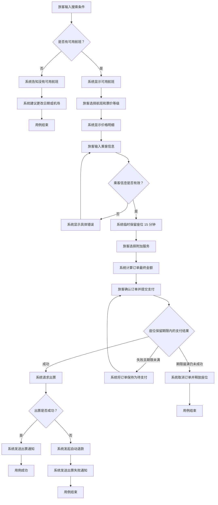

# 预订航班

## 参与者

- **主要参与者：** 旅客
- **协作参与者：** 支付系统、航空公司库存系统

## 简要说明

旅客搜索可用航班、选择航班并填写乘客信息，在完成支付后获得有效机票。

## 前置条件

1. 航空公司库存系统可用。

## 事件流

### 基本事件流

1. 旅客输入出发地、目的地、旅行日期和票价等级。
2. 系统搜索并显示可用航班。
3. 旅客选择航班和票价等级。
4. 系统显示票价、机场建设费和燃油附加费等价格明细。
5. 旅客输入乘客姓名、身份证件号码和联系方式。
6. 系统确认乘客信息有效，并临时保留座位 15 分钟。
7. 旅客选择选座、餐食或行李额度等附加服务。
8. 系统计算订单最终金额，并应用会员折扣或优惠券。
9. 旅客确认订单并提交支付。
10. 支付系统完成扣款。
11. 系统通过航空公司库存系统出票。
12. 航空公司库存系统确认出票成功。
13. 系统向旅客发送包含航班号、时间、座位号和电子客票号的出票通知。

### 备选事件流

#### 没有可用航班

1. 当系统确认所选日期没有可用航班时，系统告知旅客没有可用航班。
2. 系统建议旅客更改日期或选择附近机场。
3. 用例结束。

#### 修改乘客信息

1. 当系统确认乘客信息无效时，系统显示具体错误。
2. 旅客修改乘客信息。
3. 系统重新验证乘客信息；信息有效后，系统临时保留座位，并继续处理附加服务。

#### 重试支付

1. 当支付在座位保留期限内失败时，系统告知旅客支付失败，并将订单保持为待支付。
2. 旅客可以在座位保留期限内重新提交支付。
3. 支付在座位保留期限内成功完成后，系统继续出票；期限届满时仍未成功完成支付，进入支付超时事件流。

### 异常事件流

#### 支付超时

1. 当旅客未在 15 分钟内完成支付时，系统自动取消订单。
2. 系统释放临时保留的座位。
3. 用例结束。

#### 出票失败

1. 当航空公司库存系统无法完成出票时，系统发起自动退款。
2. 系统通知旅客出票失败，款项将在一至三个工作日内原路退回。
3. 用例结束。

## 流程图（可选）

本用例包含多个分支、循环和恢复路径，因此使用 Mermaid 图补充说明事件流之间的关系。

## 后置条件

**成功场景：**

1. 已生成订单号，订单状态为“已出票”。
2. 航空公司库存系统已扣减相应座位库存。
3. 旅客已通过短信或邮件收到出票通知。
4. 支付系统已完成扣款。

**失败场景：**

1. 没有可用航班时，未生成订单，也未扣减座位库存。
2. 支付超时后，订单已取消，临时保留的座位已释放。
3. 出票失败时，未生成有效机票；如果已经收款，系统已发起原路退款。

## 业务规则

- **临时座位保留期限**：座位临时保留 15 分钟，超时后自动释放。
- **支付超时规则**：如果未在 15 分钟内完成支付，系统自动取消订单。
- **航班搜索限制**：仅显示仍有可售座位的航班。
- **订单航班限制**：同一订单中的所有乘客必须选择同一航班。
- **身份证件购票限制**：同一身份证件号码在同一航班上只能购买一张经济舱机票。
- **乘客信息验证**：姓名必须与身份证件号码匹配，且身份证件号码格式必须有效。
- **信息变更约束**：提交订单后不得更改乘客和航班信息。
- **儿童与婴儿票价**：2 至 12 岁儿童的票价为成人全价票的 50%，2 岁以下婴儿的票价为 10%。
- **优惠组合限制**：会员折扣和优惠券不得同时使用。
- **特殊餐食预订**：素食或清真餐等特殊餐食必须至少提前 24 小时申请。

## 特殊需求

- **性能：** 航班搜索响应时间不超过 2 秒；支付回调处理时间不超过 5 秒。
- **安全：** 静态加密乘客身份证件信息；支付处理符合 PCI DSS。
- **可用性：** 系统可用性不低于 99.9%。

## 扩展点（可选）

- **附加服务**：未来支持升舱和贵宾休息室预订。
- **通知渠道**：未来支持航空公司 App 通知、微信服务通知和其他渠道。
