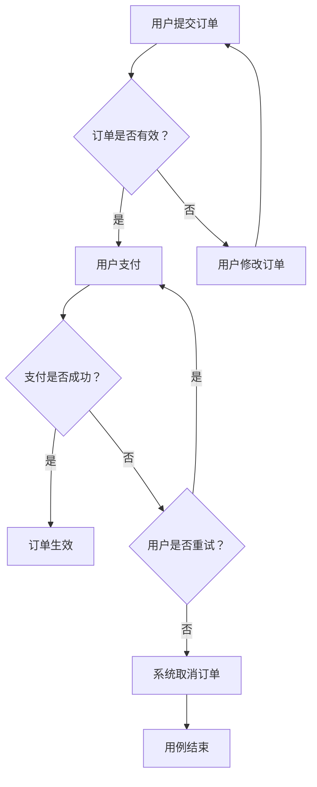

# 使用 Mermaid 补充说明复杂业务流程

## 背景

用例规约的事件流需要以文本完整描述基本事件流、备选事件流和异常事件流。文本事件流便于逐项审查业务行为，也是业务规则、验收和后续实现的规范依据。

当流程包含较多相互影响的分支、循环、回退、恢复路径或跨事件流转换时，仅靠文本可能难以快速理解整体关系。Mermaid 图可以在这些场景中提供直观的补充说明，但不应取代事件流。

## 决策

**事件流是业务流程的规范性描述；仅在流程复杂时使用 Mermaid 图作为补充说明。**

核心约定：

1. **始终完整编写事件流**
   - 每份用例规约都必须使用文本分别描述基本事件流、备选事件流和异常事件流。
   - 事件按照发生顺序写成可观察的参与者行为或系统响应。
   - 可以使用有序列表改善阅读体验，但列表序号只表示当前文档中的阅读顺序，不是稳定标识，也不得作为跨章节引用契约。
2. **仅在复杂流程中补充 Mermaid 图**
   - 当多个分支、循环、回退、恢复路径或跨事件流转换使文本关系难以快速理解时，可以在事件流之后增加 Mermaid flowchart。
   - 简单流程不需要 Mermaid 图，缺少 Mermaid 图不影响用例规约的完整性。
3. **保持图与事件流一致**
   - 图只能呈现事件流中已经描述的行为、判断和转换，不得引入新的业务语义。
   - Mermaid 语法所需的内部节点名只是图内实现细节，不要求稳定，也不得被正文引用。
   - 图与文本不一致时，以文本事件流为准，并在交付前修正图。
4. **业务规则保持自包含**
   - 业务规则直接说明适用条件、约束和结果，不引用事件序号或 Mermaid 节点名。

## 后果

- **正面影响**：事件流始终完整且可独立审查；复杂流程仍可通过图快速理解整体关系。
- **负面影响**：复杂用例需要同时维护文本事件流和 Mermaid 图，必须额外检查两者是否一致。

## 示例

对于只有单一路径的简单流程，仅编写事件流：

1. 用户提交邮箱地址。
2. 系统发送确认邮件。
3. 用户完成确认。

对于包含多个分支和恢复路径的复杂流程，先完整编写事件流：

**基本事件流：**

1. 用户提交订单。
2. 系统确认订单有效。
3. 用户支付。
4. 系统确认支付成功，订单生效。

**备选事件流：**

1. 订单无效时，用户修改并重新提交订单。
2. 支付失败时，用户可以重试支付。

**异常事件流：**

1. 支付失败后用户选择取消时，系统取消订单，用例结束。

然后使用 Mermaid 图补充说明事件流之间的关系：

## 已否决的方案

1. 仅使用 Mermaid 图表达流程：图无法取代可逐项审查的规范性事件流。
2. 所有用例都同时编写事件流和 Mermaid 图：简单流程会产生不必要的重复和维护成本。
3. 仅使用文本事件流：复杂分支和恢复路径的整体关系不够直观。
