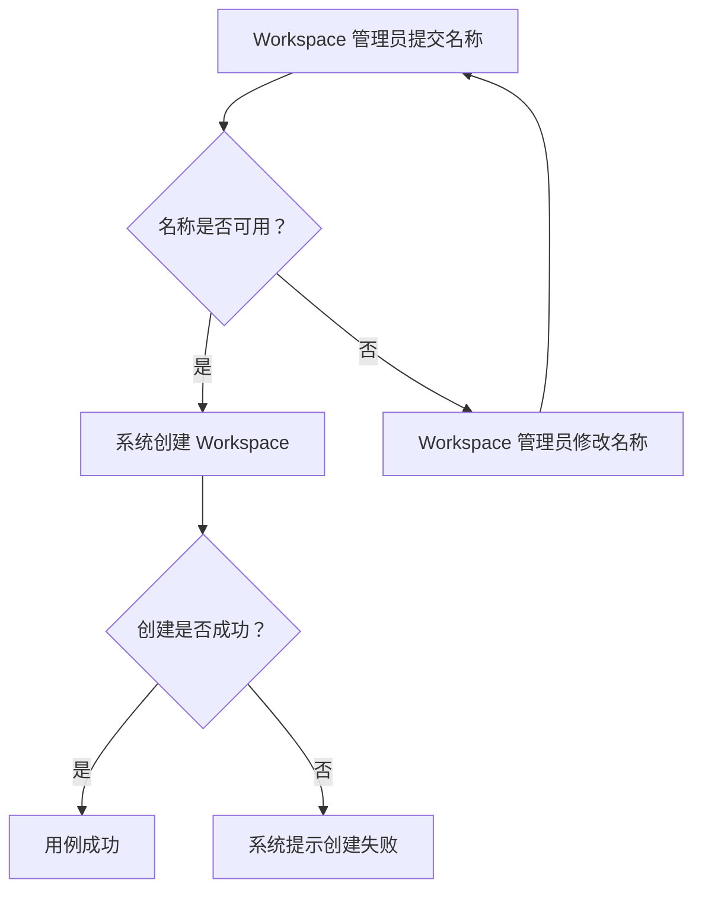

# {用例名称}

## 参与者

> 说明发起或支持此用例的人员、角色、外部参与方或外部系统。

<!--
格式：

- **主要参与者：** **{参与者}**
- **协作参与者：** **{参与者}**

示例：

- **主要参与者：** **Workspace 管理员**
- **协作参与者：** **规则服务**
-->

## 简要说明

> 使用一至两句话概述用例的业务目标和价值。

<!--
格式：

简洁描述目标和价值的正文。

示例：

管理员创建 Workspace，使团队可以在同一位置组织规则配置。
-->

## 前置条件

> 列出用例开始前必须满足且可验证的条件。

<!--
格式：

1. {条件}

示例：

1. Workspace 管理员拥有创建 Workspace 的权限。
-->

## 事件流

> 使用文本完整描述事件流。事件应是可观察的参与者行为或系统响应。有序列表的序号只表示阅读顺序，不是稳定标识。

### 基本事件流

<!--
格式：

1. {参与者执行的行为或系统响应}
2. {参与者执行的行为或系统响应}

示例：

1. Workspace 管理员提交 Workspace 名称。
2. 系统确认名称可用。
3. 系统创建 Workspace。
-->

### 备选事件流

<!--
按照触发条件分别描述仍可继续或以其他有效结果结束的路径。没有已知备选事件流时写“无”。

格式：

#### {备选场景名称}

1. 当{触发条件}时，{参与者行为或系统响应}。
2. {后续行为或结果}。

示例：

#### 修改 Workspace 名称

1. 当系统确认名称已被占用时，系统提示 Workspace 管理员修改名称。
2. Workspace 管理员提交新名称。
3. 系统重新确认名称是否可用。
-->

### 异常事件流

<!--
按照触发条件分别描述失败、终止或需要恢复的路径。没有已知异常事件流时写“无”。

格式：

#### {异常场景名称}

1. 当{异常条件}发生时，{系统响应}。
2. {恢复操作或最终状态}。

示例：

#### 创建失败

1. 当系统无法保存 Workspace 时，系统提示创建失败。
2. 系统不创建 Workspace。
-->

## 流程图（可选）

> 仅当多个分支、循环、回退、恢复路径或跨事件流转换使文本关系难以快速理解时，使用 Mermaid flowchart 补充说明。图不得取代事件流或引入新业务语义；内部节点名不要求稳定，也不得被正文引用。

<!--
复杂流程示例：

流程简单时，删除整个“流程图（可选）”章节。
-->

## 后置条件

> 分别说明用例成功和失败时系统保证成立的状态。

<!--
格式：

**成功场景：**

1. {后置条件}

**失败场景：**

1. {后置条件}

示例：

**成功场景：**

1. 新 Workspace 可供团队使用。

**失败场景：**

1. 没有创建 Workspace。
-->

## 业务规则

> 使用自包含的语句说明业务规则和约束，不引用事件序号或 Mermaid 节点名。

<!--
格式：

- **{规则名称}**：{适用条件、约束和结果}

示例：

- **Workspace 名称唯一**：Workspace 名称在组织内必须唯一；名称已被占用时不得创建 Workspace。
-->

## 特殊需求

> 记录与此用例直接相关的重要非功能需求。没有已知特殊需求时写“无”。

<!--
格式：

- **性能：** {需求}
- **安全：** {需求}
- **可用性：** {需求}

示例：

- **性能：** 正常负载下，Workspace 创建操作在两秒内完成。
- **安全：** 仅 Workspace 管理员可以创建 Workspace。
- **可用性：** 管理服务可用时，Workspace 创建功能必须可用。
-->

## 扩展点（可选）

> 仅在需求材料提供充分依据时，说明未来可支持的业务扩展。

<!--
格式：

- **{扩展点名称}**：{扩展说明}

示例：

- **组织命名策略**：支持组织自定义 Workspace 命名规则。
-->
