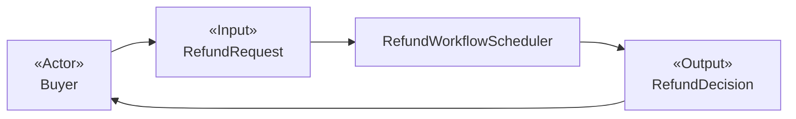
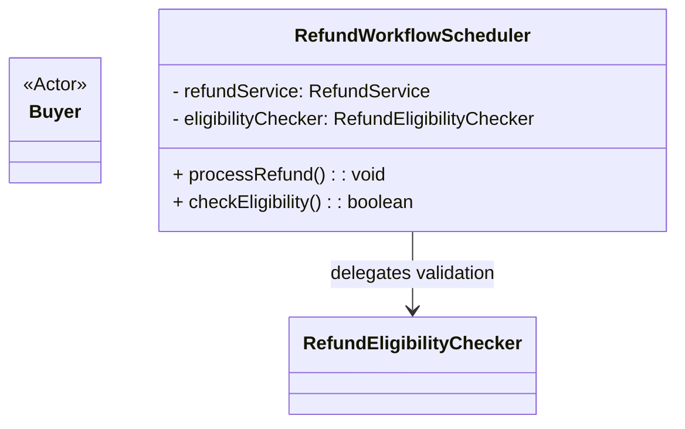

```mermaid
classDiagram
    class RefundWorkflowScheduler
    <<Caller>> RefundWorkflowScheduler
    class RefundRequest
    <<Input>> RefundRequest
    class RefundReviewScheduler
    class RefundEligibilityChecker
    class RefundDecision
    <<Output>> RefundDecision

    RefundWorkflowScheduler ..> RefundReviewScheduler
    RefundReviewScheduler ..> RefundRequest
    RefundReviewScheduler ..> RefundEligibilityChecker
    RefundReviewScheduler ..> RefundDecision
```

# oo-design-naive

## 参考资料

- [面向对象设计命名规范](references/naming-conventions.md)
- [设计文档模板](references/design-document-template.md)
- [用例规约示例：发布短视频](references/use-case-specification-publish-video.md)
- [设计文档示例：发布短视频](references/design-document-example-publish-video.md)

## 核心原则

- **以用例规约为导向：**面向对象设计必须从结构化用例规约开始，不得虚构业务需求。
- **业务语义优先：**包括类名、职责和协作者在内的所有设计产物都必须围绕业务语义展开，不得将技术实现细节泄漏到设计层。
- **命名一致：**类名必须遵循**面向对象设计命名规范**中定义的风格。

## 设计工作流

### 前置步骤：校准参考案例

开始设计前，必须成对阅读**用例规约示例：发布短视频**和**设计文档示例：发布短视频**：

- 前者代表结构化用例规约输入，后者代表对应的预期设计输出。
- 对照参与者目标和生命周期入口如何映射为独立用例，以及候选类的职责和协作关系如何从业务流程中产生。
- 对照共享子流程如何在多个调用方之间复用，以及 `flowchart` 与 `classDiagram` 如何表达不同设计层级。
- 使用案例校准设计结构、职责粒度和图示粒度，不得用案例中的业务事实覆盖当前用例规约。

### 第 1 步：提取名词——识别业务实体

从用例规约出发，在用例名称、参与者、前置条件、基本流程、扩展流程和业务规则中提取候选名词。

**特别说明：**将支付系统、物流系统等外部系统表示为抽象参与者，并明确标记为外部参与者。

针对每个名词提出三个问题：

1. 业务方是否认可这个概念具有业务含义？
2. 业务概念能否独立存在？
3. 业务概念是否具有生命周期？

**判断示例：**

- “买家”、“订单”、“订单项”和“退款申请”等名词通常具有独立业务价值，可作为候选类。
- “申请退款的原因”、“申请退款的金额”具有业务语义，但不能作为独立实体存在，不应成为独立类。
- “页面”、“消息”、“接口”、“请求”、“响应”、“数据库” 此类技术导向的名词通常不应成为独立类。

### 第 2 步：识别动词——识别业务职能

从用例规约的事件流中提取动词。事件流不是静态的名词集合，而是一系列业务动作。

例如：

- 验证是否允许退款。
- 计算可退款金额。
- 确定退款路径。
- 创建退款申请。
- 触发风控检查。
- 将申请转入人工审核。
- 通知买家。

然后严格按照**业务职能**进行动作分组。

**关键判断标准：**

- 是否执行独立的业务决策、业务策略或业务规则？
- 是否需要被独立说明、复用或替换？
- 是否提供独立价值？

如果满足，可以考虑将其表示为职能类。例如：

- `RefundEligibilityChecker`：判断退款资格。
- `RefundAmountCalculator`：计算实际退款金额。
- `RefundFinancial`：向用户执行退款。
- `RefundNotifier`：通知用户。

### 第 3 步：分配职责——连接业务工作流

沿着用例规约的事件流，为第 2 步识别出的业务动作分配负责人和协作者，并明确动作之间的衔接关系。目标是将候选类组织成能够完成整个用例的协作链，而不是停留在彼此孤立的职责列表。

按照以下顺序分析每个关键动作：

1. 明确由谁根据用例输入或前一个业务结果触发该动作。
2. 明确由谁执行该动作，以及执行过程中需要哪些协作者。
3. 明确该动作产生什么业务结果，以及结果交给谁继续处理。
4. 检查现有候选类能否完整承担这些职责。

例如：

- 对于“通知买家”，明确谁决定发送通知、谁起草通知内容，以及谁执行通知。
- 对于“触发风控检查”，明确谁发起检查、谁执行检查，以及检查结果由谁接收并用于后续决策。
- 对于“转入人工审核”，明确谁判断进入人工审核的业务条件、谁发起流程转换，以及谁接收申请并继续处理。

如果某项职责无法合理分配给现有候选类，并且符合第 2 步的业务职能判断标准，则根据该职责补充候选类。例如：

- `RefundWorkflowScheduler`：协调退款流程中各项业务动作的执行顺序与结果传递。
- `RefundRiskInspector`：负责风控子流程，并将检查结果返回给流程协调者。
- `RefundNotificationDrafter`：负责起草退款通知内容，补充通知执行之前缺失的内容准备职责。

### 第 4 步：处理异常——增强稳健性

严格聚焦业务异常。以下场景属于技术问题，明确排除出设计范围：

- 网络中断、超时或不稳定。
- 数据库连接失败。
- 第三方接口因技术原因不可用。
- 系统宕机或重启。
- 内存不足或性能问题。

#### 第 4-1 步：列出业务异常场景

在主流程的每个关键点询问“这里可能发生什么业务问题？”，列出所有业务异常场景。

**判断标准**（依次应用两项测试）：

1. **移除测试：**如果移除此机制，主流程还能否完成？如果不能，该场景可能是业务异常，继续进行第二项测试。
2. **业务方参与测试：**理解和解决该问题是否需要非技术业务干系人参与？如果需要，它就是应纳入设计的业务异常。

#### 第 4-2 步：为每个异常分配业务职责

针对每个业务异常场景询问：

- 谁负责**检测**异常？（观察者）
- 谁负责**决定**如何处理？（决策者）
- 谁负责**执行**处理动作？（执行者）

#### 第 4-3 步：识别负责异常处理的新候选类

如果现有候选类都无法承担异常处理职责，则新增候选类。例如：

- “买家错过退货期限”需要负责超时检测、自动关闭退货申请的类。
- “商家拒绝退款”可能需要一个负责协商或仲裁工作流的类。

#### 第 4-4 步：关联异常流程与主流程

表示负责检测或处理业务异常的类，并使用无标签的标准 Mermaid 关系将其连接起来。在相邻正文中说明触发异常的业务条件，而不是将其写成关系标签。

### 第 5 步：细化边界——避免职能混杂

#### 第 5-1 步：细化职能边界

主要目标是调整职能，使每个类都具有清晰的职能角色，避免职责臃肿或重叠。

分离决策、执行和协调：

- **决策类**回答“应该选择哪条路径？”。例如，`RefundEligibilityChecker` 判断退款资格。
- **执行类**回答“如何执行这个动作？”。例如，`RefundNotifier` 通知用户。
- **协调类**回答“如何连接完整的用例工作流？”。例如，`RefundWorkflowScheduler` 协调整体工作流。

如果不进行这种分离，很容易产生一个把决策、执行、通知和状态变更合为一体的庞大“退款控制器”。这样的类或许能让工作流运行，却会掩盖业务含义。

#### 第 5-2 步：细化层级边界

主要目标是关注点分离：同一层级内的职能应具有相同的抽象程度。

- **用例层级：**资格检查、金额计算、路径决策、风控检查和退款通知。
- **子流程层级：**风控检查和退款通知的具体细节。

分层结构从抽象走向具体。用例层级只定义整体工作流，不定义每个工作流节点的内部细节；子流程层级提供具体实现。层级没有固定深度，应始终以业务含义和语义为先。

## 设计文档

设计文档是唯一交付物，只呈现最终设计，不包含任何分析和推导过程。按照**设计文档模板**组织内容。

### 内容

1. **候选类说明：**每个候选类包含`类名`、`职责`和`协作者`。
2. **候选类可视化：**为每个不同的用例使用一组独立的 Mermaid 图：
   - 使用 `flowchart` 展示用例概览。
   - 紧接着使用 `classDiagram` 展示该用例的内部类设计。
   - 每个独立的嵌套子流程额外使用一个 `classDiagram`。不得为子流程添加 `flowchart`，也不得为每个调用方重复绘制共享子流程图。

### 约束

- 将用例概览和子流程内部结构放在不同的图中。不得使用 namespace 或一张组合图模拟层级结构。
- 每个不同的参与者目标和生命周期入口都必须有各自的用例 `flowchart` 及紧随其后的 `classDiagram`。不得将独立用例伪装成另一用例的子流程。
- 将用例概览视为黑盒。图中只显示外部使用者、用例输入、名称具有业务含义的用例协调者和用例输出，不显示任何内部协作者或子流程协调者。
- 在紧随其后的 `classDiagram` 中逐字复用用例协调者的名称，并将其标记为 `Caller`。对于嵌套子流程，逐字复用其在上一层中的调用方名称。
- 每个类图都显示上一层的一个或多个调用方、本层输入与输出，以及在本层内部协作的候选类。
- 当上一层有多个类调用同一个嵌套子流程时，在同一个共享子流程类图中将这些类全部标记为 `Caller`。
- 只能使用以下角色构造型：
  - `Actor`：仅用于用例概览 `flowchart`，标记发起或使用该用例的外部使用者。
  - `Caller`：仅用于 `classDiagram`，标记调用当前设计层级的、来自上一层概览或类设计层级的候选类。
  - `Input`：可用于任意层级，标记该层级所需的输入。
  - `Output`：可用于任意层级，标记该层级生成的最终产物。
- 不得添加其他角色构造型。没有上述四种角色的类不使用构造型。
- 图中的类定义只能包含类名，以及可选的职责摘要；不得包含属性定义或方法签名。
- 图中的类定义不得包含 `API`、数据库表、控制器、服务层或消息队列等实现细节。
- 图中的类关系只能使用标准 `mermaid` 语法，不得为关系添加文字标签。

### 约束示例

合规示例：

不合规示例：

不合规原因：

- 用例概览缺失 `flowchart`。
- 用例 `Actor` 出现在子流程类图中，违反 **仅用于用例概览 flowchart** 规则。
- 出现了属性定义（`- refundService: RefundService`），违反了不得包含属性的规则。
- 出现了方法签名（`+ processRefund(): void`），违反了不得包含方法的规则。
- 关系带有文字标签（`RefundWorkflowScheduler --> RefundEligibilityChecker : delegates validation`），违反了不得描述关系的规则。

## 审查清单

- 每个候选类都包含`类名`、`职责`和`协作者`，且名称符合**面向对象设计命名规范**。
- 外部行动者和外部参与者与内部候选类分开说明。
- 每个不同的参与者目标和生命周期入口都有一组独立的 `flowchart` 和紧随其后的 `classDiagram`，没有将独立用例伪装成子流程。
- 用例概览和子流程内部结构分别位于不同的图中，没有使用 namespace 或组合图模拟层级。
- 每个用例概览都保持黑盒，只包含外部使用者、用例输入、用例协调者和用例输出。
- 每个 `classDiagram` 都包含上一层的全部 `Caller`、本层 `Input` 与 `Output`，以及本层内部候选类。
- 每个独立的嵌套子流程都只有一个共享 `classDiagram`，并完整列出上一层的所有 `Caller`。
- 每个图中的 `Caller`、`Input` 和 `Output` 与上一层及相邻正文使用完全相同的名称。
- 图中只使用 `Actor`、`Caller`、`Input` 和 `Output` 四种 `Stereotype`，其中 `Actor` 仅用于用例概览 `flowchart`，`Caller` 仅用于 `classDiagram`。
- 没有角色的候选类不使用 `Stereotype`，也没有添加其他 `Stereotype`。
- 图中不包含属性、方法签名、技术实现细节或关系文字标签。
- 设计文档只呈现最终设计，不包含分析或推导过程。
