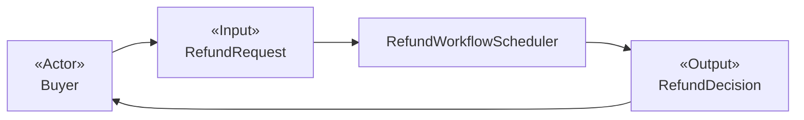
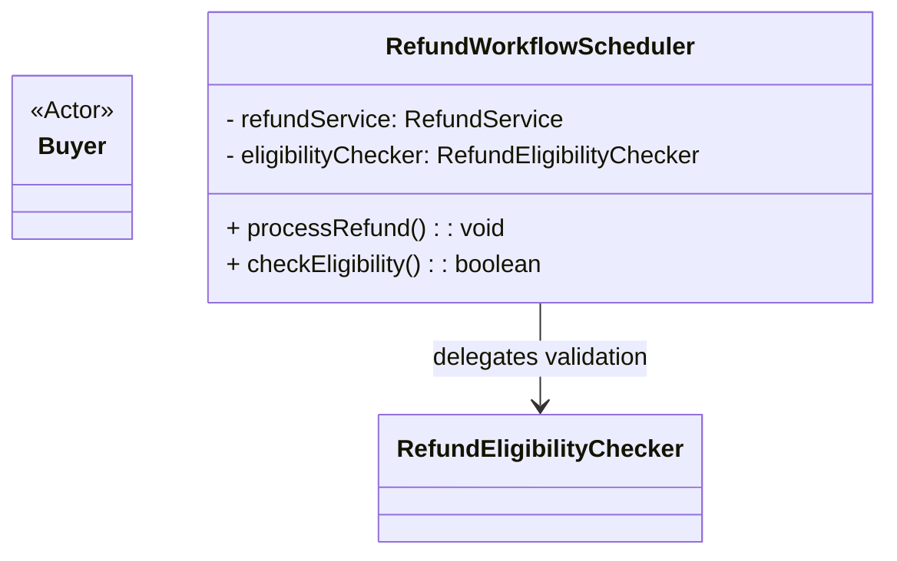

# oo-design-naive

## When to Use

Use this skill when the user requests object-oriented analysis or object-oriented design.

## Key Principles

- **Use case specification Oriented:** Object-oriented design must begin with a structured use-case specification. Do not invent business requirements.
- **Prioritize business semantics:** Every design artifact, including class names, responsibilities, and collaborations, must center on business semantics. Do not leak technical implementation details into the design layer.
- **Use consistent naming:** Class names must follow the style defined in the [object-oriented design naming conventions](references/naming-conventions.md).

## Design Workflow

Follow the [detailed design workflow](references/design-workflow.md) when performing object-oriented design.

## Deliverables

The deliverables are divided into two parts and must be generated and delivered independently.

### Design Document (Required)

This is the final deliverable. It presents only the final design and excludes all analysis and derivation. Organize it according to the [design document template](references/design-document-template.md).

Core content:

1. **Candidate-class descriptions:** Each candidate class includes `Class Name`, `Responsibility`, and `Collaborators`.
2. **Candidate-class visualization:** Use a separate Mermaid diagram pair for each distinct use case:
   - Use a `flowchart` for the use-case overview.
   - Follow it immediately with a `classDiagram` for that use case's internal class design.
   - Use additional separate `classDiagram` diagrams only for nested subprocess levels.

#### Design Document Constraints

- Keep the use-case overview and subprocess internals in separate diagrams. Do not use namespaces or one combined diagram to simulate the hierarchy.
- Give each distinct actor goal and lifecycle entry its own use-case flowchart and following class diagram. Do not disguise a separate use case as a subprocess of another use case.
- Treat the use-case overview as a black box. It shows only the external consumer, use-case input, meaningfully named use-case coordinator, and use-case output. It does not show any internal collaborator or subprocess coordinator.
- Repeat the use-case coordinator's exact name in the immediately following class diagram and mark it as `Caller`. For a nested subprocess, repeat the exact name of its caller from the enclosing level.
- Each class diagram shows the caller from the enclosing level, the level's input and output, and the candidate classes that collaborate inside that level.
- Use only these role stereotypes:
  - `Actor`: use-case level only; marks the external consumer that initiates or consumes the use case.
  - `Caller`: subprocess level only; marks the candidate class in the enclosing level that calls the subprocess.
  - `Input`: any level; marks the necessary input to that level.
  - `Output`: any level; marks the final artifact produced by that level.
- Do not add other role stereotypes. A class without one of these four roles remains unstereotyped.
- Class definitions in the diagram may contain only the class name and a responsibility summary. They must not contain attribute definitions or method signatures.
- Class definitions in the diagram must not contain implementation details such as `API`s, database tables, controllers, service layers, or message queues.
- Relationships between classes in the diagram must use only standard `mermaid` syntax. Do not add text labels to relationships.

#### Design Document Constraint Examples

Compliant example:

```mermaid
classDiagram
    class RefundWorkflowScheduler
    <<Caller>> RefundWorkflowScheduler
    class RefundRequest
    <<Input>> RefundRequest
    class RefundReviewScheduler
    class RefundEligibilityChecker
    class RefundDecision
    <<Output>> RefundDecision

    RefundWorkflowScheduler ..> RefundReviewScheduler
    RefundReviewScheduler ..> RefundRequest
    RefundReviewScheduler ..> RefundEligibilityChecker
    RefundReviewScheduler ..> RefundDecision
```

Noncompliant example:

Reasons for noncompliance:

- A `classDiagram` is used for the use-case overview instead of a `flowchart`.
- `Actor` appears in a subprocess-style class diagram instead of only in the use-case overview.
- Attribute definitions appear (`- refundService: RefundService`), violating the rule that attributes are not allowed.
- Method signatures appear (`+ processRefund(): void`), violating the rule that methods are not allowed.
- A phrase labels the relationship (`RefundWorkflowScheduler --> RefundEligibilityChecker : delegates validation`), violating the rule that relationship descriptions are not allowed.

### Thinking-Process Document (Optional)

Record the complete analysis trail from the use-case specification to the candidate classes. Organize it according to the [thinking-process document template](references/thinking-process-template.md).

## Examples

The following documents apply the analysis workflow to the **use-case specification example: Publish a Short Video** and show the resulting artifacts:

- [Use-case specification example: Publish a Short Video](./references/use-case-specification-publish-video.md)
- [Design document example: Publish a Short Video](./references/design-document-example-publish-video.md)
- [Thinking-process document example: Publish a Short Video](references/thinking-process-publish-video-example.md)
