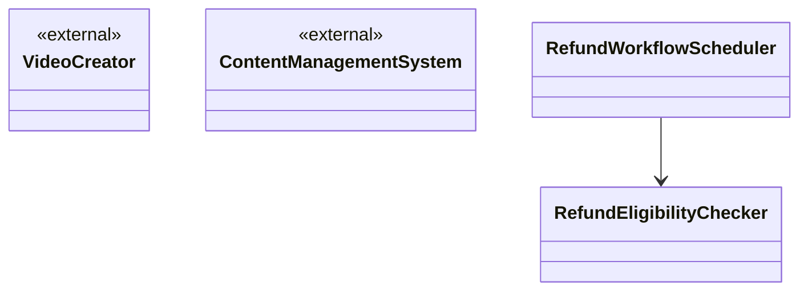
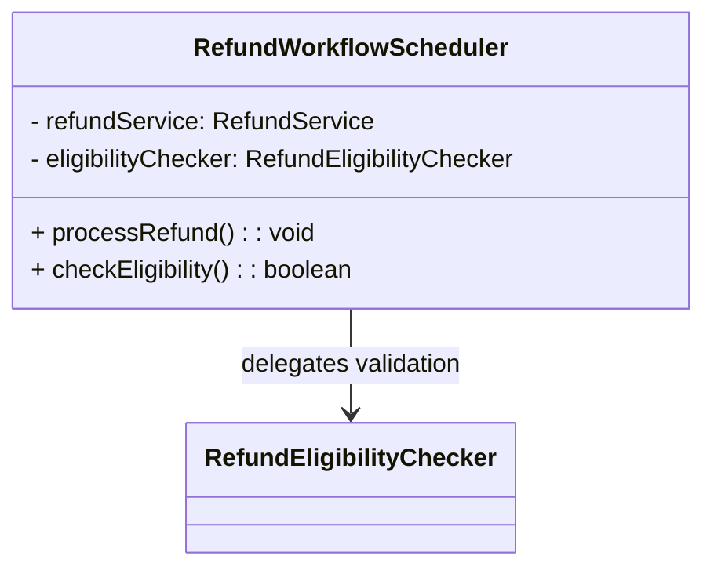

# oo-design-naive

## When to Use

Use this skill when the user requests object-oriented analysis or object-oriented design.

## Key Principles

- **Use case specification Oriented:** Object-oriented design must begin with a structured use-case specification. Do not invent business requirements.
- **Prioritize business semantics:** Every design artifact, including class names, responsibilities, and collaborations, must center on business semantics. Do not leak technical implementation details into the design layer.
- **Separate design artifacts:** Generate and deliver the design document (the final deliverable) and the thinking-process document (the analysis trail) independently.
- **Use consistent naming:** Class names must follow the style defined in the [object-oriented design naming conventions](references/naming-conventions.md).

## Design Workflow

Follow the [detailed design workflow](references/design-workflow.md) when performing object-oriented design.

## Deliverables

The deliverables are divided into two parts and must be generated and delivered independently.

### Design Document (Required)

This is the final deliverable. It presents only the final design and excludes all analysis and derivation. Organize it according to the [design document template](references/design-document-template.md).

Core content:

1. **Candidate-class descriptions:** Each candidate class includes `Class Name`, `Responsibility`, and `Collaborators`.
2. **Candidate-class visualization:** Use `mermaid` to draw a class diagram that shows the hierarchy between the use-case level and subprocess levels.

#### Design Document Constraints

- External participants in the class diagram must be explicitly marked `external`.
- Class definitions in the diagram may contain only the class name and a responsibility summary. They must not contain attribute definitions or method signatures.
- Class definitions in the diagram must not contain implementation details such as `API`s, database tables, controllers, service layers, or message queues.
- Relationships between classes in the diagram must use only standard `mermaid` syntax. Do not add text labels to relationships.

#### Design Document Constraint Examples

Compliant example:

Noncompliant example:

Reasons for noncompliance:

- Attribute definitions appear (`- refundService: RefundService`), violating the rule that attributes are not allowed.
- Method signatures appear (`+ processRefund(): void`), violating the rule that methods are not allowed.
- A phrase labels the relationship (`RefundWorkflowScheduler --> RefundEligibilityChecker : delegates validation`), violating the rule that relationship descriptions are not allowed.

### Thinking-Process Document (Optional)

Record the complete analysis trail from the use-case specification to the candidate classes. Organize it according to the [thinking-process document template](references/thinking-process-template.md).

## Examples

The following documents apply the analysis workflow to the **use-case specification example: Publish a Short Video** and show the resulting artifacts:

- [Use-case specification example: Publish a Short Video](./references/use-case-specification-publish-video.md)
- [Design document example: Publish a Short Video](./references/design-document-example-publish-video.md)
- [Thinking-process document example: Publish a Short Video](references/thinking-process-publish-video-example.md)
