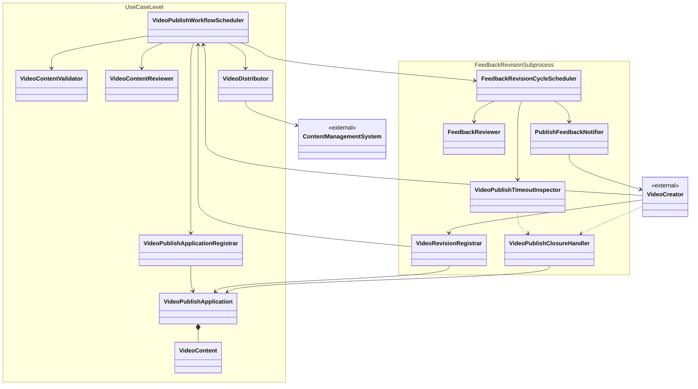

# Object-Oriented Design: Publish a Short Video

## Candidate classes

### VideoPublishApplication

- **Class Name:** `VideoPublishApplication`
- **Responsibility:** Represents one publication attempt and owns its lifecycle from creation to distributable, rejected, or terminated. It keeps every review feedback item and content revision within the same application.
- **Collaborators:** `VideoContent`, `FeedbackReviewer`, `VideoPublishApplicationRegistrar`, `VideoPublishWorkflowScheduler`, `VideoPublishClosureHandler`

### VideoContent

- **Class Name:** `VideoContent`
- **Responsibility:** Represents the short video and its publication information throughout validation, review, revision, and distribution readiness.
- **Collaborators:** `VideoPublishApplication`, `VideoContentValidator`, `VideoContentReviewer`, `VideoRevisionRegistrar`, `VideoDistributor`

### FeedbackReviewer

- **Class Name:** `FeedbackReviewer`
- **Responsibility:** Represents actionable reasons why the current video or publication information did not pass validation or review, and establishes the current 24-hour revision window.
- **Collaborators:** `VideoPublishApplication`, `FeedbackRevisionCycleScheduler`, `PublishFeedbackNotifier`, `VideoPublishTimeoutInspector`

### VideoPublishWorkflowScheduler

- **Class Name:** `VideoPublishWorkflowScheduler`
- **Responsibility:** Coordinates the publication use case from application creation through full validation and review, delegates rejected outcomes to the feedback-and-revision cycle, and advances an approved video toward distribution readiness.
- **Collaborators:** `VideoPublishApplicationRegistrar`, `VideoContentValidator`, `VideoContentReviewer`, `FeedbackRevisionCycleScheduler`, `VideoDistributor`, `VideoPublishClosureHandler`

### VideoPublishApplicationRegistrar

- **Class Name:** `VideoPublishApplicationRegistrar`
- **Responsibility:** Creates the publication application and records its associations with the submitted video, subsequent revisions, review feedback, and final business outcome.
- **Collaborators:** `VideoPublishApplication`, `VideoContent`, `FeedbackReviewer`, `VideoPublishWorkflowScheduler`, `VideoRevisionRegistrar`, `VideoPublishClosureHandler`

### VideoContentValidator

- **Class Name:** `VideoContentValidator`
- **Responsibility:** Determines whether the current video and publication information comply with publication rules before content review.
- **Collaborators:** `VideoContent`, `VideoPublishWorkflowScheduler`, `FeedbackReviewer`

### VideoContentReviewer

- **Class Name:** `VideoContentReviewer`
- **Responsibility:** Obtains and interprets the content-review decision for the current video, including actionable feedback when the review does not pass.
- **Collaborators:** `VideoContent`, `VideoPublishWorkflowScheduler`, `FeedbackReviewer`.

### VideoDistributor

- **Class Name:** `VideoDistributor`
- **Responsibility:** Distribute an approved short video into public after validation and review have both passed.
- **Collaborators:** `VideoPublishApplication`, `VideoContent`, `VideoPublishWorkflowScheduler`, `ContentManagementSystem`

### FeedbackRevisionCycleScheduler

- **Class Name:** `FeedbackRevisionCycleScheduler`
- **Responsibility:** Coordinates the rejected-outcome subprocess: preserve feedback, notify the creator, wait for a revision or termination condition, and return updated content to the complete validation-and-review sequence.
- **Collaborators:** `FeedbackReviewer`, `PublishFeedbackNotifier`, `VideoRevisionRegistrar`, `VideoPublishTimeoutInspector`, `VideoPublishClosureHandler`, `VideoPublishWorkflowScheduler`

### PublishFeedbackNotifier

- **Class Name:** `PublishFeedbackNotifier`
- **Responsibility:** Delivers actionable validation or review feedback to the content creator for the current publication application.
- **Collaborators:** `FeedbackReviewer`, `FeedbackRevisionCycleScheduler`, `VideoCreator`

### VideoRevisionRegistrar

- **Class Name:** `VideoRevisionRegistrar`
- **Responsibility:** Records a creator's updated video or publication information as a new revision of the current application and makes that revision eligible for a complete re-evaluation.
- **Collaborators:** `VideoPublishApplication`, `VideoContent`, `VideoPublishApplicationRegistrar`, `FeedbackRevisionCycleScheduler`, `VideoCreator`

### VideoPublishTimeoutInspector

- **Class Name:** `VideoPublishTimeoutInspector`
- **Responsibility:** Determines whether the content creator has failed to submit an update within 24 hours of the latest feedback. Each accepted revision ends the current waiting period; a later feedback item starts a new one.
- **Collaborators:** `FeedbackReviewer`, `FeedbackRevisionCycleScheduler`, `VideoPublishClosureHandler`

### VideoPublishClosureHandler

- **Class Name:** `VideoPublishClosureHandler`
- **Responsibility:** Ends the current publication application when the creator withdraws it or when the latest revision window expires, preserving the applicable rejected or terminated outcome.
- **Collaborators:** `VideoPublishApplication`, `VideoPublishApplicationRegistrar`, `FeedbackRevisionCycleScheduler`, `VideoPublishTimeoutInspector`, `VideoCreator`

## External participants

- **VideoCreator — external actor:** Starts, revises, or withdraws a short-video publication application.
- **ContentManagementSystem — external actor:** Holds the uploaded video and accepts the approved video's distribution-ready status.

## Candidate-class visualization

