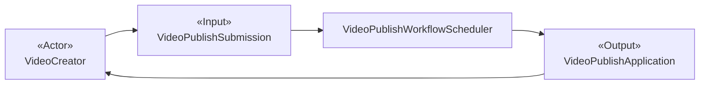
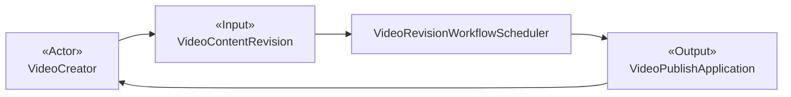
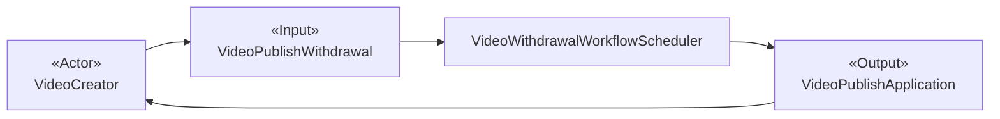

```mermaid
classDiagram
    direction LR

    class VideoPublishWorkflowScheduler
    <<Caller>> VideoPublishWorkflowScheduler
    class VideoPublishSubmission
    <<Input>> VideoPublishSubmission
    class VideoPublishApplicationRegistrar
    class VideoContentValidator
    class VideoContentReviewer
    class VideoDistributionScheduler
    class VideoContent
    class VideoPublishApplication
    <<Output>> VideoPublishApplication

    VideoPublishWorkflowScheduler ..> VideoPublishSubmission
    VideoPublishWorkflowScheduler ..> VideoPublishApplicationRegistrar
    VideoPublishWorkflowScheduler ..> VideoContentValidator
    VideoPublishWorkflowScheduler ..> VideoContentReviewer
    VideoPublishWorkflowScheduler ..> VideoDistributionScheduler
    VideoPublishWorkflowScheduler ..> VideoPublishApplication
    VideoPublishApplicationRegistrar ..> VideoPublishSubmission
    VideoPublishApplicationRegistrar ..> VideoContent
    VideoPublishApplicationRegistrar ..> VideoPublishApplication
    VideoContentValidator ..> VideoContent
    VideoContentReviewer ..> VideoContent
```

# 发布短视频

## 候选类说明

### VideoPublishSubmission

- **类名：**`VideoPublishSubmission`
- **职责：**表示创作者用于发起一次发布申请并提供初始视频内容的首次提交。
- **协作者：**`VideoCreator`、`VideoContent`、`VideoPublishApplication`、`VideoPublishApplicationRegistrar`、`VideoPublishWorkflowScheduler`

### VideoPublishApplication

- **类名：**`VideoPublishApplication`
- **职责：**表示一次发布尝试，并负责从创建到可发布、已拒绝或已终止的完整生命周期。它将每一条审核反馈和每一次内容修改都保留在同一申请中。
- **协作者：**`VideoPublishSubmission`、`VideoContent`、`VideoContentRevision`、`VideoPublishWithdrawal`、`FeedbackReviewer`、`VideoPublishApplicationRegistrar`、`VideoRevisionRegistrar`、`VideoPublishWorkflowScheduler`、`VideoRevisionWorkflowScheduler`、`VideoWithdrawalWorkflowScheduler`、`VideoPublishClosureHandler`

### VideoContent

- **类名：**`VideoContent`
- **职责：**表示贯穿验证、审核、修改和发布准备过程的短视频及其发布信息。
- **协作者：**`VideoPublishSubmission`、`VideoPublishApplication`、`VideoContentRevision`、`PublishedVideoContent`、`VideoPublishApplicationRegistrar`、`VideoContentValidator`、`VideoContentReviewer`、`VideoRevisionRegistrar`、`VideoDistributionScheduler`、`VideoDistributor`

### VideoContentRevision

- **类名：**`VideoContentRevision`
- **职责：**表示创作者收到反馈后进行的后续更新，提供修改后的视频内容，并继续归属于现有发布申请。
- **协作者：**`VideoCreator`、`VideoContent`、`VideoPublishApplication`、`VideoRevisionRegistrar`、`VideoRevisionWorkflowScheduler`

### VideoPublishWithdrawal

- **类名：**`VideoPublishWithdrawal`
- **职责：**表示创作者撤回现有发布申请的请求。
- **协作者：**`VideoCreator`、`VideoPublishApplication`、`VideoWithdrawalWorkflowScheduler`、`VideoPublishClosureHandler`

### FeedbackReviewer

- **类名：**`FeedbackReviewer`
- **职责：**审阅当前视频或发布信息未通过验证或审核的原因，将其整理为可操作反馈，并确定当前 24 小时修改时限。
- **协作者：**`VideoPublishApplication`、`VideoContentValidator`、`VideoContentReviewer`、`VideoRevisionWorkflowScheduler`、`VideoRevisionNotifier`、`VideoPublishTimeoutInspector`

### VideoPublishWorkflowScheduler

- **类名：**`VideoPublishWorkflowScheduler`
- **职责：**协调首次发布用例，从提交和创建申请开始，经过验证与审核，最终记录可操作的反馈或公开发布结果。
- **协作者：**`VideoPublishSubmission`、`VideoPublishApplicationRegistrar`、`VideoContentValidator`、`VideoContentReviewer`、`VideoDistributionScheduler`、`VideoPublishApplication`

### VideoRevisionWorkflowScheduler

- **类名：**`VideoRevisionWorkflowScheduler`
- **职责：**协调现有发布申请的修改用例，从接受内容修改开始，经过完整验证与审核，最终记录可操作的反馈或公开发布结果。
- **协作者：**`VideoContentRevision`、`VideoRevisionRegistrar`、`VideoContentValidator`、`VideoContentReviewer`、`FeedbackReviewer`、`VideoRevisionNotifier`、`VideoPublishTimeoutInspector`、`VideoPublishClosureHandler`、`VideoDistributionScheduler`、`VideoPublishApplication`

### VideoWithdrawalWorkflowScheduler

- **类名：**`VideoWithdrawalWorkflowScheduler`
- **职责：**协调撤回发布申请用例，从接受撤回请求到结束当前申请并记录已终止结果。
- **协作者：**`VideoPublishWithdrawal`、`VideoPublishClosureHandler`、`VideoPublishApplication`

### VideoPublishApplicationRegistrar

- **类名：**`VideoPublishApplicationRegistrar`
- **职责：**创建发布申请，并记录它与首次提交的视频内容之间的关联。
- **协作者：**`VideoPublishSubmission`、`VideoPublishApplication`、`VideoContent`、`VideoPublishWorkflowScheduler`

### VideoContentValidator

- **类名：**`VideoContentValidator`
- **职责：**在内容审核前判断当前视频和发布信息是否符合发布规则。
- **协作者：**`VideoContent`、`VideoPublishWorkflowScheduler`、`VideoRevisionWorkflowScheduler`、`FeedbackReviewer`

### VideoContentReviewer

- **类名：**`VideoContentReviewer`
- **职责：**获取并解释当前视频的内容审核决定，包括审核未通过时的可操作反馈。
- **协作者：**`VideoContent`、`VideoPublishWorkflowScheduler`、`VideoRevisionWorkflowScheduler`、`FeedbackReviewer`

### VideoDistributor

- **类名：**`VideoDistributor`
- **职责：**将已批准的视频内容交付给内容管理系统，使其可供公开访问。
- **协作者：**`VideoContent`、`VideoDistributionScheduler`、`PublishedVideoContent`、`ContentManagementSystem`

### VideoDistributionScheduler

- **类名：**`VideoDistributionScheduler`
- **职责：**协调已批准视频内容的发布子流程，并建立最终可公开访问的视频。
- **协作者：**`VideoPublishWorkflowScheduler`、`VideoRevisionWorkflowScheduler`、`VideoContent`、`VideoDistributor`、`PublishedVideoContent`

### PublishedVideoContent

- **类名：**`PublishedVideoContent`
- **职责：**表示已获得批准并可供公开访问的短视频。
- **协作者：**`VideoContent`、`VideoDistributionScheduler`、`VideoDistributor`、`ContentManagementSystem`

### VideoRevisionNotifier

- **类名：**`VideoRevisionNotifier`
- **职责：**针对当前发布申请，将可操作的验证或审核反馈发送给内容创作者。
- **协作者：**`FeedbackReviewer`、`VideoRevisionWorkflowScheduler`、`VideoCreator`

### VideoRevisionRegistrar

- **类名：**`VideoRevisionRegistrar`
- **职责：**将创作者更新的视频或发布信息记录为当前申请的新修改版本，并记录对该版本进行完整重新评估后产生的结果。
- **协作者：**`VideoContentRevision`、`VideoPublishApplication`、`VideoContent`、`VideoRevisionWorkflowScheduler`、`VideoCreator`

### VideoPublishTimeoutInspector

- **类名：**`VideoPublishTimeoutInspector`
- **职责：**判断内容创作者是否未在最近一次反馈后的 24 小时内提交更新。每次接受修改都会结束当前等待期；后续反馈会开始新的等待期。
- **协作者：**`FeedbackReviewer`、`VideoRevisionWorkflowScheduler`、`VideoPublishClosureHandler`

### VideoPublishClosureHandler

- **类名：**`VideoPublishClosureHandler`
- **职责：**当创作者撤回申请或最新修改时限到期时，结束当前发布申请，并保留相应的已拒绝或已终止结果。
- **协作者：**`VideoPublishApplication`、`VideoPublishWithdrawal`、`VideoRevisionWorkflowScheduler`、`VideoWithdrawalWorkflowScheduler`、`VideoPublishTimeoutInspector`、`VideoCreator`

## 外部参与者

- **VideoCreator——外部行动者：**发起、修改或撤回短视频发布申请。
- **ContentManagementSystem——外部参与者：**保存已上传的视频内容，并在发布过程中使已批准的内容可供公开访问。

## 候选类可视化

### 申请发布短视频

### 收到反馈后修改短视频

```mermaid
classDiagram
    direction LR

    class VideoRevisionWorkflowScheduler
    <<Caller>> VideoRevisionWorkflowScheduler
    class VideoContentRevision
    <<Input>> VideoContentRevision
    class VideoRevisionRegistrar
    class VideoContentValidator
    class VideoContentReviewer
    class FeedbackReviewer
    class VideoRevisionNotifier
    class VideoPublishTimeoutInspector
    class VideoPublishClosureHandler
    class VideoDistributionScheduler
    class VideoContent
    class VideoPublishApplication
    <<Output>> VideoPublishApplication

    VideoRevisionWorkflowScheduler ..> VideoContentRevision
    VideoRevisionWorkflowScheduler ..> VideoRevisionRegistrar
    VideoRevisionWorkflowScheduler ..> VideoContentValidator
    VideoRevisionWorkflowScheduler ..> VideoContentReviewer
    VideoRevisionWorkflowScheduler ..> VideoRevisionNotifier
    VideoRevisionWorkflowScheduler ..> VideoPublishTimeoutInspector
    VideoRevisionWorkflowScheduler ..> VideoPublishClosureHandler
    VideoRevisionWorkflowScheduler ..> VideoDistributionScheduler
    VideoRevisionWorkflowScheduler ..> VideoPublishApplication
    VideoRevisionRegistrar ..> VideoContentRevision
    VideoRevisionRegistrar ..> VideoContent
    VideoRevisionRegistrar ..> VideoPublishApplication
    VideoContentValidator ..> VideoContent
    VideoContentValidator ..> FeedbackReviewer
    VideoContentReviewer ..> VideoContent
    VideoContentReviewer ..> FeedbackReviewer
    VideoRevisionNotifier ..> FeedbackReviewer
    VideoPublishTimeoutInspector ..> VideoPublishClosureHandler
    VideoPublishClosureHandler ..> VideoPublishApplication
```

### 撤回短视频发布申请

```mermaid
classDiagram
    direction LR

    class VideoWithdrawalWorkflowScheduler
    <<Caller>> VideoWithdrawalWorkflowScheduler
    class VideoPublishWithdrawal
    <<Input>> VideoPublishWithdrawal
    class VideoPublishClosureHandler
    class VideoPublishApplication
    <<Output>> VideoPublishApplication

    VideoWithdrawalWorkflowScheduler ..> VideoPublishWithdrawal
    VideoWithdrawalWorkflowScheduler ..> VideoPublishClosureHandler
    VideoWithdrawalWorkflowScheduler ..> VideoPublishApplication
    VideoPublishClosureHandler ..> VideoPublishApplication
```

### 公开发布短视频

```mermaid
classDiagram
    direction LR

    class VideoPublishWorkflowScheduler
    <<Caller>> VideoPublishWorkflowScheduler
    class VideoRevisionWorkflowScheduler
    <<Caller>> VideoRevisionWorkflowScheduler
    class VideoContent
    <<Input>> VideoContent
    class VideoDistributionScheduler
    class VideoDistributor
    class ContentManagementSystem
    class PublishedVideoContent
    <<Output>> PublishedVideoContent

    VideoPublishWorkflowScheduler ..> VideoDistributionScheduler
    VideoRevisionWorkflowScheduler ..> VideoDistributionScheduler
    VideoDistributionScheduler ..> VideoContent
    VideoDistributionScheduler ..> VideoDistributor
    VideoDistributionScheduler ..> PublishedVideoContent
    VideoDistributor ..> VideoContent
    VideoDistributor ..> ContentManagementSystem
    VideoDistributor ..> PublishedVideoContent
    PublishedVideoContent ..> ContentManagementSystem
```

