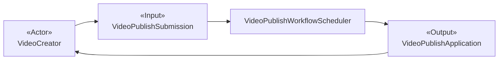
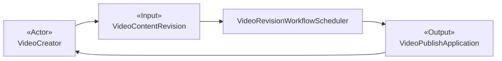
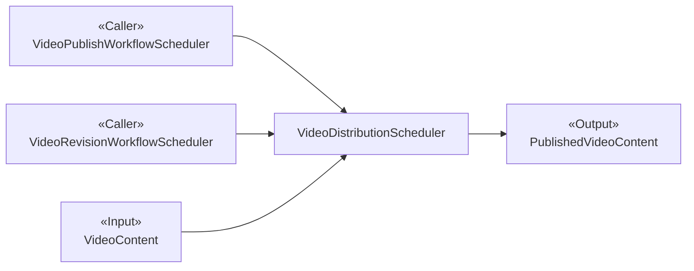

```mermaid
classDiagram
    direction LR

    class VideoRevisionWorkflowScheduler
    <<Caller>> VideoRevisionWorkflowScheduler
    class VideoContentRevision
    <<Input>> VideoContentRevision
    class VideoRevisionRegistrar
    class VideoContentValidator
    class VideoContentReviewer
    class FeedbackReviewer
    class VideoRevisionNotifier
    class VideoPublishTimeoutInspector
    class VideoPublishClosureHandler
    class VideoDistributionScheduler
    class VideoContent
    class VideoPublishApplication
    <<Output>> VideoPublishApplication

    VideoRevisionWorkflowScheduler ..> VideoContentRevision
    VideoRevisionWorkflowScheduler ..> VideoRevisionRegistrar
    VideoRevisionWorkflowScheduler ..> VideoContentValidator
    VideoRevisionWorkflowScheduler ..> VideoContentReviewer
    VideoRevisionWorkflowScheduler ..> VideoRevisionNotifier
    VideoRevisionWorkflowScheduler ..> VideoPublishTimeoutInspector
    VideoRevisionWorkflowScheduler ..> VideoPublishClosureHandler
    VideoRevisionWorkflowScheduler ..> VideoDistributionScheduler
    VideoRevisionWorkflowScheduler ..> VideoPublishApplication
    VideoRevisionRegistrar ..> VideoContentRevision
    VideoRevisionRegistrar ..> VideoContent
    VideoRevisionRegistrar ..> VideoPublishApplication
    VideoContentValidator ..> VideoContent
    VideoContentValidator ..> FeedbackReviewer
    VideoContentReviewer ..> VideoContent
    VideoContentReviewer ..> FeedbackReviewer
    VideoRevisionNotifier ..> FeedbackReviewer
    VideoPublishTimeoutInspector ..> VideoPublishClosureHandler
    VideoPublishClosureHandler ..> VideoPublishApplication
```

# Object-Oriented Design: Publish a Short Video

## Candidate classes

### VideoPublishSubmission

- **Class Name:** `VideoPublishSubmission`
- **Responsibility:** Represents the creator's initial submission that starts one publication application and supplies its initial video content.
- **Collaborators:** `VideoCreator`, `VideoContent`, `VideoPublishApplication`, `VideoPublishApplicationRegistrar`, `VideoPublishWorkflowScheduler`

### VideoPublishApplication

- **Class Name:** `VideoPublishApplication`
- **Responsibility:** Represents one publication attempt and owns its lifecycle from creation to distributable, rejected, or terminated. It keeps every review feedback item and content revision within the same application.
- **Collaborators:** `VideoPublishSubmission`, `VideoContent`, `VideoContentRevision`, `FeedbackReviewer`, `VideoPublishApplicationRegistrar`, `VideoRevisionRegistrar`, `VideoPublishWorkflowScheduler`, `VideoRevisionWorkflowScheduler`, `VideoPublishClosureHandler`

### VideoContent

- **Class Name:** `VideoContent`
- **Responsibility:** Represents the short video and its publication information throughout validation, review, revision, and distribution readiness.
- **Collaborators:** `VideoPublishSubmission`, `VideoPublishApplication`, `VideoContentRevision`, `PublishedVideoContent`, `VideoPublishApplicationRegistrar`, `VideoContentValidator`, `VideoContentReviewer`, `VideoRevisionRegistrar`, `VideoDistributionScheduler`, `VideoDistributor`

### VideoContentRevision

- **Class Name:** `VideoContentRevision`
- **Responsibility:** Represents a creator's subsequent update after feedback, supplies the revised video content, and remains part of the existing publication application.
- **Collaborators:** `VideoCreator`, `VideoContent`, `VideoPublishApplication`, `VideoRevisionRegistrar`, `VideoRevisionWorkflowScheduler`

### FeedbackReviewer

- **Class Name:** `FeedbackReviewer`
- **Responsibility:** Represents actionable reasons why the current video or publication information did not pass validation or review, and establishes the current 24-hour revision window.
- **Collaborators:** `VideoPublishApplication`, `VideoContentValidator`, `VideoContentReviewer`, `VideoRevisionWorkflowScheduler`, `VideoRevisionNotifier`, `VideoPublishTimeoutInspector`

### VideoPublishWorkflowScheduler

- **Class Name:** `VideoPublishWorkflowScheduler`
- **Responsibility:** Coordinates the initial publication use case from submission and application creation through validation and review, then records either actionable feedback or the result of public distribution.
- **Collaborators:** `VideoPublishSubmission`, `VideoPublishApplicationRegistrar`, `VideoContentValidator`, `VideoContentReviewer`, `VideoDistributionScheduler`, `VideoPublishApplication`

### VideoRevisionWorkflowScheduler

- **Class Name:** `VideoRevisionWorkflowScheduler`
- **Responsibility:** Coordinates the revision use case for an existing publication application from an accepted content revision through complete validation and review, then records either actionable feedback or the result of public distribution.
- **Collaborators:** `VideoContentRevision`, `VideoRevisionRegistrar`, `VideoContentValidator`, `VideoContentReviewer`, `FeedbackReviewer`, `VideoRevisionNotifier`, `VideoPublishTimeoutInspector`, `VideoPublishClosureHandler`, `VideoDistributionScheduler`, `VideoPublishApplication`

### VideoPublishApplicationRegistrar

- **Class Name:** `VideoPublishApplicationRegistrar`
- **Responsibility:** Creates the publication application and records its association with the initially submitted video content.
- **Collaborators:** `VideoPublishSubmission`, `VideoPublishApplication`, `VideoContent`, `VideoPublishWorkflowScheduler`

### VideoContentValidator

- **Class Name:** `VideoContentValidator`
- **Responsibility:** Determines whether the current video and publication information comply with publication rules before content review.
- **Collaborators:** `VideoContent`, `VideoPublishWorkflowScheduler`, `VideoRevisionWorkflowScheduler`, `FeedbackReviewer`

### VideoContentReviewer

- **Class Name:** `VideoContentReviewer`
- **Responsibility:** Obtains and interprets the content-review decision for the current video, including actionable feedback when the review does not pass.
- **Collaborators:** `VideoContent`, `VideoPublishWorkflowScheduler`, `VideoRevisionWorkflowScheduler`, `FeedbackReviewer`

### VideoDistributor

- **Class Name:** `VideoDistributor`
- **Responsibility:** Delivers approved video content to the content management system for public availability.
- **Collaborators:** `VideoContent`, `VideoDistributionScheduler`, `PublishedVideoContent`, `ContentManagementSystem`

### VideoDistributionScheduler

- **Class Name:** `VideoDistributionScheduler`
- **Responsibility:** Coordinates the distribution subprocess for approved video content and establishes the resulting publicly available video.
- **Collaborators:** `VideoPublishWorkflowScheduler`, `VideoRevisionWorkflowScheduler`, `VideoContent`, `VideoDistributor`, `PublishedVideoContent`

### PublishedVideoContent

- **Class Name:** `PublishedVideoContent`
- **Responsibility:** Represents the approved short video after it has been made publicly available.
- **Collaborators:** `VideoContent`, `VideoDistributionScheduler`, `VideoDistributor`, `ContentManagementSystem`

### VideoRevisionNotifier

- **Class Name:** `VideoRevisionNotifier`
- **Responsibility:** Delivers actionable validation or review feedback to the content creator for the current publication application.
- **Collaborators:** `FeedbackReviewer`, `VideoRevisionWorkflowScheduler`, `VideoCreator`

### VideoRevisionRegistrar

- **Class Name:** `VideoRevisionRegistrar`
- **Responsibility:** Records a creator's updated video or publication information as a new revision of the current application and records the outcome produced by its complete re-evaluation.
- **Collaborators:** `VideoContentRevision`, `VideoPublishApplication`, `VideoContent`, `VideoRevisionWorkflowScheduler`, `VideoCreator`

### VideoPublishTimeoutInspector

- **Class Name:** `VideoPublishTimeoutInspector`
- **Responsibility:** Determines whether the content creator has failed to submit an update within 24 hours of the latest feedback. Each accepted revision ends the current waiting period; a later feedback item starts a new one.
- **Collaborators:** `FeedbackReviewer`, `VideoRevisionWorkflowScheduler`, `VideoPublishClosureHandler`

### VideoPublishClosureHandler

- **Class Name:** `VideoPublishClosureHandler`
- **Responsibility:** Ends the current publication application when the creator withdraws it or when the latest revision window expires, preserving the applicable rejected or terminated outcome.
- **Collaborators:** `VideoPublishApplication`, `VideoRevisionWorkflowScheduler`, `VideoPublishTimeoutInspector`, `VideoCreator`

## External participants

- **VideoCreator — external actor:** Starts, revises, or withdraws a short-video publication application.
- **ContentManagementSystem — external participant:** Holds uploaded video content and makes approved content publicly available during distribution.

## Candidate-class visualization

### Apply to Publish a Short Video

```mermaid
classDiagram
    direction LR

    class VideoPublishWorkflowScheduler
    <<Caller>> VideoPublishWorkflowScheduler
    class VideoPublishSubmission
    <<Input>> VideoPublishSubmission
    class VideoPublishApplicationRegistrar
    class VideoContentValidator
    class VideoContentReviewer
    class VideoDistributionScheduler
    class VideoContent
    class VideoPublishApplication
    <<Output>> VideoPublishApplication

    VideoPublishWorkflowScheduler ..> VideoPublishSubmission
    VideoPublishWorkflowScheduler ..> VideoPublishApplicationRegistrar
    VideoPublishWorkflowScheduler ..> VideoContentValidator
    VideoPublishWorkflowScheduler ..> VideoContentReviewer
    VideoPublishWorkflowScheduler ..> VideoDistributionScheduler
    VideoPublishWorkflowScheduler ..> VideoPublishApplication
    VideoPublishApplicationRegistrar ..> VideoPublishSubmission
    VideoPublishApplicationRegistrar ..> VideoContent
    VideoPublishApplicationRegistrar ..> VideoPublishApplication
    VideoContentValidator ..> VideoContent
    VideoContentReviewer ..> VideoContent
```

### Revise a Short Video After Feedback

#### Class Design

### Distribute the Short Video Subprocess

```mermaid
classDiagram
    direction LR

    class VideoPublishWorkflowScheduler
    <<Caller>> VideoPublishWorkflowScheduler
    class VideoRevisionWorkflowScheduler
    <<Caller>> VideoRevisionWorkflowScheduler
    class VideoContent
    <<Input>> VideoContent
    class VideoDistributionScheduler
    class VideoDistributor
    class ContentManagementSystem
    <<Actor>> ContentManagementSystem
    class PublishedVideoContent
    <<Output>> PublishedVideoContent

    VideoPublishWorkflowScheduler ..> VideoDistributionScheduler
    VideoRevisionWorkflowScheduler ..> VideoDistributionScheduler
    VideoDistributionScheduler ..> VideoContent
    VideoDistributionScheduler ..> VideoDistributor
    VideoDistributionScheduler ..> PublishedVideoContent
    VideoDistributor ..> VideoContent
    VideoDistributor ..> ContentManagementSystem
    VideoDistributor ..> PublishedVideoContent
    PublishedVideoContent ..> ContentManagementSystem
```

