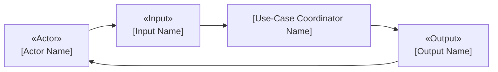

# Object-Oriented Design: [Use Case Name]

## Candidate-Class Descriptions

### [Class Name]

- **Class Name:** `[Class Name]`
- **Responsibility:** [Business responsibility]
- **Collaborators:** `[Collaborator Name 1]`, `[Collaborator Name 2]`

## External Participants

- **[Actor Name] — external actor:** [Business responsibility]
- **[Participant Name] — external participant:** [Business responsibility]

## Candidate-Class Visualization

### Use-Case Overview

### Class Design

```mermaid
classDiagram
    class UseCaseCoordinator["[Use-Case Coordinator Name]"]
    <<Caller>> UseCaseCoordinator
    class UseCaseInput["[Input Name]"]
    <<Input>> UseCaseInput
    class UseCaseCollaborator["[Collaborator Name]"]
    class UseCaseOutput["[Output Name]"]
    <<Output>> UseCaseOutput

    UseCaseCoordinator ..> UseCaseInput
    UseCaseCoordinator ..> UseCaseCollaborator
    UseCaseCoordinator ..> UseCaseOutput
```

