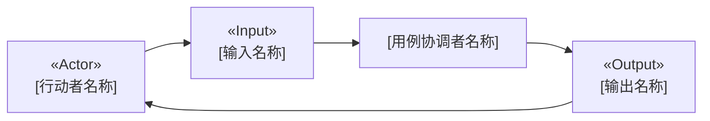

# [设计名称]

## 候选类说明

### [类名]

- **类名：**`[类名]`
- **职责：**[业务职责]
- **协作者：**`[协作者名称 1]`、`[协作者名称 2]`

## 外部参与者

- **[参与者名称]——外部行动者：**[业务职责]
- **[参与者名称]——外部参与者：**[业务职责]

## 候选类可视化

<!-- 为每个不同的用例或子流程重复相应标题和图组。 -->

### [用例场景说明]

```mermaid
classDiagram
    class UseCaseCoordinator["[用例协调者名称]"]
    <<Caller>> UseCaseCoordinator
    class UseCaseInput["[输入名称]"]
    <<Input>> UseCaseInput
    class UseCaseCollaborator["[协作者名称]"]
    class UseCaseOutput["[输出名称]"]
    <<Output>> UseCaseOutput

    UseCaseCoordinator ..> UseCaseInput
    UseCaseCoordinator ..> UseCaseCollaborator
    UseCaseCoordinator ..> UseCaseOutput
```

<!-- 完成所有用例图组后，如果设计不包含嵌套子流程，则省略以下部分。 -->

### [子流程说明]

```mermaid
classDiagram
    %% 根据实际调用方重复或删除调用方声明及其关系。
    class EnclosingCallerOne["[上一层调用方名称 1]"]
    <<Caller>> EnclosingCallerOne
    class EnclosingCallerTwo["[上一层调用方名称 2]"]
    <<Caller>> EnclosingCallerTwo
    class SubprocessInput["[子流程输入名称]"]
    <<Input>> SubprocessInput
    class SubprocessCoordinator["[子流程协调者名称]"]
    class SubprocessCollaborator["[子流程协作者名称]"]
    class SubprocessOutput["[子流程输出名称]"]
    <<Output>> SubprocessOutput

    EnclosingCallerOne ..> SubprocessCoordinator
    EnclosingCallerTwo ..> SubprocessCoordinator
    SubprocessCoordinator ..> SubprocessInput
    SubprocessCoordinator ..> SubprocessCollaborator
    SubprocessCoordinator ..> SubprocessOutput
```

