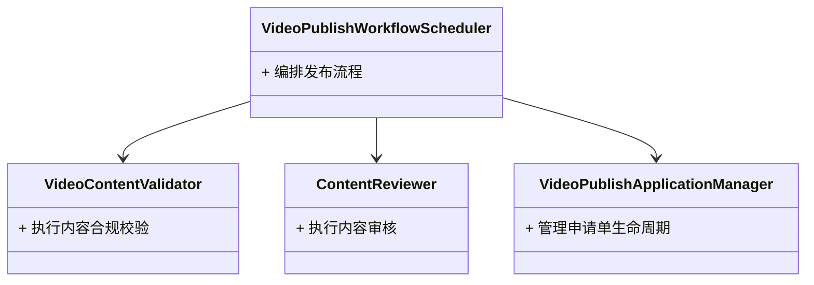

# 设计文档模板

> 本文档为面向对象设计的最终交付物模板。设计文档仅呈现最终设计成果，不包含任何分析推导过程。

---

## 文档信息

- **用例名称**：[用例名称]
- **文档版本**：[版本号]
- **编写日期**：[日期]

## 候选类说明

### Class 1: [类名]

- **Class Name**：[类名]
- **Responsibility**：[职责描述，说明该类在业务中承担的职责]
- **Collaborators**：[协作类列表，说明该类与哪些类协作]

### Class 2: [类名]

- **Class Name**：[类名]
- **Responsibility**：[职责描述]
- **Collaborators**：[协作类列表]

（依此类推...）

## 候选类可视化

使用 mermaid 绘制类图，需体现用例层级与子流程层级之间的层级关系：

## 约束检查清单

- [ ] 设计中未出现属性、方法、接口、数据库表等实现细节
- [ ] 设计中未出现控制器、服务层、消息队列等技术术语
- [ ] 外部参与者已明确标记
- [ ] 类图体现了用例层级与子流程层级的关系
- [ ] 所有类名遵循命名规范（业务角色后缀，无技术后缀）
