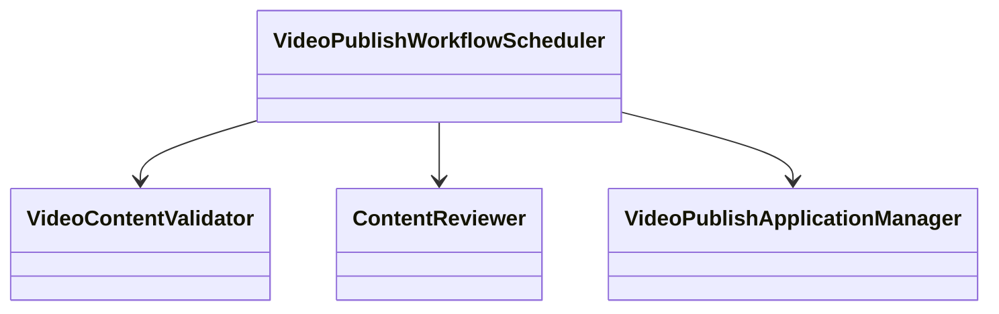

# Object-Oriented Design

## Candidate-Class Descriptions

### Class 1: [Class Name]

- **Class Name:** [Class Name]
- **Responsibility:** [Describe the class's business responsibility]
- **Collaborators:** [List the classes with which this class collaborates]

### Class 2: [Class Name]

- **Class Name:** [Class Name]
- **Responsibility:** [Responsibility description]
- **Collaborators:** [Collaborating classes]

(...)

## Candidate-Class Visualization

Use Mermaid to draw a class diagram that shows the hierarchy between the use-case level and subprocess levels:

