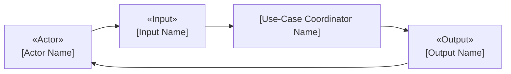

```mermaid
classDiagram
    class UseCaseCoordinator["[Use-Case Coordinator Name]"]
    <<Caller>> UseCaseCoordinator
    class UseCaseInput["[Input Name]"]
    <<Input>> UseCaseInput
    class UseCaseCollaborator["[Collaborator Name]"]
    class UseCaseOutput["[Output Name]"]
    <<Output>> UseCaseOutput

    UseCaseCoordinator ..> UseCaseInput
    UseCaseCoordinator ..> UseCaseCollaborator
    UseCaseCoordinator ..> UseCaseOutput
```

# [Design Name]

## Candidate-Class Descriptions

### [Class Name]

- **Class Name:** `[Class Name]`
- **Responsibility:** [Business responsibility]
- **Collaborators:** `[Collaborator Name 1]`, `[Collaborator Name 2]`

## External Participants

- **[Actor Name] — external actor:** [Business responsibility]
- **[Participant Name] — external participant:** [Business responsibility]

## Candidate-Class Visualization

<!-- Repeat this heading and diagram pair for each distinct use case or sub-process. -->

### [Use-Case Scenario Description]

<!-- After all use-case diagram pairs, omit this section when the design has no nested subprocesses. -->

### [Subprocess Description]

```mermaid
classDiagram
    %% Repeat or remove caller declarations and relationships to match the actual callers.
    class EnclosingCallerOne["[Enclosing Caller Name 1]"]
    <<Caller>> EnclosingCallerOne
    class EnclosingCallerTwo["[Enclosing Caller Name 2]"]
    <<Caller>> EnclosingCallerTwo
    class SubprocessInput["[Subprocess Input Name]"]
    <<Input>> SubprocessInput
    class SubprocessCoordinator["[Subprocess Coordinator Name]"]
    class SubprocessCollaborator["[Subprocess Collaborator Name]"]
    class SubprocessOutput["[Subprocess Output Name]"]
    <<Output>> SubprocessOutput

    EnclosingCallerOne ..> SubprocessCoordinator
    EnclosingCallerTwo ..> SubprocessCoordinator
    SubprocessCoordinator ..> SubprocessInput
    SubprocessCoordinator ..> SubprocessCollaborator
    SubprocessCoordinator ..> SubprocessOutput
```

