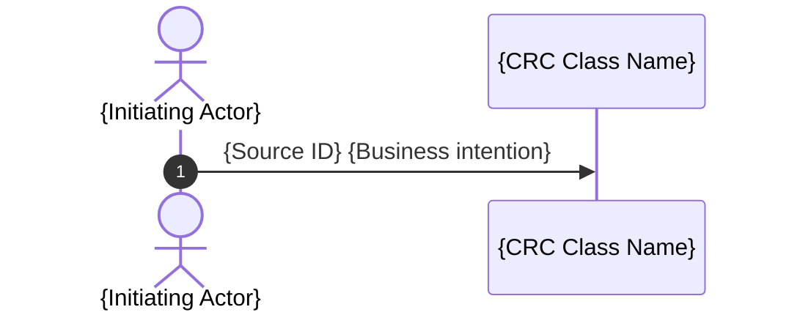

# Object-Oriented Design: {Design Scope}

## 1. Use-Case Coverage

<!-- List only descriptive links to source Requirement Specifications and Use Case Specifications. -->

- [{Source Title}]({Source Path})

## 2. CRC Model

<!-- Repeat this subsection for every class. Use class names consistently throughout the document. -->

### {Class Name}

- **Role:** {Entity | Control | Boundary --> Driving Port | Boundary --> Driven Port}
- **Purpose:** {Concise domain purpose}
- **Responsibilities:** {Outcomes or decisions owned by this class}
- **Collaborators:** {Class names only | None}

## 3. UML Class Diagram

<!--
Populate this section according to the diagram rules in SKILL.md.
-->

```mermaid
classDiagram
    class {ClassName} {
        <<{Entity | Boundary | Control}>>
    }
```

## 4. Use-Case Sequence Diagrams

<!-- Repeat this subsection for every use case. -->

### {Use Case Specification Title}

**Use Case Specification:** [{Source Title}]({Source Path})

<!--
Repeat the diagram block under the same workflow heading when the source defines multiple paths in that category.
-->

#### {Primary Workflow | Alternate Workflow | Exception Workflow}



<!-- Populate each diagram according to the diagram rules in SKILL.md. -->
