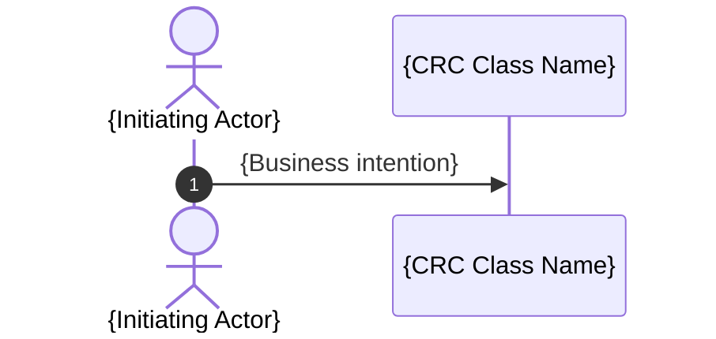

# Object-Oriented Design: {Design Scope}

<!--
Keep exactly the four numbered sections in this template. Do not add implementation design,
candidate lists, traceability matrices, diagnostic notes, or validation rules to the artifact.
Remove instructional comments and unused placeholders from the completed artifact.
-->

## 1. Workflow Coverage

<!-- List each Workflow Source. Link Referenced Input; use a descriptive Source Label for Direct Input. -->

- {Referenced Input Link | Direct Input: Source Label}

## 2. CRC Model

<!--
Repeat this subsection for every class. Every named collaborator must have its own CRC card.
Use class names consistently throughout the document.
-->

### {Class Name}

- **Role:** {Entity | Control | Boundary --> Driving Port | Boundary --> Driven Port}
- **Purpose:** {Concise domain purpose}
- **Responsibilities:** {Outcomes or decisions owned by this class}
- **Collaborators:** {Class names only | None}

## 3. UML Class Diagram

<!--
Include every CRC class with its EBC stereotype. Add a boundary-role note to every Boundary
and label every modeled collaboration. Do not show attributes, methods, visibility,
responsibility lists, or implementation interfaces inside class boxes.

Use the relationship justified by the source evidence. Add multiplicity or lifecycle ownership
only when the source supports it. Split an unreadable model into cohesive Mermaid blocks without
adding per-diagram headings. Ensure every Mermaid block is valid.
-->

```mermaid
classDiagram
    class {ClassName} {
        <<{Entity | Boundary | Control}>>
    }
```

## 4. Workflow Sequence Diagrams

<!--
Repeat this subsection for every Workflow. Use its source Workflow Title; assign a neutral title
when none is provided. Every sequence participant must be an actor or have a CRC card.
-->

### {Workflow Title}

**Workflow Source:** {Referenced Input Link | Direct Input: Source Label}

<!--
Repeat the diagram block under the same Workflow heading for every distinct start-to-end Path.
Preserve source Path names; assign neutral names only when none are provided.
-->

#### {Source Path Name | Neutral Path Name}

{One concise business-focused paragraph stating the Path's precondition or trigger, exercised behavior, and terminal outcome without narrating implementation details or repeating diagram messages.}



<!--
Make each diagram a complete Path. Do not combine Paths with alt, else, opt, loop, or par.
Declare only the actors and CRC classes used by the Path, and label participants with CRC class
names only. Express every message and note as a plain business intention; do not prefix diagram
text with source identifiers, step numbers, or synthetic trace labels. Reflect every relevant
interaction needed to exercise the CRC responsibilities, including interactions blocked by a
Requirement Gap. Ensure every Mermaid block is valid.
-->
