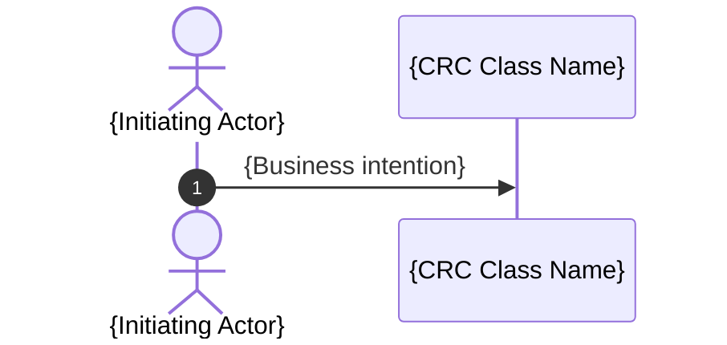

# Object-Oriented Design: {Design Scope}

## 1. Workflow Coverage

<!-- List each Workflow Source. Link Referenced Input; use a descriptive Source Label for Direct Input. -->

- {Referenced Input Link | Direct Input: Source Label}

## 2. CRC Model

<!-- Repeat this subsection for every class. Use class names consistently throughout the document. -->

### {Class Name}

- **Role:** {Entity | Control | Boundary --> Driving Port | Boundary --> Driven Port}
- **Purpose:** {Concise domain purpose}
- **Responsibilities:** {Outcomes or decisions owned by this class}
- **Collaborators:** {Class names only | None}

## 3. UML Class Diagram

<!--
Populate this section according to the diagram rules in SKILL.md.
-->

```mermaid
classDiagram
    class {ClassName} {
        <<{Entity | Boundary | Control}>>
    }
```

## 4. Workflow Sequence Diagrams

<!-- Repeat this subsection for every Workflow. -->

### {Workflow Title}

**Workflow Source:** {Referenced Input Link | Direct Input: Source Label}

<!--
Repeat the diagram block under the same Workflow heading for every distinct start-to-end Path.
-->

#### {Source Path Name | Neutral Path Name}

{Concise business explanation of the Path's precondition or trigger, exercised behavior, and terminal outcome.}



<!-- Populate each diagram according to the diagram rules in SKILL.md. -->
