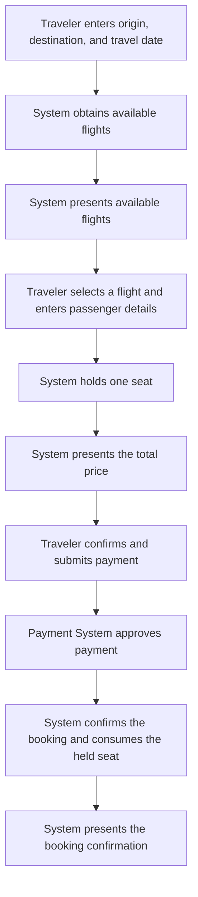
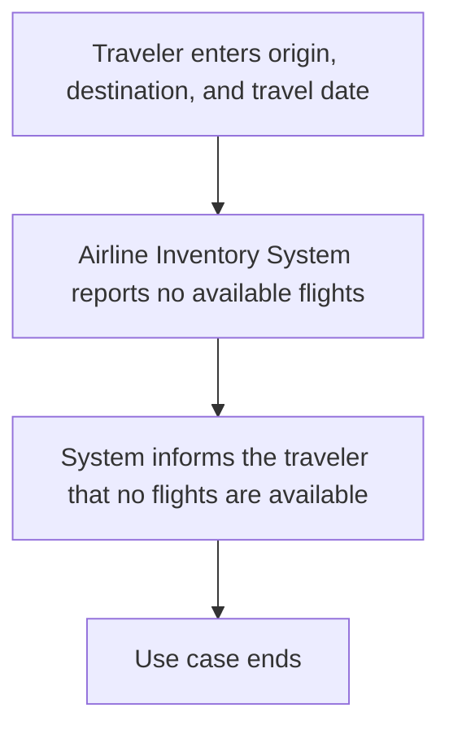
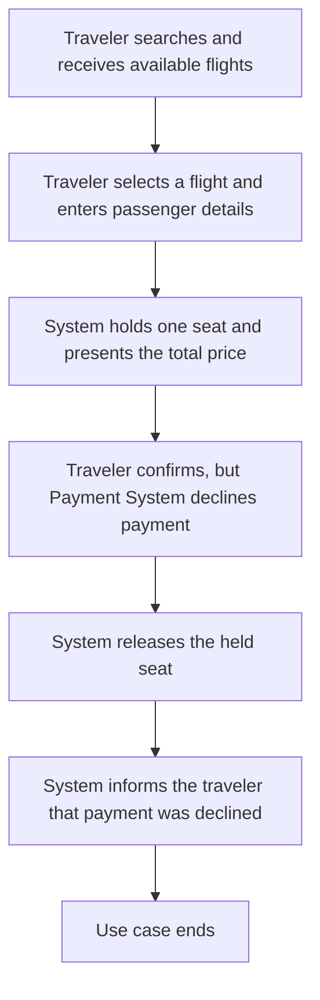

# Book a Flight

## Actors

- **Primary Actor:** Traveler
- **Supporting Actors:** Payment System, Airline Inventory System

## Brief Description

The traveler selects an available flight and receives a confirmed booking after payment is approved.

## Preconditions

1. The airline inventory system and payment system are available.

## Primary Workflow

## Alternate Workflow

## Exception Workflow

## Postconditions

**Success:**

1. A confirmed booking exists.
2. Payment is approved and the held seat is consumed.

**Failure:**

1. No confirmed booking exists.
2. Any held seat is released and no payment is collected.

## Business Rules

- **Available-flight rule:** Present only flights with seats available for sale.
- **Failed-payment rule:** Release the held seat when payment is declined.
