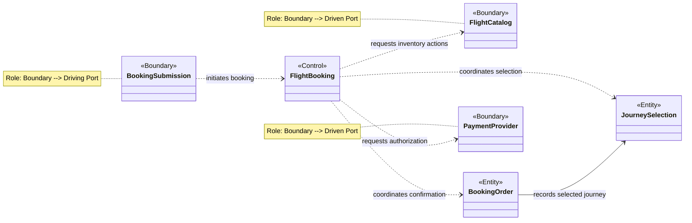
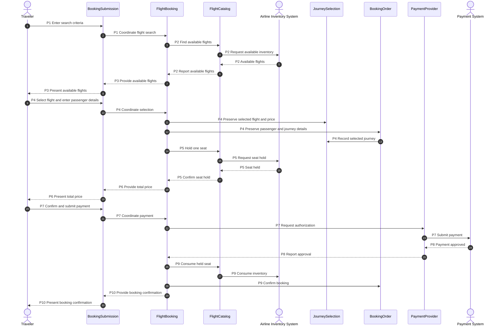
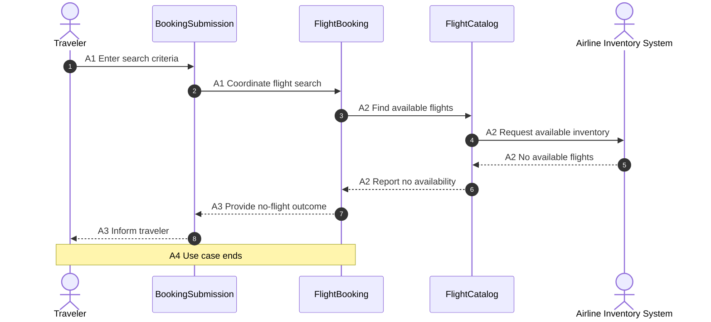
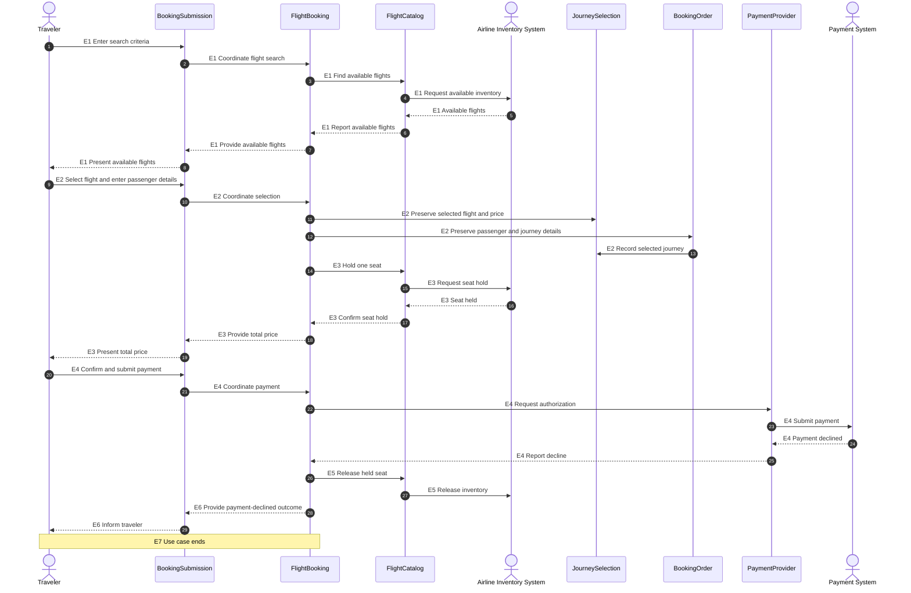

# Object-Oriented Design: Book a Flight

## 1. Use-Case Coverage

- [Book a Flight](book-a-flight-use-case.md)

## 2. CRC Model

### BookingSubmission

- **Role:** Boundary --> Driving Port.
- **Purpose:** Represent the traveler's interaction with flight booking.
- **Responsibilities:** Receive search, selection, passenger, confirmation, and payment stimuli; present available flights, prices, and booking outcomes.
- **Collaborators:** `FlightBooking`.

### FlightBooking

- **Role:** Control.
- **Purpose:** Coordinate the Book a Flight use case.
- **Responsibilities:** Coordinate flight search, selection, seat holding, payment, booking confirmation, and seat release.
- **Collaborators:** `BookingSubmission`, `FlightCatalog`, `JourneySelection`, `BookingOrder`, `PaymentProvider`.

### FlightCatalog

- **Role:** Boundary --> Driven Port.
- **Purpose:** Represent the airline inventory capabilities used during booking.
- **Responsibilities:** Find available flights; hold, consume, and release seat inventory.
- **Collaborators:** `FlightBooking`.

### JourneySelection

- **Role:** Entity.
- **Purpose:** Represent the flight selected by the traveler.
- **Responsibilities:** Preserve the selected flight and its price.
- **Collaborators:** None.

### BookingOrder

- **Role:** Entity.
- **Purpose:** Represent the traveler's booking.
- **Responsibilities:** Preserve passenger and journey details; become confirmed only after payment approval.
- **Collaborators:** `JourneySelection`.

### PaymentProvider

- **Role:** Boundary --> Driven Port.
- **Purpose:** Represent payment authorization supplied by the external payment system.
- **Responsibilities:** Request payment authorization and report approval or decline.
- **Collaborators:** `FlightBooking`.

## 3. UML Class Diagram

## 4. Use-Case Sequence Diagrams

### Book a Flight

**Use Case Specification:** [Book a Flight](book-a-flight-use-case.md)

#### Primary Workflow

#### Alternate Workflow

#### Exception Workflow

