```mermaid
classDiagram
    direction LR

    class LinkCheckWorkflowScheduler
    <<Caller>> LinkCheckWorkflowScheduler

    class LinkCheckDelegation
    <<Input>> LinkCheckDelegation
    class LinkCheckScope
    <<Input>> LinkCheckScope
    class SpecificationDocumentRepository
    class SpecificationDocument
    class SpecificationDocumentBatchChecker
    class SpecificationDocumentChecker
    class ReferencedDocumentDiscoverer
    class ResolvedSpecificationLink

    LinkCheckWorkflowScheduler ..> SpecificationDocumentBatchChecker
    LinkCheckScope "1" o-- "0..*" SpecificationDocument
    SpecificationDocumentRepository "1" o-- "0..*" SpecificationDocument
    SpecificationDocumentBatchChecker --> "1" SpecificationDocumentRepository
    SpecificationDocumentBatchChecker ..> LinkCheckDelegation
    SpecificationDocumentBatchChecker ..> LinkCheckScope
    SpecificationDocumentBatchChecker ..> SpecificationDocumentChecker
    SpecificationDocumentBatchChecker ..> ReferencedDocumentDiscoverer
    SpecificationDocumentBatchChecker ..> ResolvedSpecificationLink
    ReferencedDocumentDiscoverer ..> LinkCheckDelegation
    ReferencedDocumentDiscoverer ..> ResolvedSpecificationLink
    ReferencedDocumentDiscoverer ..> SpecificationDocumentRepository
```

# Object-Oriented Design: Check Specification Documents for Dead Links

## Prerequities

- [Markdown Linkage Specification](spec.md)
- [Check Specification Documents for Dead Links](use-case/check-specification-documents-for-dead-links.md)
- [Single-Document Check](use-case/workflows/single-document-check-workflow.md)
- [Multiple-Document Check](use-case/workflows/multiple-document-check-workflow.md)
- [Link Check Scope Builder](roles/LinkCheckScopeBuilder.md)

## Candidate-Class Descriptions

### LinkCheckDelegation

- **Class Name:** `LinkCheckDelegation`
- **Responsibility:** Represents a maintainer's instruction to check one or more specification documents within a project boundary, preserving the starting document paths and the shallow or recursive traversal choice.
- **Collaborators:** `SpecificationDocumentMaintainer`, `LinkCheckWorkflowScheduler`, `LinkCheckScopeBuilder`, `SpecificationDocumentBatchChecker`, `LinkCheckReport`

### LinkCheckScope

- **Class Name:** `LinkCheckScope`
- **Responsibility:** Represents the established, ordered starting documents and every tolerated document-path issue discovered while interpreting a delegation.
- **Collaborators:** `LinkCheckScopeBuilder`, `SpecificationDocumentRepository`, `SpecificationDocumentBatchChecker`, `LinkCheckReport`

### SpecificationDocumentRepository

- **Class Name:** `SpecificationDocumentRepository`
- **Responsibility:** Represents the ordered working set of pending and checked specification documents for one batch check, admits each starting or discovered document once, and supplies the next unchecked document.
- **Collaborators:** `LinkCheckScope`, `SpecificationDocument`, `SpecificationDocumentBatchChecker`, `ReferencedDocumentDiscoverer`

### SpecificationDocument

- **Class Name:** `SpecificationDocument`
- **Responsibility:** Represents one Markdown specification document by its project-relative identity and authored content while its headings and links are checked.
- **Collaborators:** `SpecificationDocumentRepository`, `SpecificationDocumentChecker`, `SpecificationLinkExtractor`, `SpecificationHeadingCataloger`

### SpecificationLink

- **Class Name:** `SpecificationLink`
- **Responsibility:** Represents one supported Markdown link exactly as authored, including its visible name and the path or anchor supplied by the document maintainer.
- **Collaborators:** `SpecificationLinkExtractor`, `SpecificationLinkChecker`, `ResolvedSpecificationLink`

### ResolvedSpecificationLink

- **Class Name:** `ResolvedSpecificationLink`
- **Responsibility:** Represents the immutable, traceable live or dead outcome of checking one specification link, including its source location, resolved target, and one dead reason when applicable.
- **Collaborators:** `SpecificationLink`, `SpecificationLinkChecker`, `SpecificationDocumentChecker`, `ReferencedDocumentDiscoverer`, `SpecificationDocumentBatchChecker`, `LinkCheckReport`

### LinkCheckReport

- **Class Name:** `LinkCheckReport`
- **Responsibility:** Represents the raw result of one completed delegation by preserving the delegation, established scope, and every dead resolved specification link.
- **Collaborators:** `LinkCheckDelegation`, `LinkCheckScope`, `ResolvedSpecificationLink`, `LinkCheckReportFabricator`, `SpecificationDocumentMaintainer`

### LinkCheckWorkflowScheduler

- **Class Name:** `LinkCheckWorkflowScheduler`
- **Responsibility:** Coordinates the complete use case from an accepted delegation through scope construction and document checking to preparation of a traceable report.
- **Collaborators:** `SpecificationDocumentMaintainer`, `LinkCheckDelegation`, `LinkCheckScopeBuilder`, `SpecificationDocumentBatchChecker`, `LinkCheckReportFabricator`, `LinkCheckReport`

### LinkCheckScopeBuilder

- **Class Name:** `LinkCheckScopeBuilder`
- **Responsibility:** Establishes the stable project boundary, evaluates each delegated document path in order, records tolerated path issues, and either produces a link check scope or stops for an invalid project root.
- **Collaborators:** `LinkCheckDelegation`, `LinkCheckScope`, `LinkCheckWorkflowScheduler`

### SpecificationDocumentBatchChecker

- **Class Name:** `SpecificationDocumentBatchChecker`
- **Responsibility:** Coordinates checking the ordered collection of pending documents, ensures that each document is checked at most once, aggregates dead-link outcomes, and applies the delegation's traversal mode.
- **Collaborators:** `LinkCheckDelegation`, `LinkCheckScope`, `SpecificationDocumentRepository`, `SpecificationDocumentChecker`, `ReferencedDocumentDiscoverer`, `ResolvedSpecificationLink`, `LinkCheckWorkflowScheduler`

### SpecificationDocumentChecker

- **Class Name:** `SpecificationDocumentChecker`
- **Responsibility:** Coordinates one document check by obtaining its supported links and heading identifiers, checking every supported link exactly once, and separating any resulting live and dead outcomes.
- **Collaborators:** `SpecificationDocument`, `SpecificationLinkExtractor`, `SpecificationHeadingCataloger`, `SpecificationLinkChecker`, `ResolvedSpecificationLink`, `SpecificationDocumentBatchChecker`

### SpecificationLinkExtractor

- **Class Name:** `SpecificationLinkExtractor`
- **Responsibility:** Identifies the supported local-file, in-file-anchor, and cross-file-anchor links in a specification document while preserving their authored material.
- **Collaborators:** `SpecificationDocument`, `SpecificationLink`, `SpecificationDocumentChecker`

### SpecificationHeadingCataloger

- **Class Name:** `SpecificationHeadingCataloger`
- **Responsibility:** Establishes the heading identifiers available in a specification document so in-file and cross-file anchors can be checked against authored headings.
- **Collaborators:** `SpecificationDocument`, `SpecificationDocumentChecker`, `CrossFileAnchorLinkCheckStrategy`

### SpecificationLinkChecker

- **Class Name:** `SpecificationLinkChecker`
- **Responsibility:** Selects the strategy for one specification link from its composed strategy collection, delegates the scenario-specific check, and returns an array containing one resolved-link outcome or an empty array when no strategy matches.
- **Collaborators:** `SpecificationLink`, `SpecificationLinkCheckStrategy`, `ResolvedSpecificationLink`, `SpecificationDocumentChecker`

### SpecificationLinkCheckStrategy

- **Class Name:** `SpecificationLinkCheckStrategy`
- **Responsibility:** Defines the abstract, interchangeable contract for recognizing and checking one supported specification-link scenario while serving as the dependency-injection identifier for the strategy collection.
- **Collaborators:** `SpecificationLink`, `SpecificationLinkChecker`, `ResolvedSpecificationLink`

### InFileAnchorLinkCheckStrategy

- **Class Name:** `InFileAnchorLinkCheckStrategy`
- **Responsibility:** Checks an in-file-anchor link against the source document's cataloged headings and establishes a live outcome or an anchor-not-found outcome.
- **Collaborators:** `SpecificationLinkCheckStrategy`, `SpecificationLink`, `ResolvedSpecificationLink`

### LocalFileLinkCheckStrategy

- **Class Name:** `LocalFileLinkCheckStrategy`
- **Responsibility:** Resolves a local-file link, tests project containment before target existence, and establishes a live outcome or the applicable dead outcome.
- **Collaborators:** `SpecificationLinkCheckStrategy`, `SpecificationLink`, `ResolvedSpecificationLink`

### CrossFileAnchorLinkCheckStrategy

- **Class Name:** `CrossFileAnchorLinkCheckStrategy`
- **Responsibility:** Resolves a cross-file-anchor link, tests project containment and target existence before heading identity, and establishes a live outcome or the applicable dead outcome.
- **Collaborators:** `SpecificationLinkCheckStrategy`, `SpecificationLink`, `SpecificationHeadingCataloger`, `ResolvedSpecificationLink`

### ReferencedDocumentDiscoverer

- **Class Name:** `ReferencedDocumentDiscoverer`
- **Responsibility:** In recursive mode, identifies unchecked Markdown documents reached through live resolved links while excluding documents already pending or checked.
- **Collaborators:** `LinkCheckDelegation`, `ResolvedSpecificationLink`, `SpecificationDocumentRepository`, `SpecificationDocumentBatchChecker`

### LinkCheckReportFabricator

- **Class Name:** `LinkCheckReportFabricator`
- **Responsibility:** Prepares the raw report for a completed check from the original delegation, established scope, and aggregated dead resolved links.
- **Collaborators:** `LinkCheckDelegation`, `LinkCheckScope`, `ResolvedSpecificationLink`, `LinkCheckReport`, `LinkCheckWorkflowScheduler`

## External Participants

- **SpecificationDocumentMaintainer — external actor:** Delegates the documents and traversal mode to check, then receives the completed traceable report.

## Candidate-Class Visualization

The diagrams present static class relationships at the use-case, batch-check,
and single-document levels. They use composition, aggregation, association,
dependency, and multiplicity rather than execution order. Boundary classes are
repeated where they connect adjacent levels. Relationship labels are omitted,
while the `Input`, `Output`, and `Caller` class stereotypes are preserved.

### Use-Case Overview

```mermaid
classDiagram
    direction LR

    class SpecificationDocumentMaintainer
    <<Actor>> SpecificationDocumentMaintainer

    class LinkCheckDelegation
    <<Input>> LinkCheckDelegation
    class LinkCheckReport
    <<Output>> LinkCheckReport
    class LinkCheckWorkflowScheduler
    class LinkCheckScopeBuilder
    class LinkCheckScope
    class SpecificationDocumentBatchChecker
    class LinkCheckReportFabricator
    class ResolvedSpecificationLink

    SpecificationDocumentMaintainer ..> LinkCheckDelegation
    SpecificationDocumentMaintainer ..> LinkCheckWorkflowScheduler
    LinkCheckWorkflowScheduler ..> LinkCheckDelegation
    LinkCheckWorkflowScheduler ..> LinkCheckScopeBuilder
    LinkCheckWorkflowScheduler ..> SpecificationDocumentBatchChecker
    LinkCheckWorkflowScheduler ..> LinkCheckReportFabricator
    LinkCheckWorkflowScheduler ..> LinkCheckReport
    LinkCheckScopeBuilder ..> LinkCheckDelegation
    LinkCheckScopeBuilder ..> LinkCheckScope
    SpecificationDocumentBatchChecker ..> LinkCheckScope
    LinkCheckReportFabricator ..> LinkCheckDelegation
    LinkCheckReportFabricator ..> LinkCheckScope
    LinkCheckReportFabricator ..> ResolvedSpecificationLink
    LinkCheckReportFabricator ..> LinkCheckReport
    LinkCheckReport "1" o-- "1" LinkCheckDelegation
    LinkCheckReport "1" o-- "1" LinkCheckScope
    LinkCheckReport "1" o-- "0..*" ResolvedSpecificationLink
    SpecificationDocumentMaintainer ..> LinkCheckReport
```

### Specification Document Batch Check

`LinkCheckScope` and `SpecificationDocumentRepository` aggregate documents for
different lifetimes: the scope preserves accepted starting documents, while the
repository preserves the mutable working set for one batch check. The batch
checker depends on both aggregates and on its document-checking and discovery
collaborators.

### Single-Document Subprocess

```mermaid
classDiagram
    direction LR

    class SpecificationDocumentBatchChecker
    <<Caller>> SpecificationDocumentBatchChecker

    class SpecificationDocument
    <<Input>> SpecificationDocument
    class SpecificationDocumentChecker
    class SpecificationLinkExtractor
    class SpecificationHeadingCataloger
    class SpecificationLinkChecker
    class SpecificationLinkCheckStrategy
    <<abstract>> SpecificationLinkCheckStrategy
    class InFileAnchorLinkCheckStrategy
    class LocalFileLinkCheckStrategy
    class CrossFileAnchorLinkCheckStrategy
    class SpecificationLink
    class ResolvedSpecificationLink
    <<Output>> ResolvedSpecificationLink

    SpecificationDocumentBatchChecker ..> SpecificationDocumentChecker
    SpecificationDocument "1" *-- "0..*" SpecificationLink
    ResolvedSpecificationLink "1" --> "1" SpecificationLink
    SpecificationDocumentChecker ..> SpecificationDocument
    SpecificationDocumentChecker ..> SpecificationLinkExtractor
    SpecificationDocumentChecker ..> SpecificationHeadingCataloger
    SpecificationDocumentChecker ..> SpecificationLinkChecker
    SpecificationDocumentChecker ..> ResolvedSpecificationLink
    SpecificationLinkExtractor ..> SpecificationDocument
    SpecificationLinkExtractor ..> SpecificationLink
    SpecificationHeadingCataloger ..> SpecificationDocument
    SpecificationLinkChecker ..> SpecificationLink
    SpecificationLinkChecker ..> ResolvedSpecificationLink
    SpecificationLinkChecker "1" o-- "3" SpecificationLinkCheckStrategy
    InFileAnchorLinkCheckStrategy ..|> SpecificationLinkCheckStrategy
    LocalFileLinkCheckStrategy ..|> SpecificationLinkCheckStrategy
    CrossFileAnchorLinkCheckStrategy ..|> SpecificationLinkCheckStrategy
    InFileAnchorLinkCheckStrategy ..> SpecificationLink
    InFileAnchorLinkCheckStrategy ..> ResolvedSpecificationLink
    LocalFileLinkCheckStrategy ..> SpecificationLink
    LocalFileLinkCheckStrategy ..> ResolvedSpecificationLink
    CrossFileAnchorLinkCheckStrategy ..> SpecificationLink
    CrossFileAnchorLinkCheckStrategy ..> SpecificationHeadingCataloger
    CrossFileAnchorLinkCheckStrategy ..> ResolvedSpecificationLink
```

