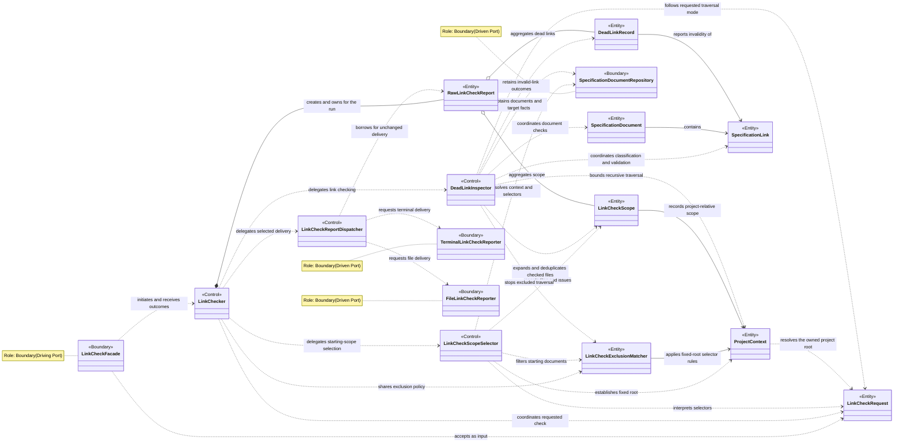
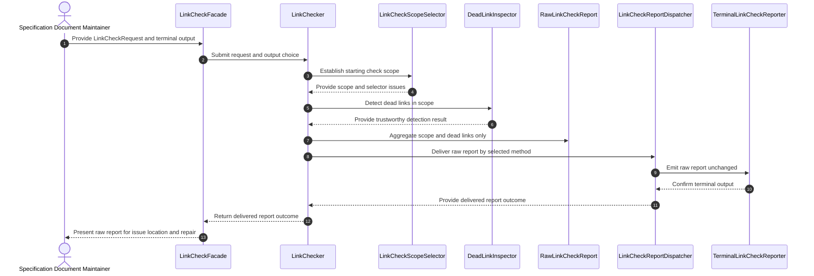
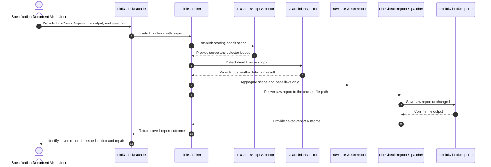
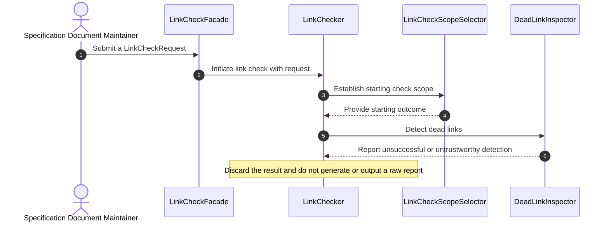
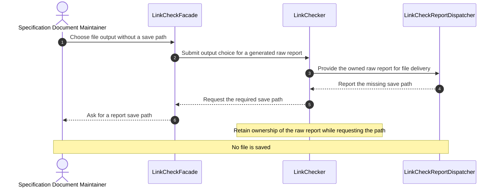
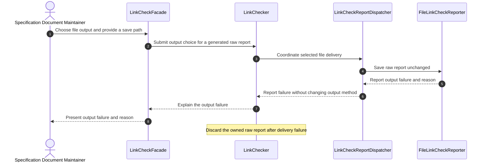
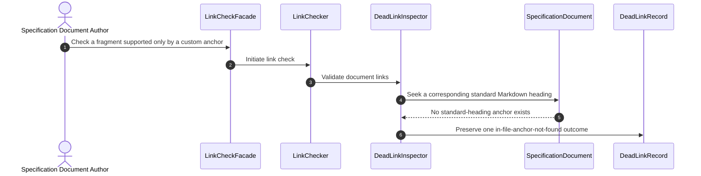
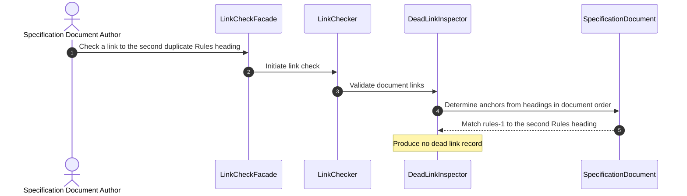
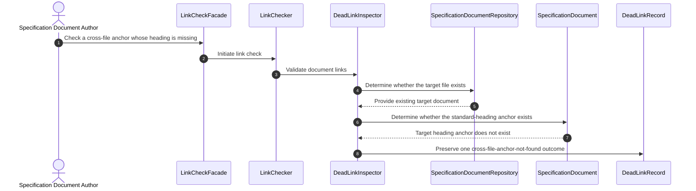
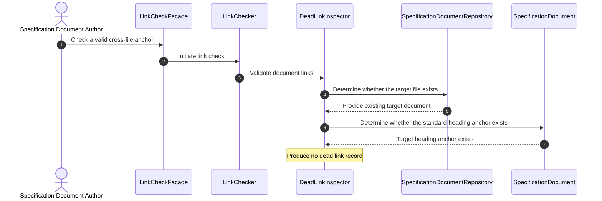

# Technical Design

## Workflow Coverage

- [Dead Link Detection Requirements for Specification Documents](spec.md)
- [Link Check Request Rules](rules/link-check-request-format.md)
- [Dead Link Record Reporting Rules](rules/dead-link-record-format.md)
- [Link Check Report Rules](rules/link-check-report-format.md)
- [Detect Dead Links in a Single File](stories/detect-links-in-single-file.md)
- [Detect Dead Local File Links](stories/detect-local-file-links.md)
- [Detect Dead In-File Anchor Links](stories/detect-in-file-anchor-links.md)
- [Detect Dead Cross-File Anchor Links](stories/detect-cross-file-anchor-links.md)
- [Detect Dead Links in a File Collection](stories/detect-links-in-file-collection.md)
- [Detect Dead Links Recursively Through File References](stories/detect-links-in-reference-chain.md)
- [Generate a Raw Link Check Report](stories/generate-link-check-report.md)
- [Output a Link Check Report](stories/output-link-check-report.md)

## Package Selections

- **`tinyglobby`**: Expands project-relative and permitted absolute include and
  exclude selectors. It provides the required glob behavior with a smaller
  dependency surface than `globby` or `fast-glob`.
- **`mdast-util-from-markdown`**: Parses CommonMark into a syntax tree so links
  and headings can be detected without fragile regular expressions. The
  higher-level `remark` processing pipeline is unnecessary for this use case.
- **`unist-util-visit`**: Traverses link and heading nodes in the Markdown
  syntax tree without requiring a custom recursive walker.
- **`mdast-util-to-string`**: Extracts visible heading text, including headings
  containing nested Markdown formatting, for anchor generation.
- **`github-slugger`**: Generates the GitHub-compatible heading identifiers and
  duplicate-heading suffixes required by the anchor detection stories.
- **`@types/mdast`**: Provides TypeScript types for Markdown document roots,
  links, and headings. This is a development dependency.
- **`inversify`**: Provides the dependency injection container used to bind and
  resolve application services and their collaborators by constructor token.
- **`commander`**: Parses the CLI commands and options. This dependency already
  exists in the package.
- **`zod`**: Validates shared request and response contracts and provides
  inferred TypeScript types. This dependency already exists in the package.
- **`@modelcontextprotocol/sdk`**: Provides MCP tool registration and transport
  support. This dependency already exists in the package.

## CRC Model

### LinkCheckFacade

- **Role:** Boundary(Driving Port).
- **Purpose:** Represent the author or maintainer's interaction with a link check.
- **Responsibilities:** Receive a complete `LinkCheckRequest`, the output choice, and the save path; pass the request to the link-check workflow without reconstructing its project root, include, exclude, or mode fields; present delivered reports, requests for a missing save path, and failure reasons.
- **Collaborators:** `LinkCheckRequest`, `LinkChecker`.

### LinkChecker

- **Role:** Control.
- **Purpose:** Coordinate the complete specification-document link-check journey.
- **Responsibilities:** Coordinate project-context establishment, scope selection, dead link checking, raw-report creation, and selected report delivery; own the raw report throughout the run; prevent report creation or output after an untrustworthy check; retain the raw report while a missing save path is requested; discard the run's raw report after delivery failure.
- **Collaborators:** `LinkCheckFacade`, `LinkCheckRequest`, `LinkCheckScopeSelector`, `LinkCheckExclusionMatcher`, `DeadLinkInspector`, `RawLinkCheckReport`, `LinkCheckReportDispatcher`.

### LinkCheckRequest

- **Role:** Entity.
- **Purpose:** Represent the maintainer's requested project boundary, link-check scope, and traversal intent.
- **Responsibilities:** Preserve the project root, include selectors, exclude selectors, and the shallow or recursive choice; provide the root used to establish `ProjectContext`; determine whether reference traversal is requested.
- **Data contract:** [Link Check Request Rules](rules/link-check-request-format.md).
- **Collaborators:** None.

### ProjectContext

- **Role:** Entity.
- **Purpose:** Represent the fixed project boundary for one link check.
- **Responsibilities:**
  - Resolve and preserve the project root supplied by `LinkCheckRequest`;
  - determine whether selected or discovered documents remain within that root;
  - provide project-relative identities for checked documents.
- **Rules:** [Project Context](rules/link-check-request-format.md#project-context).
- **Collaborators:** None.

### LinkCheckScope

- **Role:** Entity.
- **Purpose:** Represent the documents actually checked and the non-fatal issues encountered while selecting them.
- **Responsibilities:** Retain each checked document once; retain every selector issue with its original selector and reason; prevent duplicate and cyclic checking; preserve an empty scope as a valid result.
- **Data contract:** [`LinkCheckScope` and `LinkCheckScopeIssue`](rules/link-check-report-format.md#data-model).
- **Collaborators:** `ProjectContext`.

### LinkCheckScopeSelector

- **Role:** Control.
- **Purpose:** Establish the project context and starting document set for a link check.
- **Responsibilities:** Resolve include selectors independently; use the shared exclusion matcher to remove excluded documents; retain non-fatal selector issues; continue after selector issues; establish an empty or populated starting scope without treating selection issues as check failure.
- **Collaborators:** `LinkCheckRequest`, `ProjectContext`, `LinkCheckScope`, `LinkCheckExclusionMatcher`, `SpecificationDocumentRepository`.

### LinkCheckExclusionMatcher

- **Role:** Entity.
- **Purpose:** Represent the exclusion policy shared by starting-scope selection and recursive traversal.
- **Responsibilities:** Preserve the request's exclude selectors; interpret literal and glob exclusions using the fixed project root and the selector rules; determine consistently whether a resolved candidate document is excluded without treating exclusion as link invalidity.
- **Rules:** [Exclusion and selector rules](rules/link-check-request-format.md#selection-rules).
- **Collaborators:** `ProjectContext`.

### SpecificationDocumentRepository

- **Role:** Boundary(Driven Port).
- **Purpose:** Represent access to specification documents and their filesystem context.
- **Responsibilities:** Resolve project roots and selectors; report document existence and kind; provide selected and referenced Markdown documents; determine resolved containment without changing original selectors or link targets.
- **Collaborators:** `LinkCheckScopeSelector`, `DeadLinkInspector`.

### DeadLinkInspector

- **Role:** Control.
- **Purpose:** Coordinate dead link detection across the documents in one check.
- **Responsibilities:** Check every in-scope document at most once; classify and validate each supported link; follow eligible Markdown references only in recursive mode; use the shared exclusion matcher to stop traversal at excluded targets; stop traversal at outside-root, non-Markdown, or missing targets; retain one compliant dead link record for each invalid link.
- **Collaborators:** `LinkCheckRequest`, `ProjectContext`, `LinkCheckScope`, `LinkCheckExclusionMatcher`, `SpecificationDocumentRepository`, `SpecificationDocument`, `SpecificationLink`, `DeadLinkRecord`.

### SpecificationDocument

- **Role:** Entity.
- **Purpose:** Represent one Markdown specification document being checked.
- **Responsibilities:** Preserve the document's project-relative identity and links; recognize standard Markdown headings; determine GitHub-compatible heading anchors in document order, including duplicate-heading suffixes; exclude custom anchors from valid heading targets.
- **Collaborators:** `SpecificationLink`.

### SpecificationLink

- **Role:** Entity.
- **Purpose:** Represent one supported local Markdown link in its source-document context.
- **Responsibilities:** Preserve the complete original link text and target; determine whether the link is a local-file, in-file-anchor, or cross-file-anchor link; derive the validation location by resolving relative paths, decoding URL-encoded paths, and ignoring query parameters without changing the reported target.
- **Scope:** Only the supported link types defined by the [single-file detection epic](stories/detect-links-in-single-file.md) are represented. Other link forms are outside this model and are not validated by `DeadLinkInspector`.
- **Collaborators:** None.

### DeadLinkRecord

- **Role:** Entity.
- **Purpose:** Represent one traceable invalid specification link.
- **Responsibilities:** Preserve the source document, original link text, original target, link scenario, and single applicable dead link reason; prevent a missing cross-file target from also producing an anchor-missing reason.
- **Data contract:** [`DeadLinkRecord`, `LinkType`, and `DeadLinkErrorType`](rules/dead-link-record-format.md#data-model).
- **Collaborators:** `SpecificationLink`.

### RawLinkCheckReport

- **Role:** Entity.
- **Purpose:** Represent the unprocessed business result of one trustworthy link check.
- **Responsibilities:** Aggregate only the check scope and every dead link record; preserve empty collections and selector issues; exclude totals, conclusions, grouping, sorting, summaries, and delivery concerns.
- **Data contract:** [`LinkCheckReport`](rules/link-check-report-format.md#data-model).
- **Collaborators:** `LinkCheckScope`, `DeadLinkRecord`.

### LinkCheckReportDispatcher

- **Role:** Control.
- **Purpose:** Coordinate final delivery of a generated raw report by the user's selected method.
- **Responsibilities:** Receive the raw report from `LinkChecker` without taking ownership; preserve it without transformation during delivery; require a save path for file delivery; use only the selected output method; return delivery success, a missing-save-path request, or delivery failure and its reason without fallback.
- **Collaborators:** `RawLinkCheckReport`, `TerminalLinkCheckReporter`, `FileLinkCheckReporter`.

### TerminalLinkCheckReporter

- **Role:** Boundary(Driven Port).
- **Purpose:** Represent terminal delivery of a raw link check report.
- **Responsibilities:** Emit the raw report content to the terminal unchanged; report terminal-output success or failure.
- **Collaborators:** `LinkCheckReportDispatcher`.

### FileLinkCheckReporter

- **Role:** Boundary(Driven Port).
- **Purpose:** Represent file delivery of a raw link check report.
- **Responsibilities:** Save the raw report content unchanged at the provided path; report file-output success or failure and its reason.
- **Collaborators:** `LinkCheckReportDispatcher`.

## Class Diagram



## Workflow Sequence Diagrams

### Dead Link Detection Requirements for Specification Documents

**Workflow Source:** [Dead Link Detection Requirements for Specification Documents](spec.md)

#### Terminal Output Journey

The maintainer selects the documents and traversal mode, the system completes a trustworthy check, and the unchanged raw report is displayed in the terminal for review.



#### File Output Journey

The maintainer selects the documents and traversal mode and supplies a save path, after which the system checks the documents and saves the unchanged raw report to that path.



#### Detection Does Not Complete Successfully

The check cannot produce a trustworthy detection result, so the system discards the partial result and stops before raw-report generation or delivery.



#### File Output Without a Save Path

The maintainer chooses file output but omits the required path, so the system requests the missing path and does not save the report.



#### Report Output Fails

The selected file destination cannot accept the report, so the system explains the failure, does not switch destinations, and discards this run's raw report.



### Detect Dead Links in a Single File (Epic)

**Workflow Source:** [Detect Dead Links in a Single File](stories/detect-links-in-single-file.md)

#### Single-File Detection

The author selects one Markdown document, and the system examines its supported links and headings to retain one traceable record for every invalid link.

```mermaid
sequenceDiagram
    autonumber
    actor Author as Specification Document Author
    participant Submission as LinkCheckFacade
    participant Check as LinkChecker
    participant Detection as DeadLinkInspector
    participant Document as SpecificationDocument
    participant Link as SpecificationLink
    participant Record as DeadLinkRecord

    Author->>Submission: Choose one Markdown file for checking
    Submission->>Check: Initiate single-file check
    Check->>Detection: Check the selected document
    Detection->>Document: Examine document links and headings
    Document-->>Detection: Provide contained links and heading anchors
    Detection->>Link: Classify each supported link
    Detection->>Record: Retain one record for each invalid link
    Detection-->>Check: Provide all single-file dead link records
```

### Detect Dead Local File Links

**Workflow Source:** [Detect Dead Local File Links](stories/detect-local-file-links.md)

#### Scenario 1: The target local file exists

The link resolves to an existing local file, so validation succeeds and no dead link record is produced.

```mermaid
sequenceDiagram
    autonumber
    actor Author as Specification Document Author
    participant Submission as LinkCheckFacade
    participant Check as LinkChecker
    participant Detection as DeadLinkInspector
    participant Link as SpecificationLink
    participant Access as SpecificationDocumentRepository

    Author->>Submission: Check a document containing a local file link
    Submission->>Check: Initiate link check
    Check->>Detection: Validate document links
    Detection->>Link: Classify and resolve the local-file validation location
    Detection->>Access: Determine whether the local target exists
    Access-->>Detection: Target exists
    Note over Detection: Produce no dead link record
```

#### Scenario 2: The target local file does not exist

The link resolves to a missing local file, so the system records one `local-file-not-found` result while preserving the original link target.

```mermaid
sequenceDiagram
    autonumber
    actor Author as Specification Document Author
    participant Submission as LinkCheckFacade
    participant Check as LinkChecker
    participant Detection as DeadLinkInspector
    participant Link as SpecificationLink
    participant Access as SpecificationDocumentRepository
    participant Record as DeadLinkRecord

    Author->>Submission: Check a document containing a missing local target
    Submission->>Check: Initiate link check
    Check->>Detection: Validate document links
    Detection->>Link: Classify and resolve the local-file validation location
    Detection->>Access: Determine whether the local target exists
    Access-->>Detection: Target does not exist
    Detection->>Record: Preserve one local-file-not-found outcome and original target
```

#### Scenario 3: Fragment-only links are not handled by this story

The link contains only a fragment, so it is classified for in-file anchor validation rather than local-file validation.

```mermaid
sequenceDiagram
    autonumber
    actor Author as Specification Document Author
    participant Submission as LinkCheckFacade
    participant Check as LinkChecker
    participant Detection as DeadLinkInspector
    participant Link as SpecificationLink

    Author->>Submission: Check a document containing a fragment-only link
    Submission->>Check: Initiate link check
    Check->>Detection: Validate document links
    Detection->>Link: Classify the link as an in-file anchor
    Note over Detection,Link: Exclude the link from local-file validation and route it to in-file-anchor validation
```

#### Scenario 4: Links containing a file path and anchor are not handled by this story

The link contains both a file path and an anchor, so it is classified for cross-file anchor validation rather than local-file validation.

```mermaid
sequenceDiagram
    autonumber
    actor Author as Specification Document Author
    participant Submission as LinkCheckFacade
    participant Check as LinkChecker
    participant Detection as DeadLinkInspector
    participant Link as SpecificationLink

    Author->>Submission: Check a document containing a file-and-anchor link
    Submission->>Check: Initiate link check
    Check->>Detection: Validate document links
    Detection->>Link: Classify the link as a cross-file anchor
    Note over Detection,Link: Exclude the link from local-file validation and route it to cross-file-anchor validation
```

#### Scenario 5: URL-encoded paths and query parameters do not change file-existence validation

The system decodes the local path and ignores query parameters for validation while preserving the original target for reporting; because the resolved file exists, no record is produced.

```mermaid
sequenceDiagram
    autonumber
    actor Author as Specification Document Author
    participant Submission as LinkCheckFacade
    participant Check as LinkChecker
    participant Detection as DeadLinkInspector
    participant Link as SpecificationLink
    participant Access as SpecificationDocumentRepository

    Author->>Submission: Check a URL-encoded local link with query parameters
    Submission->>Check: Initiate link check
    Check->>Detection: Validate document links
    Detection->>Link: Decode the path, ignore query parameters, and preserve the original target
    Detection->>Access: Determine whether the resolved local target exists
    Access-->>Detection: Target exists
    Note over Detection: Produce no dead link record
```

### Detect Dead In-File Anchor Links

**Workflow Source:** [Detect Dead In-File Anchor Links](stories/detect-in-file-anchor-links.md)

#### Scenario 1: The target in-file anchor exists

The fragment matches a standard Markdown heading in the current document, so the link is valid and produces no dead link record.

```mermaid
sequenceDiagram
    autonumber
    actor Author as Specification Document Author
    participant Submission as LinkCheckFacade
    participant Check as LinkChecker
    participant Detection as DeadLinkInspector
    participant Document as SpecificationDocument
    participant Link as SpecificationLink

    Author->>Submission: Check a document containing a fragment-only link
    Submission->>Check: Initiate link check
    Check->>Detection: Validate document links
    Detection->>Link: Classify the link as an in-file anchor
    Detection->>Document: Determine whether the standard-heading anchor exists in this document
    Document-->>Detection: Target heading anchor exists
    Note over Detection: Produce no dead link record
```

#### Scenario 2: The target in-file anchor does not exist

The fragment does not match a standard Markdown heading in the current document, so the system records one `in-file-anchor-not-found` result.

```mermaid
sequenceDiagram
    autonumber
    actor Author as Specification Document Author
    participant Submission as LinkCheckFacade
    participant Check as LinkChecker
    participant Detection as DeadLinkInspector
    participant Document as SpecificationDocument
    participant Link as SpecificationLink
    participant Record as DeadLinkRecord

    Author->>Submission: Check a document containing a missing fragment target
    Submission->>Check: Initiate link check
    Check->>Detection: Validate document links
    Detection->>Link: Classify the link as an in-file anchor
    Detection->>Document: Determine whether the standard-heading anchor exists in this document
    Document-->>Detection: Target heading anchor does not exist
    Detection->>Record: Preserve one in-file-anchor-not-found outcome and original target
```

#### Scenario 3: Validation does not read other files

The fragment is evaluated only against headings in its source document; no other document participates in the validation decision.

```mermaid
sequenceDiagram
    autonumber
    actor Author as Specification Document Author
    participant Submission as LinkCheckFacade
    participant Check as LinkChecker
    participant Detection as DeadLinkInspector
    participant Document as SpecificationDocument
    participant Link as SpecificationLink

    Author->>Submission: Check a document containing a fragment-only link
    Submission->>Check: Initiate link check
    Check->>Detection: Validate document links
    Detection->>Link: Classify the link as an in-file anchor
    Detection->>Document: Validate the anchor using only the current document
    Document-->>Detection: Provide the current document's standard-heading anchors
    Note over Detection,Document: Do not consult any other document
```

#### Scenario 4: Custom anchors are not valid targets

Only a custom anchor matches the fragment, so the target is treated as missing because this workflow recognizes standard Markdown headings only.



#### Scenario 5: Duplicate headings use GitHub-compatible suffixes

The document assigns GitHub-compatible suffixes in heading order, allowing `#rules-1` to resolve to the second heading named `Rules`.



### Detect Dead Cross-File Anchor Links

**Workflow Source:** [Detect Dead Cross-File Anchor Links](stories/detect-cross-file-anchor-links.md)

#### Scenario 1: The target file does not exist

The file portion of the cross-file anchor is missing, so the system records only `cross-file-not-found` and does not attempt anchor validation.

```mermaid
sequenceDiagram
    autonumber
    actor Author as Specification Document Author
    participant Submission as LinkCheckFacade
    participant Check as LinkChecker
    participant Detection as DeadLinkInspector
    participant Link as SpecificationLink
    participant Access as SpecificationDocumentRepository
    participant Record as DeadLinkRecord

    Author->>Submission: Check a cross-file anchor whose file is missing
    Submission->>Check: Initiate link check
    Check->>Detection: Validate document links
    Detection->>Link: Resolve the target file location and preserve the original target
    Detection->>Access: Determine whether the target file exists
    Access-->>Detection: Target file does not exist
    Detection->>Record: Preserve one cross-file-not-found outcome
    Note over Detection,Record: Do not validate the target anchor or add a second reason
```

#### Scenario 2: The target file exists but the target anchor does not

The target document exists but contains no matching standard-heading anchor, so the system records one `cross-file-anchor-not-found` result.



#### Scenario 3: Both the target file and target anchor exist

Both the referenced document and its standard-heading anchor exist, so the cross-file link is valid and produces no dead link record.



#### Scenario 4: Relative paths, URL encoding, and query parameters

The system resolves the relative path from the source document, decodes it, and ignores query parameters for validation while preserving the original target; the resolved document and heading are valid.

```mermaid
sequenceDiagram
    autonumber
    actor Author as Specification Document Author
    participant Submission as LinkCheckFacade
    participant Check as LinkChecker
    participant Detection as DeadLinkInspector
    participant Link as SpecificationLink
    participant Access as SpecificationDocumentRepository
    participant Target as SpecificationDocument

    Author->>Submission: Check an encoded relative cross-file anchor with query parameters
    Submission->>Check: Initiate link check
    Check->>Detection: Validate document links
    Detection->>Link: Resolve relative path, decode it, ignore query parameters, and preserve original target
    Detection->>Access: Obtain the resolved target document
    Access-->>Detection: Provide existing target document
    Detection->>Target: Determine whether the standard-heading anchor exists
    Target-->>Detection: Target heading anchor exists
    Note over Detection: Produce no dead link record
```

#### Scenario 5: Duplicate target headings use GitHub-compatible suffixes

The target document assigns duplicate-heading suffixes in document order, allowing `#rules-1` to resolve to its second `Rules` heading.

```mermaid
sequenceDiagram
    autonumber
    actor Author as Specification Document Author
    participant Submission as LinkCheckFacade
    participant Check as LinkChecker
    participant Detection as DeadLinkInspector
    participant Access as SpecificationDocumentRepository
    participant Target as SpecificationDocument

    Author->>Submission: Check a cross-file link to the second duplicate Rules heading
    Submission->>Check: Initiate link check
    Check->>Detection: Validate document links
    Detection->>Access: Obtain the target document
    Access-->>Detection: Provide existing target document
    Detection->>Target: Determine anchors from headings in document order
    Target-->>Detection: Match rules-1 to the second Rules heading
    Note over Detection: Produce no dead link record
```

### Detect Dead Links in a File Collection

**Workflow Source:** [Detect Dead Links in a File Collection](stories/detect-links-in-file-collection.md)

#### Scenario 1: Check explicitly named Markdown files

The maintainer names two Markdown documents directly, and the shallow check includes both documents and reports invalid links from each one.

```mermaid
sequenceDiagram
    autonumber
    actor Maintainer as Specification Document Maintainer
    participant Submission as LinkCheckFacade
    participant Check as LinkChecker
    participant Selection as LinkCheckScopeSelector
    participant Scope as LinkCheckScope
    participant Detection as DeadLinkInspector
    participant Report as RawLinkCheckReport

    Maintainer->>Submission: Submit LinkCheckRequest selecting a.md and b.md in shallow mode
    Submission->>Check: Pass the request unchanged
    Check->>Selection: Resolve the starting collection
    Selection->>Scope: Retain a.md and b.md once
    Check->>Detection: Check both selected documents
    Detection-->>Check: Provide one invalid-link outcome from each document
    Check->>Report: Aggregate both files and both dead link records
```

#### Scenario 2: Check files matched by a pattern

The include pattern selects only matching Markdown documents under `specs/`, so unrelated documents and their invalid links remain outside the report.

```mermaid
sequenceDiagram
    autonumber
    actor Maintainer as Specification Document Maintainer
    participant Submission as LinkCheckFacade
    participant Check as LinkChecker
    participant Selection as LinkCheckScopeSelector
    participant Access as SpecificationDocumentRepository
    participant Scope as LinkCheckScope
    participant Detection as DeadLinkInspector
    participant Report as RawLinkCheckReport

    Maintainer->>Submission: Select specs/*.md in shallow mode
    Submission->>Check: Initiate collection check
    Check->>Selection: Resolve the include pattern
    Selection->>Access: Find matching Markdown documents
    Access-->>Selection: Provide specs/a.md and specs/b.md only
    Selection->>Scope: Retain both matched documents
    Check->>Detection: Check the selected scope only
    Detection-->>Check: Provide dead links from the two checked documents only
    Check->>Report: Aggregate selected scope and its dead links
```

#### Scenario 3: Exclude named files and files matched by a pattern

The exclusion selectors remove draft and archived documents from the selected collection, leaving only the eligible document to be checked and reported.

```mermaid
sequenceDiagram
    autonumber
    actor Maintainer as Specification Document Maintainer
    participant Submission as LinkCheckFacade
    participant Check as LinkChecker
    participant Exclusion as LinkCheckExclusionMatcher
    participant Selection as LinkCheckScopeSelector
    participant Scope as LinkCheckScope
    participant Detection as DeadLinkInspector
    participant Report as RawLinkCheckReport

    Maintainer->>Submission: Submit LinkCheckRequest with include and exclude selectors
    Submission->>Check: Pass the request unchanged
    Check->>Exclusion: Establish shared exclusion policy
    Check->>Selection: Resolve includes and apply exclusions
    Selection->>Exclusion: Test selected documents
    Selection->>Scope: Retain specs/a.md only
    Check->>Detection: Check the retained document only
    Detection-->>Check: Provide dead links from specs/a.md only
    Check->>Report: Aggregate the retained scope and its dead links
```

#### Scenario 4: An include glob matches no files

The include pattern selects no Markdown documents, so the system preserves a `glob-no-match` scope issue and still generates an empty raw report.

```mermaid
sequenceDiagram
    autonumber
    actor Maintainer as Specification Document Maintainer
    participant Submission as LinkCheckFacade
    participant Check as LinkChecker
    participant Selection as LinkCheckScopeSelector
    participant Access as SpecificationDocumentRepository
    participant Scope as LinkCheckScope
    participant Report as RawLinkCheckReport

    Maintainer->>Submission: Submit an include glob with no Markdown matches
    Submission->>Check: Initiate collection check
    Check->>Selection: Resolve the include glob
    Selection->>Access: Find matching Markdown documents
    Access-->>Selection: Report no matches
    Selection->>Scope: Retain original selector with glob-no-match reason
    Selection-->>Check: Provide empty valid scope with issue
    Check->>Report: Aggregate empty files, scope issue, and no dead links
```

#### Scenario 5: Exclusions remove every selected file

All successfully selected documents are excluded, producing an empty but valid scope with no selector issues and no dead links.

```mermaid
sequenceDiagram
    autonumber
    actor Maintainer as Specification Document Maintainer
    participant Submission as LinkCheckFacade
    participant Check as LinkChecker
    participant Selection as LinkCheckScopeSelector
    participant Scope as LinkCheckScope
    participant Report as RawLinkCheckReport

    Maintainer->>Submission: Submit valid selectors whose matches are all excluded
    Submission->>Check: Initiate collection check
    Check->>Selection: Resolve includes and apply exclusions
    Selection->>Scope: Retain no files and no selector issues
    Selection-->>Check: Provide empty valid scope
    Check->>Report: Aggregate empty scope and no dead links
```

#### Scenario 6: An absolute selector identifies a file inside the project root

The absolute selector resolves to an existing Markdown document inside the fixed project root, so the document is checked and identified by its project-relative path.

```mermaid
sequenceDiagram
    autonumber
    actor Maintainer as Specification Document Maintainer
    participant Submission as LinkCheckFacade
    participant Check as LinkChecker
    participant Selection as LinkCheckScopeSelector
    participant Context as ProjectContext
    participant Access as SpecificationDocumentRepository
    participant Scope as LinkCheckScope

    Maintainer->>Submission: Select an absolute Markdown path inside the project root
    Submission->>Check: Initiate collection check
    Check->>Selection: Resolve the absolute selector
    Selection->>Access: Resolve document and project containment
    Access-->>Selection: Report existing in-root Markdown document
    Selection->>Context: Obtain project-relative document identity
    Selection->>Scope: Retain project-relative file without a scope issue
```

#### Scenario 7: A selector resolves outside the project root

The selector points outside the project boundary, so no outside document is checked; the original selector is retained as a non-fatal scope issue while selection continues.

```mermaid
sequenceDiagram
    autonumber
    actor Maintainer as Specification Document Maintainer
    participant Submission as LinkCheckFacade
    participant Check as LinkChecker
    participant Selection as LinkCheckScopeSelector
    participant Context as ProjectContext
    participant Scope as LinkCheckScope

    Maintainer->>Submission: Submit an include selector outside the project root
    Submission->>Check: Initiate collection check
    Check->>Selection: Resolve include selectors independently
    Selection->>Context: Determine whether the selector remains in the project
    Context-->>Selection: Selector is outside the project root
    Selection->>Scope: Retain original selector with selector-outside-project-root reason
    Note over Selection,Scope: Do not check outside files and continue remaining selectors
```

#### Scenario 8: A literal include selector identifies a missing file

The literal selector identifies no existing Markdown document, so the system records a `literal-file-not-found` scope issue and continues resolving other selectors.

```mermaid
sequenceDiagram
    autonumber
    actor Maintainer as Specification Document Maintainer
    participant Submission as LinkCheckFacade
    participant Check as LinkChecker
    participant Selection as LinkCheckScopeSelector
    participant Access as SpecificationDocumentRepository
    participant Scope as LinkCheckScope

    Maintainer->>Submission: Submit a literal selector for a missing Markdown file
    Submission->>Check: Initiate collection check
    Check->>Selection: Resolve include selectors independently
    Selection->>Access: Determine whether the literal document exists
    Access-->>Selection: Literal document does not exist
    Selection->>Scope: Retain original selector with literal-file-not-found reason
    Note over Selection,Scope: Continue resolving remaining selectors
```

### Detect Dead Links Recursively Through File References

**Workflow Source:** [Detect Dead Links Recursively Through File References](stories/detect-links-in-reference-chain.md)

#### Scenario 1: Check every reachable Markdown file in recursive mode

Recursive mode begins with the selected document, follows every eligible Markdown reference, and reports invalid links using the document that actually contains each link as its source.

```mermaid
sequenceDiagram
    autonumber
    actor Maintainer as Specification Document Maintainer
    participant Submission as LinkCheckFacade
    participant Check as LinkChecker
    participant Scope as LinkCheckScope
    participant Detection as DeadLinkInspector
    participant Access as SpecificationDocumentRepository
    participant Record as DeadLinkRecord

    Maintainer->>Submission: Submit LinkCheckRequest selecting a starting document in recursive mode
    Submission->>Check: Pass the request unchanged
    Check->>Detection: Check the starting scope and follow eligible references
    Detection->>Access: Obtain each reachable in-root Markdown document
    Detection->>Scope: Retain starting and reachable documents once
    Detection->>Record: Preserve invalid link from the indirectly reached document
    Detection-->>Check: Provide scope and traceable dead link records
```

#### Scenario 2: Shallow mode checks only selected files

Shallow mode checks only the initially selected document and does not inspect referenced documents or report invalid links found only within them.

```mermaid
sequenceDiagram
    autonumber
    actor Maintainer as Specification Document Maintainer
    participant Submission as LinkCheckFacade
    participant Check as LinkChecker
    participant Scope as LinkCheckScope
    participant Detection as DeadLinkInspector

    Maintainer->>Submission: Submit LinkCheckRequest selecting the starting document in shallow mode
    Submission->>Check: Pass the request unchanged
    Check->>Detection: Check selected documents only
    Detection->>Scope: Retain only the starting document
    Note over Detection,Scope: Do not inspect file A or file B and do not report file B's invalid link
```

#### Scenario 3: Recursive mode follows indirect references

Recursive mode follows references beyond the first level, adds indirectly reached Markdown documents to the scope, and reports their invalid links against their own paths.

```mermaid
sequenceDiagram
    autonumber
    actor Maintainer as Specification Document Maintainer
    participant Submission as LinkCheckFacade
    participant Check as LinkChecker
    participant Detection as DeadLinkInspector
    participant Access as SpecificationDocumentRepository
    participant Scope as LinkCheckScope
    participant Record as DeadLinkRecord

    Maintainer->>Submission: Select the starting document in recursive mode
    Submission->>Check: Initiate recursive check
    Check->>Detection: Follow eligible references without a depth limit
    Detection->>Access: Obtain file A and then file B
    Detection->>Scope: Retain file B as checked
    Detection->>Record: Preserve file B as the invalid link's source
```

#### Scenario 4: The same file is reached through multiple reference paths

When multiple reference paths reach the same document, the scope recognizes that it was already checked and prevents duplicate checking and duplicate records.

```mermaid
sequenceDiagram
    autonumber
    actor Maintainer as Specification Document Maintainer
    participant Submission as LinkCheckFacade
    participant Check as LinkChecker
    participant Detection as DeadLinkInspector
    participant Scope as LinkCheckScope
    participant Record as DeadLinkRecord

    Maintainer->>Submission: Request recursive checking with converging references
    Submission->>Check: Initiate recursive check
    Check->>Detection: Follow both reference paths
    Detection->>Scope: Determine whether the reached document was already checked
    Scope-->>Detection: Document already retained
    Note over Detection,Scope: Do not check the document again
    Detection->>Record: Retain the invalid link only once
```

#### Scenario 5: The reference chain contains a cycle

When traversal returns to a document already checked, the scope stops the cycle so each document and each invalid link are processed at most once.

```mermaid
sequenceDiagram
    autonumber
    actor Maintainer as Specification Document Maintainer
    participant Submission as LinkCheckFacade
    participant Check as LinkChecker
    participant Detection as DeadLinkInspector
    participant Scope as LinkCheckScope
    participant Record as DeadLinkRecord

    Maintainer->>Submission: Request recursive checking of a cyclic reference chain
    Submission->>Check: Initiate recursive check
    Check->>Detection: Follow eligible references
    Detection->>Scope: Determine whether the next document was already checked
    Scope-->>Detection: Document already retained in this check
    Note over Detection,Scope: Stop repeating the cycle
    Detection->>Record: Retain each encountered invalid link at most once
```

#### Scenario 6: The reference chain contains a link to a non-existent file

The missing reference is reported under its applicable single-file rule, but the nonexistent target cannot be added to or expanded through the recursive scope.

```mermaid
sequenceDiagram
    autonumber
    actor Maintainer as Specification Document Maintainer
    participant Submission as LinkCheckFacade
    participant Check as LinkChecker
    participant Detection as DeadLinkInspector
    participant Access as SpecificationDocumentRepository
    participant Scope as LinkCheckScope
    participant Record as DeadLinkRecord

    Maintainer->>Submission: Request recursive checking with a missing referenced file
    Submission->>Check: Initiate recursive check
    Check->>Detection: Validate and follow eligible references
    Detection->>Access: Determine whether the referenced target exists
    Access-->>Detection: Target does not exist
    Detection->>Record: Preserve the applicable single-file dead link outcome
    Note over Detection,Scope: Do not add the missing target to the check scope
```

#### Scenario 7: Excluded references are validated but not followed

An excluded referenced document remains a valid link target, but it is not added to the check scope and its contents are not inspected.

```mermaid
sequenceDiagram
    autonumber
    actor Maintainer as Specification Document Maintainer
    participant Submission as LinkCheckFacade
    participant Check as LinkChecker
    participant Exclusion as LinkCheckExclusionMatcher
    participant Detection as DeadLinkInspector
    participant Access as SpecificationDocumentRepository
    participant Scope as LinkCheckScope

    Maintainer->>Submission: Submit LinkCheckRequest for recursive checking with an exclusion
    Submission->>Check: Pass the request unchanged
    Check->>Exclusion: Establish shared exclusion policy
    Check->>Detection: Validate and follow eligible references
    Detection->>Access: Validate the referenced target
    Access-->>Detection: Target exists
    Detection->>Exclusion: Determine whether the target is excluded
    Exclusion-->>Detection: Target is excluded
    Note over Detection,Scope: Do not add or inspect the excluded document
```

### Generate a Raw Link Check Report

**Workflow Source:** [Generate a Raw Link Check Report](stories/generate-link-check-report.md)

#### Scenario 1: Detection succeeds with no dead links

The check completes successfully without selector issues or invalid links, so the raw report preserves the checked scope and empty issue and dead-link collections.

```mermaid
sequenceDiagram
    autonumber
    actor Maintainer as Specification Document Maintainer
    participant Submission as LinkCheckFacade
    participant Check as LinkChecker
    participant Scope as LinkCheckScope
    participant Report as RawLinkCheckReport

    Maintainer->>Submission: Request a link check
    Submission->>Check: Initiate link check
    Scope-->>Check: Provide successful scope with no issues
    Note over Check: Detection succeeds with no dead links
    Check->>Report: Aggregate scope, empty issues, and empty dead links
```

#### Scenario 2: Detection succeeds with dead links

The check completes successfully with an invalid link, so the raw report combines the check scope with the compliant dead link record.

```mermaid
sequenceDiagram
    autonumber
    actor Maintainer as Specification Document Maintainer
    participant Submission as LinkCheckFacade
    participant Check as LinkChecker
    participant Scope as LinkCheckScope
    participant Record as DeadLinkRecord
    participant Report as RawLinkCheckReport

    Maintainer->>Submission: Request a link check
    Submission->>Check: Initiate link check
    Scope-->>Check: Provide successful check scope
    Record-->>Check: Provide one compliant dead link record
    Check->>Report: Aggregate scope and the dead link record
```

#### Scenario 3: The report retains multiple raw dead link records

The check produces records from multiple documents, and the raw report retains every original fact without calculating totals or reorganizing the results.

```mermaid
sequenceDiagram
    autonumber
    actor Maintainer as Specification Document Maintainer
    participant Submission as LinkCheckFacade
    participant Check as LinkChecker
    participant Scope as LinkCheckScope
    participant Record as DeadLinkRecord
    participant Report as RawLinkCheckReport

    Maintainer->>Submission: Request a multi-document link check
    Submission->>Check: Initiate link check
    Scope-->>Check: Provide successful multi-document scope
    Record-->>Check: Provide every traceable dead link record
    Check->>Report: Aggregate scope and every record unchanged
    Note over Report: Do not derive totals, grouping, sorting, or summaries
```

#### Scenario 4: Selection produces issues and no files

Selection contributes no documents but does produce non-fatal issues, so the system generates a raw report containing the empty file scope, all issues, and no dead links.

```mermaid
sequenceDiagram
    autonumber
    actor Maintainer as Specification Document Maintainer
    participant Submission as LinkCheckFacade
    participant Check as LinkChecker
    participant Scope as LinkCheckScope
    participant Report as RawLinkCheckReport

    Maintainer->>Submission: Request a check whose selectors contribute no files
    Submission->>Check: Initiate link check
    Scope-->>Check: Provide empty files and all selector issues
    Check->>Report: Aggregate empty files, selector issues, and empty dead links
```

#### Scenario 5a: The project context is invalid

The request cannot establish a valid project boundary, so the system discards the check result and does not create a raw report.

```mermaid
sequenceDiagram
    autonumber
    actor Maintainer as Specification Document Maintainer
    participant Submission as LinkCheckFacade
    participant Check as LinkChecker
    participant Selection as LinkCheckScopeSelector

    Maintainer->>Submission: Request a link check
    Submission->>Check: Initiate link check
    Check->>Selection: Establish valid project context and scope
    Selection-->>Check: Report invalid project context
    Note over Check: Do not generate a raw report and discard the check result
```

#### Scenario 5b: Detection cannot produce a trustworthy result

An unexpected failure prevents trustworthy detection despite a valid project context, so the system discards the result and does not create a raw report.

```mermaid
sequenceDiagram
    autonumber
    actor Maintainer as Specification Document Maintainer
    participant Submission as LinkCheckFacade
    participant Check as LinkChecker
    participant Detection as DeadLinkInspector

    Maintainer->>Submission: Request a link check with valid project context
    Submission->>Check: Initiate link check
    Check->>Detection: Coordinate dead link detection
    Detection-->>Check: Report an unexpected failure preventing a trustworthy result
    Note over Check: Do not generate a raw report and discard the check result
```

### Output a Link Check Report

**Workflow Source:** [Output a Link Check Report](stories/output-link-check-report.md)

#### Scenario 1: Output the report directly in the terminal

The maintainer selects terminal delivery, and the system emits the generated raw report unchanged without adding derived content.

```mermaid
sequenceDiagram
    autonumber
    actor Maintainer as Specification Document Maintainer
    participant Submission as LinkCheckFacade
    participant Check as LinkChecker
    participant Delivery as LinkCheckReportDispatcher
    participant Terminal as TerminalLinkCheckReporter

    Maintainer->>Submission: Choose terminal output for the generated report
    Submission->>Check: Submit selected output method
    Check->>Delivery: Deliver the raw report in the terminal
    Delivery->>Report: Obtain unchanged raw report facts
    Delivery->>Terminal: Emit the raw report without derived content
    Terminal-->>Delivery: Confirm terminal output
    Delivery-->>Check: Provide successful output outcome
    Check-->>Submission: Return successful output outcome
    Submission-->>Maintainer: Present the unchanged raw report
```

#### Scenario 2: Save the report to a file

The maintainer selects file delivery and provides a path, and the system saves the generated raw report there without changing its content.

```mermaid
sequenceDiagram
    autonumber
    actor Maintainer as Specification Document Maintainer
    participant Submission as LinkCheckFacade
    participant Check as LinkChecker
    participant Report as RawLinkCheckReport
    participant Delivery as LinkCheckReportDispatcher
    participant File as FileLinkCheckReporter

    Maintainer->>Submission: Choose file output and provide a save path
    Submission->>Check: Submit selected output method and path
    Check->>Delivery: Deliver the raw report to the provided path
    Delivery->>Report: Obtain unchanged raw report facts
    Delivery->>File: Save the raw report without derived content
    File-->>Delivery: Confirm file output
    Delivery-->>Check: Provide successful save outcome
    Check-->>Submission: Return successful save outcome
    Submission-->>Maintainer: Identify the saved raw report
```

#### Scenario 3: Save to a file without providing a save path

The maintainer selects file delivery without the required path, so the system asks for that path and does not save the report.

```mermaid
sequenceDiagram
    autonumber
    actor Maintainer as Specification Document Maintainer
    participant Submission as LinkCheckFacade
    participant Check as LinkChecker
    participant Report as RawLinkCheckReport
    participant Delivery as LinkCheckReportDispatcher

    Maintainer->>Submission: Choose file output without a save path
    Submission->>Check: Submit selected output method
    Check->>Delivery: Provide the owned raw report for file delivery
    Delivery-->>Check: Report the missing save path
    Check-->>Submission: Request the required save path
    Submission-->>Maintainer: Ask for a report save path
    Note over Check: Retain ownership of the raw report while requesting the path
    Note over Maintainer,Delivery: Do not save the report
```

#### Scenario 4: Report output fails

The selected destination fails, so the system explains the reason, does not fall back to another output method, and discards the raw report from this run.

```mermaid
sequenceDiagram
    autonumber
    actor Maintainer as Specification Document Maintainer
    participant Submission as LinkCheckFacade
    participant Check as LinkChecker
    participant Delivery as LinkCheckReportDispatcher
    participant File as FileLinkCheckReporter

    Maintainer->>Submission: Choose file output and provide a save path
    Submission->>Check: Submit selected output method and path
    Check->>Delivery: Coordinate selected file delivery
    Delivery->>File: Save the raw report unchanged
    File-->>Delivery: Report failure and reason
    Delivery-->>Check: Report failure without fallback
    Check-->>Submission: Explain the output failure
    Submission-->>Maintainer: Present output failure and reason
    Note over Check: Discard the owned raw report after delivery failure
```
