```mermaid
classDiagram
    direction LR

    class SpecificationDocumentMaintainer
    <<Actor>> SpecificationDocumentMaintainer

    class LinkCheckDelegation
    <<Input>> LinkCheckDelegation
    class LinkCheckReport
    <<Output>> LinkCheckReport
    class LinkCheckWorkflowScheduler
    class LinkCheckScopeBuilder
    class LinkCheckScope
    class SpecificationDocumentBatchChecker
    class LinkCheckReportFabricator
    class ResolvedSpecificationLink

    SpecificationDocumentMaintainer ..> LinkCheckDelegation
    SpecificationDocumentMaintainer ..> LinkCheckWorkflowScheduler
    LinkCheckWorkflowScheduler ..> LinkCheckDelegation
    LinkCheckWorkflowScheduler ..> LinkCheckScopeBuilder
    LinkCheckWorkflowScheduler ..> SpecificationDocumentBatchChecker
    LinkCheckWorkflowScheduler ..> LinkCheckReportFabricator
    LinkCheckWorkflowScheduler ..> LinkCheckReport
    LinkCheckScopeBuilder ..> LinkCheckDelegation
    LinkCheckScopeBuilder ..> LinkCheckScope
    SpecificationDocumentBatchChecker ..> LinkCheckScope
    LinkCheckReportFabricator ..> LinkCheckDelegation
    LinkCheckReportFabricator ..> LinkCheckScope
    LinkCheckReportFabricator ..> ResolvedSpecificationLink
    LinkCheckReportFabricator ..> LinkCheckReport
    LinkCheckReport "1" o-- "1" LinkCheckDelegation
    LinkCheckReport "1" o-- "1" LinkCheckScope
    LinkCheckReport "1" o-- "0..*" ResolvedSpecificationLink
    SpecificationDocumentMaintainer ..> LinkCheckReport
```

```mermaid
classDiagram
    direction LR

    class SpecificationDocumentBatchChecker
    <<Caller>> SpecificationDocumentBatchChecker

    class SpecificationDocument
    <<Input>> SpecificationDocument
    class SpecificationDocumentChecker
    class SpecificationLinkExtractor
    class SpecificationHeadingCataloger
    class SpecificationLinkChecker
    class SpecificationLinkCheckStrategy
    <<abstract>> SpecificationLinkCheckStrategy
    class InFileAnchorLinkCheckStrategy
    class LocalFileLinkCheckStrategy
    class CrossFileAnchorLinkCheckStrategy
    class SpecificationLink
    class ResolvedSpecificationLink
    <<Output>> ResolvedSpecificationLink

    SpecificationDocumentBatchChecker ..> SpecificationDocumentChecker
    SpecificationDocument "1" *-- "0..*" SpecificationLink
    ResolvedSpecificationLink "1" --> "1" SpecificationLink
    SpecificationDocumentChecker ..> SpecificationDocument
    SpecificationDocumentChecker ..> SpecificationLinkExtractor
    SpecificationDocumentChecker ..> SpecificationHeadingCataloger
    SpecificationDocumentChecker ..> SpecificationLinkChecker
    SpecificationDocumentChecker ..> ResolvedSpecificationLink
    SpecificationLinkExtractor ..> SpecificationDocument
    SpecificationLinkExtractor ..> SpecificationLink
    SpecificationHeadingCataloger ..> SpecificationDocument
    SpecificationLinkChecker ..> SpecificationLink
    SpecificationLinkChecker ..> ResolvedSpecificationLink
    SpecificationLinkChecker "1" o-- "3" SpecificationLinkCheckStrategy
    InFileAnchorLinkCheckStrategy ..|> SpecificationLinkCheckStrategy
    LocalFileLinkCheckStrategy ..|> SpecificationLinkCheckStrategy
    CrossFileAnchorLinkCheckStrategy ..|> SpecificationLinkCheckStrategy
    InFileAnchorLinkCheckStrategy ..> SpecificationLink
    InFileAnchorLinkCheckStrategy ..> ResolvedSpecificationLink
    LocalFileLinkCheckStrategy ..> SpecificationLink
    LocalFileLinkCheckStrategy ..> ResolvedSpecificationLink
    CrossFileAnchorLinkCheckStrategy ..> SpecificationLink
    CrossFileAnchorLinkCheckStrategy ..> SpecificationHeadingCataloger
    CrossFileAnchorLinkCheckStrategy ..> ResolvedSpecificationLink
```

# 面向对象设计：检查规范文档中的失效链接

## 参考资料

- [Link Check Scope Builder](roles/LinkCheckScopeBuilder.md)
- [用例规约 -> 检查失效链接](use-case/check-specification-documents-for-dead-links.md)
- [单文档检查](use-case/workflows/single-document-check-workflow.md)
- [多文档检查](use-case/workflows/multiple-document-check-workflow.md)

## 候选类说明

### LinkCheckDelegation

- **类名：** `LinkCheckDelegation`
- **职责：** 表示维护者要求在项目边界内检查一个或多个规范文档的指令，并保留项目根目录、输入解析基准、文件路径、目录路径或 glob pattern 形式的 `files` 输入，以及浅层或递归遍历选择。
- **协作者：** `SpecificationDocumentMaintainer`、`LinkCheckWorkflowScheduler`、`LinkCheckScopeBuilder`、`SpecificationDocumentBatchChecker`、`LinkCheckReport`

### LinkCheckScope

- **类名：** `LinkCheckScope`
- **职责：** 表示 `LinkCheckDelegation.files` 基于 `LinkCheckDelegation.base` 解析、展开后得到的有序起始文档，以及解释 `LinkCheckDelegation` 时发现的路径、glob pattern 和 glob 匹配结果问题。
- **协作者：** `LinkCheckScopeBuilder`、`SpecificationDocumentRepository`、`SpecificationDocumentBatchChecker`、`LinkCheckReport`

### SpecificationDocumentRepository

- **类名：** `SpecificationDocumentRepository`
- **职责：** 表示一次批量检查中有序的待检查和已检查规范文档工作集；每个起始或新发现的文档只接收一次，并提供下一个未检查文档。
- **协作者：** `LinkCheckScope`、`SpecificationDocument`、`SpecificationDocumentBatchChecker`、`ReferencedDocumentDiscoverer`

### SpecificationDocument

- **类名：** `SpecificationDocument`
- **职责：** 在检查标题和链接期间，通过项目相对标识与作者原始内容表示一份 Markdown 规范文档。
- **协作者：** `SpecificationDocumentRepository`、`SpecificationDocumentChecker`、`SpecificationLinkExtractor`、`SpecificationHeadingCataloger`

### SpecificationLink

- **类名：** `SpecificationLink`
- **职责：** 与作者所写内容完全一致地表示一个受支持的 Markdown 链接，包括可见名称，以及文档维护者提供的路径或锚点。
- **协作者：** `SpecificationLinkExtractor`、`SpecificationLinkChecker`、`ResolvedSpecificationLink`

### ResolvedSpecificationLink

- **类名：** `ResolvedSpecificationLink`
- **职责：** 表示检查一个 **Specification Link** 后得到的不可变、可追溯的有效或失效结果，包括源位置、解析后的目标，以及适用时的一个失效原因。
- **协作者：** `SpecificationLink`、`SpecificationLinkChecker`、`SpecificationDocumentChecker`、`ReferencedDocumentDiscoverer`、`SpecificationDocumentBatchChecker`、`LinkCheckReport`

### LinkCheckReport

- **类名：** `LinkCheckReport`
- **职责：** 通过保留委托、已建立的范围和每个失效的 **Resolved Specification Link**，表示一次已完成委托的原始结果。
- **协作者：** `LinkCheckDelegation`、`LinkCheckScope`、`ResolvedSpecificationLink`、`LinkCheckReportFabricator`、`SpecificationDocumentMaintainer`

### LinkCheckWorkflowScheduler

- **类名：** `LinkCheckWorkflowScheduler`
- **职责：** 协调完整用例：接受 `LinkCheckDelegation`，通过 `LinkCheckScopeBuilder` 建立 `LinkCheckScope`，完成文档检查并准备 `LinkCheckReport`。
- **协作者：** `SpecificationDocumentMaintainer`、`LinkCheckDelegation`、`LinkCheckScopeBuilder`、`SpecificationDocumentBatchChecker`、`LinkCheckReportFabricator`、`LinkCheckReport`

### LinkCheckScopeBuilder

- **类名：** `LinkCheckScopeBuilder`
- **职责：** 建立稳定项目边界，按顺序识别、展开并评估 `LinkCheckDelegation.files` 的每个输入项，记录 `LinkCheckScopeIssue`，并生成 **Link Check Scope**；项目根目录无效时停止执行。
- **协作者：** `LinkCheckDelegation`、`LinkCheckScope`、`LinkCheckWorkflowScheduler`

### SpecificationDocumentBatchChecker

- **类名：** `SpecificationDocumentBatchChecker`
- **职责：** 协调检查有序的待检查文档集合，确保每份文档至多检查一次，聚合失效链接结果，并应用委托的遍历模式。
- **协作者：** `LinkCheckDelegation`、`LinkCheckScope`、`SpecificationDocumentRepository`、`SpecificationDocumentChecker`、`ReferencedDocumentDiscoverer`、`ResolvedSpecificationLink`、`LinkCheckWorkflowScheduler`

### SpecificationDocumentChecker

- **类名：** `SpecificationDocumentChecker`
- **职责：** 通过获取文档中受支持的链接和标题标识、恰好检查每个受支持链接一次，并分离产生的有效与失效结果，协调一次文档检查。
- **协作者：** `SpecificationDocument`、`SpecificationLinkExtractor`、`SpecificationHeadingCataloger`、`SpecificationLinkChecker`、`ResolvedSpecificationLink`、`SpecificationDocumentBatchChecker`

### SpecificationLinkExtractor

- **类名：** `SpecificationLinkExtractor`
- **职责：** 识别规范文档中受支持的本地文件、文档内锚点和跨文件锚点链接，同时保留作者原始内容。
- **协作者：** `SpecificationDocument`、`SpecificationLink`、`SpecificationDocumentChecker`

### SpecificationHeadingCataloger

- **类名：** `SpecificationHeadingCataloger`
- **职责：** 建立规范文档中可用的标题标识，以便对照作者写下的标题检查文档内与跨文件锚点。
- **协作者：** `SpecificationDocument`、`SpecificationDocumentChecker`、`CrossFileAnchorLinkCheckStrategy`

### SpecificationLinkChecker

- **类名：** `SpecificationLinkChecker`
- **职责：** 从组合的策略集合中为一个 **Specification Link** 选择策略，将场景特有的检查委托给该策略，并返回仅包含一个 **Resolved Specification Link** 结果的数组；无匹配策略时返回空数组。
- **协作者：** `SpecificationLink`、`SpecificationLinkCheckStrategy`、`ResolvedSpecificationLink`、`SpecificationDocumentChecker`

### SpecificationLinkCheckStrategy

- **类名：** `SpecificationLinkCheckStrategy`
- **职责：** 定义用于识别和检查一个受支持 **Specification Link** 场景的抽象、可互换契约，同时作为策略集合的依赖注入标识符。
- **协作者：** `SpecificationLink`、`SpecificationLinkChecker`、`ResolvedSpecificationLink`

### InFileAnchorLinkCheckStrategy

- **类名：** `InFileAnchorLinkCheckStrategy`
- **职责：** 对照源文档已编目的标题检查文档内锚点链接，并建立有效结果或锚点未找到结果。
- **协作者：** `SpecificationLinkCheckStrategy`、`SpecificationLink`、`ResolvedSpecificationLink`

### LocalFileLinkCheckStrategy

- **类名：** `LocalFileLinkCheckStrategy`
- **职责：** 解析本地文件链接，在检查目标是否存在之前检查项目包含关系，并建立有效结果或适用的失效结果。
- **协作者：** `SpecificationLinkCheckStrategy`、`SpecificationLink`、`ResolvedSpecificationLink`

### CrossFileAnchorLinkCheckStrategy

- **类名：** `CrossFileAnchorLinkCheckStrategy`
- **职责：** 解析跨文件锚点链接，依次检查项目包含关系、目标是否存在和标题标识，并建立有效结果或适用的失效结果。
- **协作者：** `SpecificationLinkCheckStrategy`、`SpecificationLink`、`SpecificationHeadingCataloger`、`ResolvedSpecificationLink`

### ReferencedDocumentDiscoverer

- **类名：** `ReferencedDocumentDiscoverer`
- **职责：** 在递归模式下识别通过有效的已解析链接到达且尚未检查的 Markdown 文档，同时排除已在待检查集合中或已检查的文档。
- **协作者：** `LinkCheckDelegation`、`ResolvedSpecificationLink`、`SpecificationDocumentRepository`、`SpecificationDocumentBatchChecker`

### LinkCheckReportFabricator

- **类名：** `LinkCheckReportFabricator`
- **职责：** 根据原始委托、已建立范围和聚合后的失效已解析链接，为已完成的检查准备原始报告。
- **协作者：** `LinkCheckDelegation`、`LinkCheckScope`、`ResolvedSpecificationLink`、`LinkCheckReport`、`LinkCheckWorkflowScheduler`

## 外部参与者

- **SpecificationDocumentMaintainer — 外部参与者：** 委托需要检查的文档与遍历模式，随后接收已完成且可追溯的报告。

## 候选类可视化

以下图分别呈现用例层、批量检查层和单文档层的静态类关系。图中使用组合、聚合、关联、依赖和多重性，而不是执行顺序。连接相邻层级时会重复展示边界类。关系标签被省略，但保留 `Input`、`Output` 和 `Caller` 类构造型。

### 用例概览

### 规范文档批量检查

`LinkCheckScope` 和 `SpecificationDocumentRepository` 为不同生命周期聚合文档：范围保留已接受的起始文档，repository 保留一次批量检查中可变的工作集。批量检查器同时依赖这两个聚合，以及文档检查和发现协作者。

```mermaid
classDiagram
    direction LR

    class LinkCheckWorkflowScheduler
    <<Caller>> LinkCheckWorkflowScheduler

    class LinkCheckDelegation
    <<Input>> LinkCheckDelegation
    class LinkCheckScope
    <<Input>> LinkCheckScope
    class SpecificationDocumentRepository
    class SpecificationDocument
    class SpecificationDocumentBatchChecker
    class SpecificationDocumentChecker
    class ReferencedDocumentDiscoverer
    class ResolvedSpecificationLink

    LinkCheckWorkflowScheduler ..> SpecificationDocumentBatchChecker
    LinkCheckScope "1" o-- "0..*" SpecificationDocument
    SpecificationDocumentRepository "1" o-- "0..*" SpecificationDocument
    SpecificationDocumentBatchChecker --> "1" SpecificationDocumentRepository
    SpecificationDocumentBatchChecker ..> LinkCheckDelegation
    SpecificationDocumentBatchChecker ..> LinkCheckScope
    SpecificationDocumentBatchChecker ..> SpecificationDocumentChecker
    SpecificationDocumentBatchChecker ..> ReferencedDocumentDiscoverer
    SpecificationDocumentBatchChecker ..> ResolvedSpecificationLink
    ReferencedDocumentDiscoverer ..> LinkCheckDelegation
    ReferencedDocumentDiscoverer ..> ResolvedSpecificationLink
    ReferencedDocumentDiscoverer ..> SpecificationDocumentRepository
```

### 单文档子流程

