# Object-Oriented Design: Check Specification Documents for Dead Links

## Prerequities

- [Markdown Linkage Specification](spec.md)
- [Check Specification Documents for Dead Links](use-case/check-specification-documents-for-dead-links.md)
- [Single-Document Check](use-case/workflows/single-document-check-workflow.md)
- [Multiple-Document Check](use-case/workflows/multiple-document-check-workflow.md)
- [Link Check Scope Builder](roles/LinkCheckScopeBuilder.md)

## Candidate-Class Descriptions

### LinkCheckDelegation

- **Class Name:** `LinkCheckDelegation`
- **Responsibility:** Represents a maintainer's instruction to check one or more specification documents within a project boundary, preserving the starting document paths and the shallow or recursive traversal choice.
- **Collaborators:** `SpecificationDocumentMaintainer`, `LinkCheckWorkflowScheduler`, `LinkCheckScopeBuilder`, `SpecificationDocumentBatchChecker`, `LinkCheckReport`

### LinkCheckScope

- **Class Name:** `LinkCheckScope`
- **Responsibility:** Represents the established, ordered starting documents and every tolerated document-path issue discovered while interpreting a delegation.
- **Collaborators:** `LinkCheckScopeBuilder`, `SpecificationDocumentRepository`, `SpecificationDocumentBatchChecker`, `LinkCheckReport`

### SpecificationDocumentRepository

- **Class Name:** `SpecificationDocumentRepository`
- **Responsibility:** Represents the ordered working set of pending and checked specification documents for one batch check, admits each starting or discovered document once, and supplies the next unchecked document.
- **Collaborators:** `LinkCheckScope`, `SpecificationDocument`, `SpecificationDocumentBatchChecker`, `ReferencedDocumentDiscoverer`

### SpecificationDocument

- **Class Name:** `SpecificationDocument`
- **Responsibility:** Represents one Markdown specification document by its project-relative identity and authored content while its headings and links are checked.
- **Collaborators:** `SpecificationDocumentRepository`, `SpecificationDocumentChecker`, `SpecificationLinkExtractor`, `SpecificationHeadingCataloger`

### SpecificationLink

- **Class Name:** `SpecificationLink`
- **Responsibility:** Represents one supported Markdown link exactly as authored, including its visible name and the path or anchor supplied by the document maintainer.
- **Collaborators:** `SpecificationLinkExtractor`, `SpecificationLinkChecker`, `ResolvedSpecificationLink`

### ResolvedSpecificationLink

- **Class Name:** `ResolvedSpecificationLink`
- **Responsibility:** Represents the immutable, traceable live or dead outcome of checking one specification link, including its source location, resolved target, and one dead reason when applicable.
- **Collaborators:** `SpecificationLink`, `SpecificationLinkChecker`, `SpecificationDocumentChecker`, `ReferencedDocumentDiscoverer`, `SpecificationDocumentBatchChecker`, `LinkCheckReport`

### LinkCheckReport

- **Class Name:** `LinkCheckReport`
- **Responsibility:** Represents the raw result of one completed delegation by preserving the delegation, established scope, and every dead resolved specification link.
- **Collaborators:** `LinkCheckDelegation`, `LinkCheckScope`, `ResolvedSpecificationLink`, `LinkCheckReportFabricator`, `SpecificationDocumentMaintainer`

### LinkCheckWorkflowScheduler

- **Class Name:** `LinkCheckWorkflowScheduler`
- **Responsibility:** Coordinates the complete use case from an accepted delegation through scope construction and document checking to preparation of a traceable report.
- **Collaborators:** `SpecificationDocumentMaintainer`, `LinkCheckDelegation`, `LinkCheckScopeBuilder`, `SpecificationDocumentBatchChecker`, `LinkCheckReportFabricator`, `LinkCheckReport`

### LinkCheckScopeBuilder

- **Class Name:** `LinkCheckScopeBuilder`
- **Responsibility:** Establishes the stable project boundary, evaluates each delegated document path in order, records tolerated path issues, and either produces a link check scope or stops for an invalid project root.
- **Collaborators:** `LinkCheckDelegation`, `LinkCheckScope`, `LinkCheckWorkflowScheduler`

### SpecificationDocumentBatchChecker

- **Class Name:** `SpecificationDocumentBatchChecker`
- **Responsibility:** Coordinates checking the ordered collection of pending documents, ensures that each document is checked at most once, aggregates dead-link outcomes, and applies the delegation's traversal mode.
- **Collaborators:** `LinkCheckDelegation`, `LinkCheckScope`, `SpecificationDocumentRepository`, `SpecificationDocumentChecker`, `ReferencedDocumentDiscoverer`, `ResolvedSpecificationLink`, `LinkCheckWorkflowScheduler`

### SpecificationDocumentChecker

- **Class Name:** `SpecificationDocumentChecker`
- **Responsibility:** Coordinates one document check by obtaining its supported links and heading identifiers, checking every supported link exactly once, and separating the resulting live and dead outcomes.
- **Collaborators:** `SpecificationDocument`, `SpecificationLinkExtractor`, `SpecificationHeadingCataloger`, `SpecificationLinkChecker`, `ResolvedSpecificationLink`, `SpecificationDocumentBatchChecker`

### SpecificationLinkExtractor

- **Class Name:** `SpecificationLinkExtractor`
- **Responsibility:** Identifies the supported local-file, in-file-anchor, and cross-file-anchor links in a specification document while preserving their authored material.
- **Collaborators:** `SpecificationDocument`, `SpecificationLink`, `SpecificationDocumentChecker`

### SpecificationHeadingCataloger

- **Class Name:** `SpecificationHeadingCataloger`
- **Responsibility:** Establishes the heading identifiers available in a specification document so in-file and cross-file anchors can be checked against authored headings.
- **Collaborators:** `SpecificationDocument`, `SpecificationDocumentChecker`, `SpecificationLinkChecker`

### SpecificationLinkChecker

- **Class Name:** `SpecificationLinkChecker`
- **Responsibility:** Resolves and checks one specification link, tests project containment before target existence or heading identity, and establishes exactly one live or dead resolved-link outcome.
- **Collaborators:** `SpecificationLink`, `SpecificationHeadingCataloger`, `ResolvedSpecificationLink`, `SpecificationDocumentChecker`

### ReferencedDocumentDiscoverer

- **Class Name:** `ReferencedDocumentDiscoverer`
- **Responsibility:** In recursive mode, identifies unchecked Markdown documents reached through live resolved links while excluding documents already pending or checked.
- **Collaborators:** `LinkCheckDelegation`, `ResolvedSpecificationLink`, `SpecificationDocumentRepository`, `SpecificationDocumentBatchChecker`

### LinkCheckReportFabricator

- **Class Name:** `LinkCheckReportFabricator`
- **Responsibility:** Prepares the raw report for a completed check from the original delegation, established scope, and aggregated dead resolved links.
- **Collaborators:** `LinkCheckDelegation`, `LinkCheckScope`, `ResolvedSpecificationLink`, `LinkCheckReport`, `LinkCheckWorkflowScheduler`

## External Participants

- **SpecificationDocumentMaintainer — external actor:** Delegates the documents and traversal mode to check, then receives the completed traceable report.

## Candidate-Class Visualization

The diagrams present the model from the complete use case into its two
subprocess levels. Boundary classes are repeated where they connect adjacent
levels. The candidate-class descriptions remain the complete source of
collaboration details.

### Use-Case Overview

```mermaid
classDiagram
    direction LR

    class SpecificationDocumentMaintainer
    <<external>> SpecificationDocumentMaintainer

    class LinkCheckDelegation
    <<Input>> LinkCheckDelegation
    class LinkCheckReport
    <<Output>> LinkCheckReport
    class LinkCheckWorkflowScheduler
    class LinkCheckScopeBuilder
    class LinkCheckScope
    class SpecificationDocumentBatchChecker
    class LinkCheckReportFabricator

    SpecificationDocumentMaintainer --> LinkCheckDelegation
    SpecificationDocumentMaintainer --> LinkCheckWorkflowScheduler
    LinkCheckDelegation --> LinkCheckWorkflowScheduler
    LinkCheckWorkflowScheduler --> LinkCheckScopeBuilder
    LinkCheckScopeBuilder --> LinkCheckScope
    LinkCheckWorkflowScheduler --> SpecificationDocumentBatchChecker
    LinkCheckWorkflowScheduler --> LinkCheckReportFabricator
    LinkCheckReportFabricator --> LinkCheckReport
    LinkCheckReport --> SpecificationDocumentMaintainer
```

### Specification Document Batch Check

**Subprocess contract:**

- **Trigger:** `LinkCheckWorkflowScheduler` starts the batch check after a
  `LinkCheckScope` has been established.
- **Input:** The `LinkCheckDelegation` supplies the traversal mode, and the
  `LinkCheckScope` supplies the ordered starting documents.
- **Working set:** `SpecificationDocumentRepository` tracks pending and checked
  documents and admits each starting or recursively discovered document once.
- **Output:** The aggregated dead `ResolvedSpecificationLink` instances from
  every checked document. Live instances remain internal and support recursive
  discovery when requested.

```mermaid
classDiagram
    direction LR

    class LinkCheckWorkflowScheduler
    <<Caller>> LinkCheckWorkflowScheduler

    class LinkCheckDelegation
    <<Input>> LinkCheckDelegation

    class LinkCheckScope
    <<Input>> LinkCheckScope

    class SpecificationDocumentRepository

    class SpecificationDocumentBatchChecker
    class SpecificationDocumentChecker
    class ReferencedDocumentDiscoverer

    class ResolvedSpecificationLink

    LinkCheckWorkflowScheduler --> SpecificationDocumentBatchChecker
    LinkCheckDelegation --> SpecificationDocumentBatchChecker
    LinkCheckScope --> SpecificationDocumentBatchChecker
    SpecificationDocumentBatchChecker --> SpecificationDocumentRepository
    SpecificationDocumentBatchChecker --> SpecificationDocumentChecker
    SpecificationDocumentBatchChecker --> ReferencedDocumentDiscoverer
    SpecificationDocumentChecker --> ResolvedSpecificationLink
    ReferencedDocumentDiscoverer --> ResolvedSpecificationLink
    ReferencedDocumentDiscoverer --> SpecificationDocumentRepository
```

### Single-Document Subprocess

```mermaid
classDiagram
    direction LR

    class SpecificationDocumentBatchChecker
    <<Caller>> SpecificationDocumentBatchChecker

    class SpecificationDocument
    <<Input>> SpecificationDocument

    class SpecificationDocumentChecker
    class SpecificationLinkExtractor
    class SpecificationHeadingCataloger
    class SpecificationLinkChecker
    class SpecificationLink

    class ResolvedSpecificationLink
    <<Output>> ResolvedSpecificationLink

    SpecificationDocumentBatchChecker --> SpecificationDocumentChecker
    SpecificationDocument --> SpecificationDocumentChecker
    SpecificationDocumentChecker --> SpecificationLinkExtractor
    SpecificationDocumentChecker --> SpecificationHeadingCataloger
    SpecificationLinkExtractor --> SpecificationLink
    SpecificationLink --> SpecificationLinkChecker
    SpecificationHeadingCataloger --> SpecificationLinkChecker
    SpecificationLinkChecker --> ResolvedSpecificationLink
```

