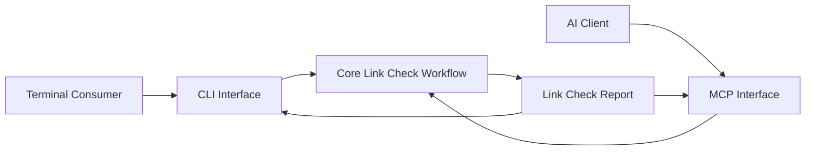

# Markdown Linkage Interface Specification

## Prerequities

- [Markdown Linkage Specification](../spec.md)
- [Link Check Delegation](../glossary/LinkCheckDelegation.md)
- [Link Check Report](../glossary/LinkCheckReport.md)
- [Check Specification Documents for Dead Links](../use-case/check-specification-documents-for-dead-links.md)

## Purpose

The interface layer exposes the dead-link checking capability through CLI and
MCP adapters over the same core workflow.

## Architecture

The CLI and MCP interfaces are sibling adapters. Neither invokes the other,
and neither contains link-checking or scope-building rules.

## Adapters

- [CLI Interface](cli.md) defines how terminal consumers invoke the
  capability.
- [MCP Interface](mcp.md) defines how AI clients invoke the capability.

## Cross-Interface Verification

Equivalent **Link Check Delegations** submitted through the CLI and MCP
interfaces must produce semantically identical **Link Check Reports**,
excluding adapter-specific envelopes and presentation.
