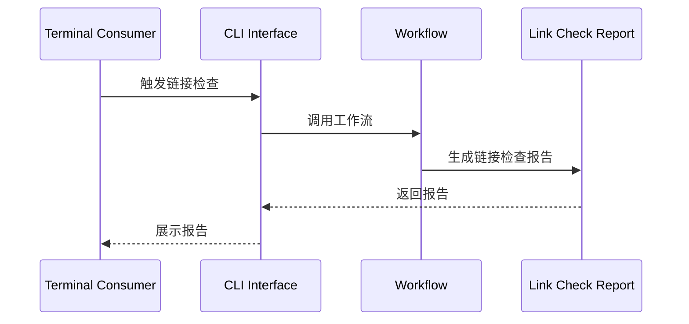
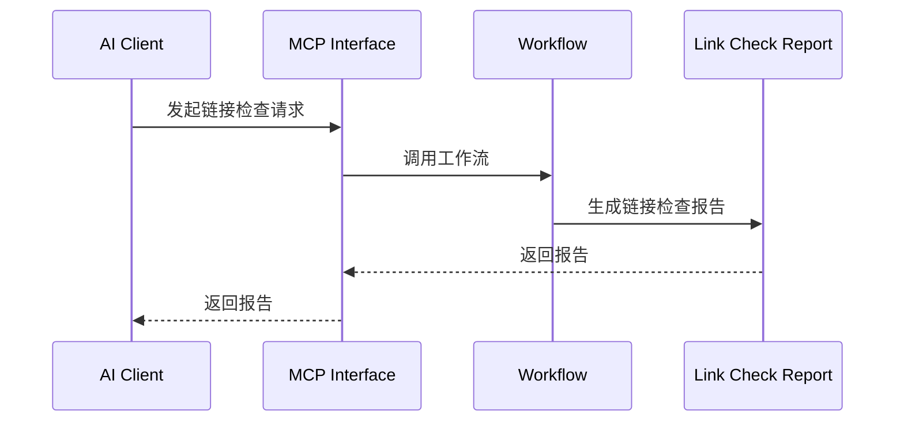

# Markdown 链接引用检查接入层设计

## 参考资料

- [Markdown 链接引用检查规约](../spec.md)
- [Link Check Delegation](../glossary/LinkCheckDelegation.md)
- [Link Check Report](../glossary/LinkCheckReport.md)
- [用例规约 -> 检查失效链接](../use-case/check-specification-documents-for-dead-links.md)

## 目的

接入层通过 `CLI` 和 `MCP`适配器，对外提供失效链接检查能力。

## 架构设计

## 适配器

- [CLI 接入层](cli.md)：定义终端使用方如何调用该能力。
- [MCP 接入层](mcp.md)：定义 AI 客户端如何调用该能力。

## 跨接口验证

通过 `CLI` 与 `MCP` 接口提交的等价 **Link Check Delegation** 必须产生语义一致的 **Link Check Report**，不考虑适配器特有的封装与呈现形式。
