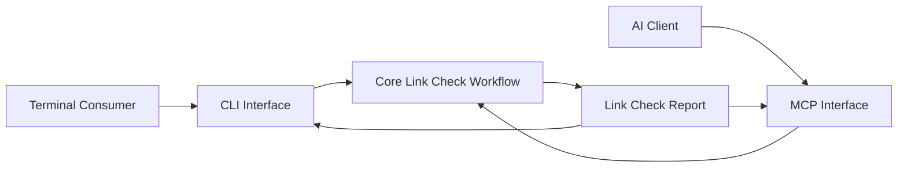

# MD Linkage Interface Specification

## Prerequities

- [Markdown Linkage Specification](../spec.md)
- [Link Check Delegation](../glossary/LinkCheckDelegation.md)
- [Link Check Scope](../glossary/LinkCheckScope.md)
- [Link Check Report](../glossary/LinkCheckReport.md)
- [Check Specification Documents for Dead Links](../use-case/check-specification-documents-for-dead-links.md)

## Purpose

The interface layer exposes the dead-link checking capability to final
consumers through CLI and MCP interfaces. Both interfaces translate a
consumer request into the same **Link Check Delegation**, invoke the same core
workflow, and present the resulting **Link Check Report**.

## Architecture

The CLI and MCP interfaces are sibling adapters over one core workflow:

- The CLI interface owns command arguments, CLI defaults, terminal output,
  and process exit status.
- The MCP interface owns MCP schemas, tool registration, protocol response
  formatting, and protocol errors.
- The core workflow owns scope construction, Markdown inspection, link
  resolution, traversal, and report construction.

Neither interface invokes the other. Neither interface contains link checking
or scope-building rules.

## Request Semantics

Both interfaces accept the information required to establish a **Link Check Delegation**:

- **Project Root:** The project boundary used to resolve and contain document
  paths.
- **Document Paths:** One or more concrete Markdown document paths. Globs are
  not supported.
- **Check Mode:** `LinkCheckMode.Shallow` or `LinkCheckMode.Recursive`.

## Result and Error Ownership

A completed workflow returns a **Link Check Report**. Scope issues and dead
links are successful findings in that report. Failures that prevent report
construction are mapped by the selected interface to its transport-specific
error mechanism.

## Responsibility Boundary

The interface layer may:

- validate command or protocol representation;
- apply the defaults defined by the selected interface contract;
- construct a **Link Check Delegation**;
- invoke the core workflow once;
- render or format the returned **Link Check Report**; and
- map a failure that prevents report construction to its transport-specific
  error mechanism.

The interface layer must not:

- determine whether a delegated document belongs to the scope;
- traverse referenced documents;
- read or parse Markdown for link-checking purposes;
- resolve or validate link targets;
- reinterpret scope issues or dead-link reasons; or
- maintain separate CLI and MCP implementations of the core workflow.

## Cross-Interface Verification

1. Submit equivalent requests through the CLI and MCP interfaces.
2. Verify that both requests produce semantically identical **Link Check
   Reports**, excluding transport-specific envelopes and presentation.
