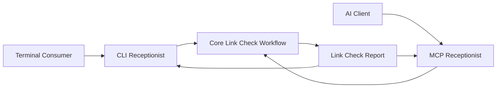

# Receptionist Layer

## Prerequities

- [CLI-First MCP Architecture](../../docs/adr/cli-first-mcp-architecture.md)
- [Link Check Delegation](glossary/LinkCheckDelegation.md)
- [Link Check Report](glossary/LinkCheckReport.md)
- [Check Specification Documents for Dead Links](use-case/check-specification-documents-for-dead-links.md)

## Purpose

The receptionist layer exposes the dead-link checking capability to final
consumers through a CLI command and an MCP tool. Both surfaces translate a
consumer request into the same **Link Check Delegation**, invoke the same core
workflow, and present the resulting **Link Check Report**.

The CLI is the package's primary interface. The MCP server is available through
the CLI's `mcp` subcommand and does not become an intermediate protocol for CLI
requests.

## Architecture



The receptionist paths are sibling adapters over one core workflow:

- The CLI receptionist owns command arguments, CLI defaults, terminal output,
  and process exit status.
- The MCP receptionist owns MCP schemas, tool registration, protocol response
  formatting, and protocol errors.
- The core workflow owns scope construction, Markdown inspection, link
  resolution, traversal, and report construction.

Neither receptionist invokes the other. Neither receptionist contains link
checking or scope-building rules.

## Shared Request Semantics

Both surfaces accept the information required to establish a **Link Check
Delegation**:

- **Project Root:** The project boundary used to resolve and contain document
  paths.
- **Document Paths:** One or more concrete Markdown document paths. Globs are
  not supported.
- **Check Mode:** `LinkCheckMode.Shallow` or `LinkCheckMode.Recursive`.

After applying surface-specific defaults and validation, each receptionist
constructs one **Link Check Delegation** and invokes the core workflow exactly
once. Equivalent CLI and MCP requests must produce semantically identical
**Link Check Reports**.

## CLI Receptionist

### Command

```text
md-linkage check <files...>
  [--root <path>]
  [--mode <shallow|recursive>]
  [--json]
```

### Input Rules

1. `files` contains at least one non-empty, concrete document path.
2. An omitted `--root` defaults to the process's current working directory.
3. A relative `--root` is resolved to an absolute path before the delegation is
   constructed.
4. An omitted `--mode` defaults to `LinkCheckMode.Shallow`.
5. File arguments remain as supplied. The core scope builder resolves them
   against the established project root.

### Output

The default output is a concise human-readable report containing:

- the number of documents admitted to the starting scope;
- the number of scope issues;
- the number of dead links;
- each scope issue, including its supplied path and reason; and
- each dead link, including its source, authored target, resolved target, and
  dead reason.

When `--json` is present, stdout contains only the serialized **Link Check
Report**. Diagnostics that are not part of the report are written to stderr.

### Exit Status

- `0`: The check completed with no scope issues and no dead links.
- `1`: The check completed and found at least one scope issue or dead link.
- `2`: The request was invalid, the project root could not be established, or
  another failure prevented a report from being produced.

Finding a scope issue or dead link is a completed check, not an invocation
failure. The nonzero status allows shell scripts and CI jobs to detect findings.

## MCP Receptionist

### Server Entry Point

```text
md-linkage mcp
```

The subcommand starts the MCP server over stdio. Protocol messages are written
to stdout, while logs and diagnostics are written to stderr.

### Tool

The read-only `check_specification_links` tool accepts:

```ts
interface CheckSpecificationLinksInput {
  /** Explicit absolute project boundary for this check. */
  readonly root: string;
  /** One or more concrete document paths. */
  readonly files: readonly string[];
  /** Defaults to LinkCheckMode.Shallow. */
  readonly mode?: LinkCheckMode;
}
```

The tool requires `root`; it never derives a project boundary from the MCP
server's current working directory. Its input schema rejects a relative or empty
root, an empty file collection, empty file paths, globs, and unsupported mode
values before the core workflow is invoked.

### Result

For a completed check, the tool returns:

- `structuredContent`: the complete **Link Check Report**; and
- `content`: a concise text summary containing document, scope-issue, and
  dead-link counts.

Scope issues and dead links remain successful tool results because they are
expected findings. Invalid input, an invalid project root, or another failure
that prevents report construction becomes an MCP error.

## Responsibility Boundary

The receptionist layer may:

- validate command or protocol representation;
- apply the defaults defined by this document;
- construct a **Link Check Delegation**;
- invoke the core workflow once;
- render or format the returned **Link Check Report**; and
- map a failure that prevents report construction to its transport-specific
  error mechanism.

The receptionist layer must not:

- determine whether a delegated document belongs to the scope;
- traverse referenced documents;
- read or parse Markdown for link-checking purposes;
- resolve or validate link targets;
- reinterpret scope issues or dead-link reasons; or
- maintain separate CLI and MCP implementations of the core workflow.

## Verification Requirements

### CLI Contract Tests

- Verify current-working-directory and shallow-mode defaults.
- Verify explicit root and mode mapping.
- Verify human-readable and JSON output.
- Verify exit statuses for clean reports, reports with findings, and failures
  that prevent report construction.

### MCP Contract Tests

- Verify input-schema constraints and the shallow-mode default.
- Verify that no implicit project root is accepted.
- Verify delegation mapping, structured report output, and text summaries.
- Verify MCP errors for invalid requests and failures that prevent report
  construction.

### Cross-Surface Acceptance Tests

- Submit equivalent requests through the CLI and MCP surfaces.
- Verify that both requests produce semantically identical **Link Check
  Reports**, excluding transport-specific envelopes and presentation.
