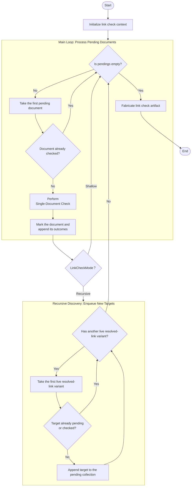

# 多文档检查

## 参考资料

- [单文档检查](./single-document-check-workflow.md)
- [Link Check Delegation](../../glossary/LinkCheckDelegation.md)
- [Link Check Scope](../../glossary/LinkCheckScope.md)
- [Resolved Specification Link](../../glossary/ResolvedSpecificationLink.md)

## 简述

检查一个有序文档集合，并可选择沿有效 Markdown 链接继续检查其他文档，同时聚合每个单文档检查结果。

## 输入

```ts
interface BatchLinkCheckTask {
  /** 用于解析链接的绝对项目边界与参照系。 */
  readonly root: string;
  /** 规范文档相对于项目的路径。 */
  readonly scope: LinkCheckScope;
  /** 用于处理后续文件的检查模式。 */
  readonly mode: LinkCheckMode;
}
```

## 输出

```ts
interface AtomicLinkCheckArtifact {
  readonly deadLinks: readonly DeadResolvedSpecificationLink[];
}
```

## 工作流


