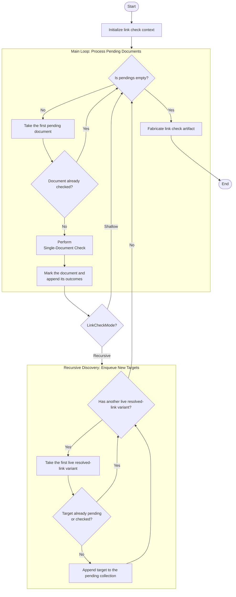

# Multiple-Document Check

## Prerequities

- [Single-Document Check](./single-document-check.md)
- [Link Check Delegation](../../glossary/LinkCheckDelegation.md)
- [Link Check Scope](../../glossary/LinkCheckScope.md)
- [Resolved Specification Link](../../glossary/ResolvedSpecificationLink.md)

## Brief Description

Check an ordered collection of documents and optionally follow live Markdown
links to additional documents, aggregating every single-document outcome.

## Input

```ts
interface BatchLinkCheckTask {
  /** Absolute project boundary and frame of reference for link resolution. */
  readonly root: string;
  /** Project-relative path of the specification document. */
  readonly scope: LinkCheckScope;
  /** Check mode for further files. */
  readonly mode: LinkCheckMode;
}
```

## Output

```ts
interface AtomicLinkCheckArtifact {
  readonly deadLinks: readonly DeadResolvedSpecificationLink[];
}
```

## Workflow


