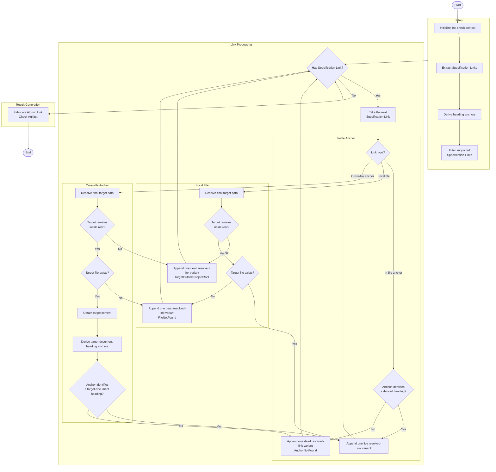

# Single-Document Check

## Prerequities

- [Specification Link](../../glossary/SpecificationLink.md)
- [Resolved Specification Link](../../glossary/ResolvedSpecificationLink.md)

## Brief Description

Validate every **Specification Link** in one document and classify
each link as either a live or dead **Resolved Specification Link** variant.

## Input

```ts
interface AtomicLinkCheckTask {
  /** Absolute project boundary and frame of reference for link resolution. */
  readonly root: string;
  /** Project-relative path of the specification document. */
  readonly filePath: string;
  /** Raw content of the specification document. */
  readonly content: string;
}
```

## Output

```ts
interface AtomicLinkCheckArtifact {
  readonly liveLinks: readonly LiveResolvedSpecificationLink[];
  readonly deadLinks: readonly DeadResolvedSpecificationLink[];
}
```

## Workflow


