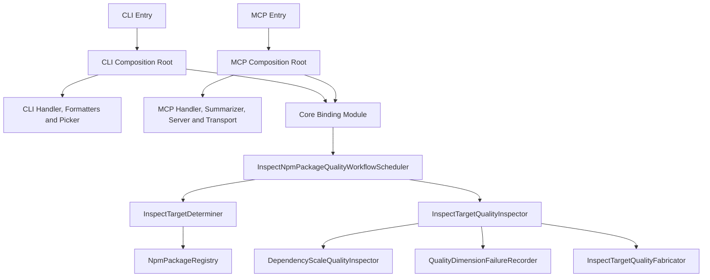

# npm-plus 依赖注入重构设计

## 参考资料

- [面向对象设计：检查 npm package 质量](design.md)
- [npm-plus 接入层设计](interfaces/spec.md)
- [npm-plus CLI 接入层设计](interfaces/cli.md)
- [npm-plus MCP 接入层设计](interfaces/mcp.md)
- [检查 npm package 质量](use-case/inspect-npm-package-quality.md)
- [CLI 与 MCP 双模式架构](../../docs/adr/cli-first-mcp-architecture.md)
- [MCP Server 开发指南](../../docs/conventions/mcp-development.md)
- [TypeScript 规范](../../docs/conventions/typescript.md)
- [自动化测试规范](../../docs/conventions/testing.md)

## 目的

重构 `npm-plus` 的对象实现与依赖装配，使其完整落实**面向对象设计：检查 npm
package 质量**，并让 CLI 与 MCP 两个入口分别通过 Inversify 组装同一套核心业务能力。

重构必须保持现有 CLI 命令、MCP tool contract、序列化结构、报告格式和错误语义不变。
本次重构不增加质量维度，不改变质量判断规则，也不引入评分、评级或采用建议。

## 设计原则

1. **面向对象设计：检查 npm package 质量**是领域对象、职责和协作关系的权威来源。
2. CLI 与 MCP 是两个独立入口，分别拥有 composition root、Container 和对象生命周期。
3. 两个入口共享核心 binding module，但不共享 Container、service instance 或可变状态。
4. 业务服务通过 constructor injection 声明必需协作者，不在业务代码中定位 Container。
5. 使用 concrete class 或 abstract class 作为 service identifier，不为一对一 class 映射保留
   无法在运行时解析的 TypeScript interface token。
6. Registry、process output、MCP server 和 transport 等真正的替换边界使用 abstract class。
7. Composition layer 只包含 binding 和对象装配，不包含业务规则或协议处理。

## 总体架构

图中的 `Core Binding Module` 表示可复用的 binding 定义。CLI composition root 与 MCP
composition root 分别将该 module 加载到自己的 Container，因此两套入口只共享装配规则，
不共享运行时容器。

## Composition root

### 核心 binding module

`src/composition/npm-package-quality-module.ts` 定义可复用的 Inversify `ContainerModule`，
负责以下 binding：

- `NpmPackageRegistry` 绑定至 `NodeNpmPackageRegistry`。
- `InspectTargetDeterminer` 绑定至自身。
- `DependencyScaleQualityInspector` 绑定至自身。
- `QualityDimensionFailureRecorder` 绑定至自身。
- `InspectTargetQualityFabricator` 绑定至自身。
- `InspectTargetQualityInspector` 绑定至自身。
- `InspectNpmPackageQualityWorkflowScheduler` 绑定至自身。

应用服务在单个入口 Container 内使用 singleton scope。核心 module 不创建 Container，也不
公开 Container instance。

### CLI composition root

`src/composition/cli-composition.ts` 每次调用时建立独立 Container，加载核心 binding
module，并绑定 CLI 专属对象：

- `InspectHandler`。
- `TerminalInspectResultFormatter`。
- `JSONInspectResultFormatter`。
- `InspectResultFormatterPicker`。
- `InspectHandlerDependencies` 的 Node.js runtime 实现。

`TerminalInspectResultFormatter` 与 `JSONInspectResultFormatter` 实现抽象契约
`InspectResultFormatter`；`InspectResultFormatterPicker` 根据 CLI option 选择实现，并以
`InspectResultFormatter` 作为返回类型。

`InspectHandlerDependencies` 是 CLI runtime 边界，负责写入 `stdout`。生产 binding 使用
`process.stdout`，测试可替换为 capturing implementation。CLI composition factory 返回已经
解析完成的 `InspectHandler`，不向入口暴露 Container。

### MCP composition root

`src/composition/mcp-composition.ts` 每次调用时建立另一个独立 Container，加载核心 binding
module，并绑定 MCP 专属对象：

- `McpHandler`。
- `InspectResultSummarizer`。
- MCP server factory。
- stdio transport factory。

`InspectResultSummarizer` 负责将原始 **InspectResult** 映射为 MCP 文本摘要。MCP server
factory 负责将核心 workflow 与 summarizer 适配为 MCP server；transport factory 负责建立
`StdioServerTransport`。这些对象都是协议或 runtime 边界，`McpHandler` 只协调 server 与
transport，不直接构造 SDK 对象。测试可以替换这些 binding，且不会启动真实 stdio。

### 入口

`src/index.ts` 只保留 Commander 命令声明、参数接收和入口选择：

- `inspect` action 从 CLI composition root 获取 `InspectHandler` 并运行。
- `mcp` action 从 MCP composition root 获取 `McpHandler` 并运行。

入口不得直接构造 core service、infrastructure adapter、formatter、MCP server 或 transport。

## 领域对象

以下概念按照**面向对象设计：检查 npm package 质量**落实为 class：

- `InspectDelegation`。
- `InspectTarget`。
- `InspectTargetQuality`。
- `InspectTargetDependencyScaleQuality`。
- `InspectTargetQualityException`。

`InspectTarget` 始终将 `tag` 固定为 `latest`，不接受调用方提供其他 tag。领域 class 使用
readonly property，并保持现有 JSON property 名称和嵌套结构，以确保 CLI 与 MCP 的序列化
contract 不变。

`DirectDependencyDeclarationFact` 与 `DirectDependencyCountFact` 是维度结果内部的纯数据记录，
不拥有独立行为或生命周期，可以继续使用 interface。

`InspectResult` 属于接入层结果 contract，不作为 core service，也不参与 Container binding。

## 核心协作

### 确定检查目标

`InspectTargetDeterminer` 通过 constructor 注入 `NpmPackageRegistry`。它使用
`InspectDelegation.packageName` 读取 Registry 的 latest manifest，并由 package 名称、响应中的
精确版本和固定 latest tag 建立 `InspectTarget`。

Registry 请求失败、响应无效或 package 不存在时，异常直接离开核心 workflow。此阶段不建立
质量结果。

### 检查依赖规模

`DependencyScaleQualityInspector` 接收已经确定的 `InspectTarget` 及其 manifest。它继续执行
现有规范化规则：

- 从运行时依赖中排除同时声明为 optional 的 package。
- 独立记录 peer dependency。
- 仅为明确声明的 optional peer 设置 `peerOptional`。
- 兼容 `bundledDependencies` 与 `bundleDependencies`。
- 使各分类数量与规范化声明保持一致。

成功时返回 `InspectTargetDependencyScaleQuality` 实例，不返回 object literal。

### 汇集检查目标质量

`InspectTargetQualityInspector` 通过 constructor 注入：

- `DependencyScaleQualityInspector`。
- `QualityDimensionFailureRecorder`。
- `InspectTargetQualityFabricator`。

它依次协调已经正式定义的质量维度。维度检查成功时保留领域结果；维度检查失败时，将异常交给
`QualityDimensionFailureRecorder` 转换为 `InspectTargetQualityException`。完成所有维度后，
`InspectTargetQualityFabricator` 使用成功结果和稳定异常建立 `InspectTargetQuality`。

`InspectTargetQualityFabricator` 是无状态 service。单次检查的临时结果保存在 method local
variable 中，不保存在 singleton instance 上，从而允许未来增加维度而不引入跨请求状态污染。

### 调度工作流

`InspectNpmPackageQualityWorkflowScheduler` 直接注入 `InspectTargetDeterminer` 和
`InspectTargetQualityInspector`。它先确定目标，再检查目标质量，最终返回目标与质量结果。

核心 service 不依赖 CLI、MCP SDK、Commander、process stream 或报告 formatter。

## DI token 与边界规则

- 设计中只有一个生产实现且不存在独立替换语义的 collaborator 使用 concrete class token。
- `NpmPackageRegistry` 保持 abstract class，因为它是 core 与外部 Registry 之间的 port。
- CLI output 使用 abstract runtime dependency，使进程 I/O 不进入 handler 业务流程。
- MCP server 与 transport 使用可替换的 class boundary，使 SDK 生命周期不进入 core 或
  `McpHandler` 的构造逻辑。
- 测试通过新建 Container 并替换边界 binding，不修改全局 Container。
- 禁止 string/symbol service identifier、service locator、全局 mutable Container 和 property
  injection。
- `@injectable()` 只标记需要由 Container 构造的 class。纯数据 class 和手工建立的结果对象不
  为了形式统一而添加 decorator。

## 错误处理

错误以目标确定是否完成为边界：

1. 目标确定前发生的输入、Registry 请求、Registry 响应和 package 不存在错误终止 workflow。
2. 目标确定后，单个质量维度异常不得终止其他维度。
3. `QualityDimensionFailureRecorder` 只公开异常的稳定 `name` 与 `message`，不泄漏 stack、cause
   或其他不可序列化数据。
4. `InspectTargetQualityFabricator` 省略失败维度字段，并将异常平铺到 `exceptions`。
5. CLI 继续以非零状态暴露输入或目标确定失败，不输出 `InspectResult`。
6. MCP adapter 继续将输入或目标确定失败映射为 MCP error response，不产生
   `structuredContent`。
7. 含有质量维度异常的结果在 CLI 与 MCP 中仍属于成功检查结果。

## 生命周期

- 每次启动 CLI action 或 MCP subcommand 时建立对应入口的 Container。
- CLI 与 MCP Container 互相不可见。
- 单个 Container 内的无状态 service 与 infrastructure adapter 使用 singleton scope。
- 工作流执行期间的目标、manifest、维度结果和异常是 method-local data，不存储于 service。
- 不在 module import 时创建 Container 或连接 transport。

## 测试策略

### 领域与核心单元测试

- 验证领域 class 保留现有序列化结构和固定 latest tag。
- 验证 `InspectTargetQualityFabricator` 正确汇集成功维度与平铺异常。
- 验证 `DependencyScaleQualityInspector` 返回领域实例，并保持全部依赖规范化规则。
- 验证 `InspectTargetQualityInspector` 在维度成功和失败时分别建立正确质量结果。
- 验证 workflow 的目标确定和质量检查顺序。

### Composition 测试

- 核心 module 加载到独立 Container 后能够解析完整 workflow。
- 将 `NpmPackageRegistry` 替换为 in-memory implementation 后，完整 workflow 使用替换实现。
- 分别解析 CLI 与 MCP handler，证明两个 composition root 均完整使用依赖注入。
- CLI 测试注入 capturing output，不写入真实 process stream。
- MCP 测试注入 fake server 与 transport，不启动真实 stdio。
- 测试不得依赖另一个测试创建的 Container 或 binding override。

### Contract 与端到端测试

- 保留 MCP schema、callback 和 in-memory transport contract test。
- 保留构建后 CLI E2E test。
- 继续验证 scoped package、JSON output、质量维度异常和目标确定错误。
- 最终运行 `test:unit`、`test:e2e`、`typecheck` 和 `build`。

所有非交互式命令通过 `mise exec --` 执行。

## 迁移范围

重构包括：

- 用核心 binding module 取代手工构造的 `NpmPackageQualityComposition`。
- 新增独立 CLI 与 MCP composition root。
- 补齐 `InspectTargetQualityFabricator` 和设计指定的领域 class。
- 将 core service 的一对一 interface constructor dependency 改为可解析的 class token。
- 为 CLI runtime 和 MCP SDK lifecycle 建立可替换注入边界。
- 调整相关测试以使用独立 Container 和明确的边界替换。

重构不包括：

- 新的质量维度。
- 新的 CLI option、MCP tool 或输出字段。
- 评分、评级、建议或 package 比较。
- Registry cache、并发调度、重试或 telemetry。
- 对其他 workspace package 的依赖注入重构。

## 完成标准

1. 实现中的领域 class、service 职责和协作关系与**面向对象设计：检查 npm package 质量**一致。
2. CLI 与 MCP 分别拥有独立 composition root，且两个入口均完全通过 constructor injection
   解析 handler 及其协作者。
3. CLI 与 MCP 只共享核心 binding module，不共享 Container 或运行时 instance。
4. Core 不依赖 Commander、MCP SDK、stdio 或 process output。
5. 不存在 interface metadata 无法解析、业务代码手工构造 collaborator 或全局 Container。
6. 公开 CLI/MCP contract 与重构前一致。
7. package unit test、E2E、typecheck 和 build 全部通过。
