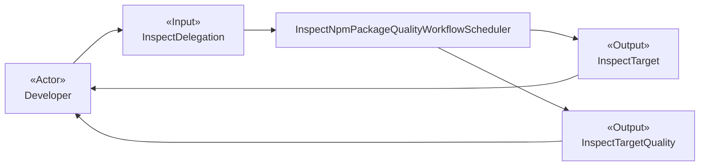

# 面向对象设计：检查 npm package 质量

## 参考资料

- [用例规约：检查 npm package 质量](use-case/inspect-npm-package-quality.md)
- [检查委托](glossary/inspect-delegation.md)
- [检查目标](glossary/inspect-target.md)
- [检查目标质量](glossary/inspect-target-quality.md)
- [检查目标依赖规模质量](glossary/raw-quality/inspect-target-dependency-scale-quality.md)
- [npm-plus 接入层设计](interfaces/spec.md)

## 候选类说明

### InspectDelegation

- **类名：**`InspectDelegation`
- **职责：**表示开发者提交的 package 检查委托，只保留需要检查最新发布版本的 package 名称。
- **协作者：**`Developer`、`InspectNpmPackageQualityWorkflowScheduler`、`InspectTargetDeterminer`

### InspectTarget

- **类名：**`InspectTarget`
- **职责：**表示通过官方 npm Registry 的 `latest` tag 确定、由 package 名称与精确版本共同确定的实际检查目标，并保留 `latest` tag。
- **协作者：**`InspectTargetDeterminer`、`InspectNpmPackageQualityWorkflowScheduler`、`InspectTargetQualityInspector`、`DependencyScaleQualityInspector`

### InspectTargetQuality

- **类名：**`InspectTargetQuality`
- **职责：**聚合检查目标各规定质量维度中能够获得的原始质量事实，以及无法获得维度数据时产生的稳定异常信息，不产生评分、评级或采用建议。
- **协作者：**`InspectNpmPackageQualityWorkflowScheduler`、`InspectTargetQualityInspector`、`InspectTargetQualityFabricator`、`InspectTargetDependencyScaleQuality`、`InspectTargetQualityException`

### InspectTargetDependencyScaleQuality

- **类名：**`InspectTargetDependencyScaleQuality`
- **职责：**表示检查目标在依赖规模维度上的客观事实，包括规范化后的直接依赖声明及与声明一致的分类数量。
- **协作者：**`DependencyScaleQualityInspector`、`InspectTargetQualityFabricator`

### InspectTargetQualityException

- **类名：**`InspectTargetQualityException`
- **职责：**表示某个质量维度无法顺利获得数据时对外公开的稳定异常事实，只保留异常名称和消息。
- **协作者：**`QualityDimensionFailureRecorder`、`InspectTargetQualityFabricator`、`InspectTargetQuality`

### InspectNpmPackageQualityWorkflowScheduler

- **类名：**`InspectNpmPackageQualityWorkflowScheduler`
- **职责：**协调检查 npm package 质量的完整用例：接受检查委托，先确定精确检查目标，再收集规定质量维度的客观事实，最终向开发者提供检查目标与检查目标质量。
- **协作者：**`Developer`、`InspectDelegation`、`InspectTargetDeterminer`、`InspectTargetQualityInspector`、`InspectTarget`、`InspectTargetQuality`

### InspectTargetDeterminer

- **类名：**`InspectTargetDeterminer`
- **职责：**通过官方 npm Registry 读取 package 的 `latest` manifest，建立包含实际精确版本和 `latest` tag 的检查目标；package 不存在时终止用例并抛出 `PackageNotFound`。
- **协作者：**`InspectNpmPackageQualityWorkflowScheduler`、`InspectDelegation`、`NpmPackageRegistry`、`InspectTarget`

### InspectTargetQualityInspector

- **类名：**`InspectTargetQualityInspector`
- **职责：**协调所有规定质量维度的检查，保留每个成功维度的原始质量事实；单个维度失败时记录稳定异常并继续其他维度，最后形成检查目标质量。
- **协作者：**`InspectNpmPackageQualityWorkflowScheduler`、`InspectTarget`、`DependencyScaleQualityInspector`、`QualityDimensionFailureRecorder`、`InspectTargetQualityFabricator`、`InspectTargetQuality`

### DependencyScaleQualityInspector

- **类名：**`DependencyScaleQualityInspector`
- **职责：**根据检查目标精确版本的发布内容建立依赖规模质量：规范化运行时、可选和对等依赖声明，处理重叠声明、可选对等依赖和捆绑依赖标记，并计算与声明一致的非负分类数量；不检查间接依赖或开发依赖。
- **协作者：**`InspectTargetQualityInspector`、`InspectTarget`、`InspectTargetDependencyScaleQuality`

### QualityDimensionFailureRecorder

- **类名：**`QualityDimensionFailureRecorder`
- **职责：**将质量维度检查期间发生的异常转换为只包含稳定名称与消息的检查目标质量异常，使该维度以失败评估结束而不终止其他维度检查。
- **协作者：**`InspectTargetQualityInspector`、`InspectTargetQualityException`、`InspectTargetQualityFabricator`

### InspectTargetQualityFabricator

- **类名：**`InspectTargetQualityFabricator`
- **职责：**汇集成功获得的各维度原始质量事实与平铺的检查目标质量异常，省略失败维度的数据字段，并形成完整、客观的检查目标质量。
- **协作者：**`InspectTargetQualityInspector`、`InspectTargetDependencyScaleQuality`、`InspectTargetQualityException`、`InspectTargetQuality`

## 外部参与者

- **Developer——外部行动者：**提交 package 检查委托，接收已经确定的检查目标及各质量维度的客观事实，并自行评价该 package 是否适合使用。

## 候选类可视化

### 检查 npm package 质量

```mermaid
classDiagram
    direction LR

    class InspectNpmPackageQualityWorkflowScheduler
    <<Caller>> InspectNpmPackageQualityWorkflowScheduler
    class InspectDelegation
    <<Input>> InspectDelegation
    class InspectTargetDeterminer
    class InspectTargetQualityInspector
    class InspectTarget
    <<Output>> InspectTarget
    class InspectTargetQuality
    <<Output>> InspectTargetQuality

    InspectNpmPackageQualityWorkflowScheduler ..> InspectDelegation
    InspectNpmPackageQualityWorkflowScheduler ..> InspectTargetDeterminer
    InspectNpmPackageQualityWorkflowScheduler ..> InspectTargetQualityInspector
    InspectNpmPackageQualityWorkflowScheduler ..> InspectTarget
    InspectNpmPackageQualityWorkflowScheduler ..> InspectTargetQuality
    InspectTargetDeterminer ..> InspectDelegation
    InspectTargetDeterminer ..> InspectTarget
    InspectTargetQualityInspector ..> InspectTarget
    InspectTargetQualityInspector ..> InspectTargetQuality
```

### 确定检查目标

`InspectTargetDeterminer` 通过 `NpmPackageRegistry` 读取官方 npm Registry 的 `latest` manifest，并以响应中的精确版本建立检查目标。当 package 不存在时，Registry 报告 `PackageNotFound`，目标确定流程终止且不生成检查结果。

```mermaid
classDiagram
    direction LR

    class InspectNpmPackageQualityWorkflowScheduler
    <<Caller>> InspectNpmPackageQualityWorkflowScheduler
    class InspectDelegation
    <<Input>> InspectDelegation
    class InspectTargetDeterminer
    class NpmPackageRegistry
    class InspectTarget
    <<Output>> InspectTarget

    InspectNpmPackageQualityWorkflowScheduler ..> InspectTargetDeterminer
    InspectTargetDeterminer ..> InspectDelegation
    InspectTargetDeterminer ..> NpmPackageRegistry
    InspectTargetDeterminer ..> InspectTarget
```

### 汇集检查目标质量

当任一质量维度检查发生异常时，`InspectTargetQualityInspector` 将异常交给 `QualityDimensionFailureRecorder` 转换为 `InspectTargetQualityException`，随后继续检查其他规定维度。`InspectTargetQualityFabricator` 只纳入成功维度的数据，并将失败维度的异常平铺到最终结果中。

```mermaid
classDiagram
    direction LR

    class InspectNpmPackageQualityWorkflowScheduler
    <<Caller>> InspectNpmPackageQualityWorkflowScheduler
    class InspectTarget
    <<Input>> InspectTarget
    class InspectTargetQualityInspector
    class DependencyScaleQualityInspector
    class QualityDimensionFailureRecorder
    class InspectTargetQualityFabricator
    class InspectTargetDependencyScaleQuality
    class InspectTargetQualityException
    class InspectTargetQuality
    <<Output>> InspectTargetQuality

    InspectNpmPackageQualityWorkflowScheduler ..> InspectTargetQualityInspector
    InspectTargetQualityInspector ..> InspectTarget
    InspectTargetQualityInspector ..> DependencyScaleQualityInspector
    InspectTargetQualityInspector ..> QualityDimensionFailureRecorder
    InspectTargetQualityInspector ..> InspectTargetQualityFabricator
    InspectTargetQualityInspector ..> InspectTargetQuality
    DependencyScaleQualityInspector ..> InspectTarget
    DependencyScaleQualityInspector ..> InspectTargetDependencyScaleQuality
    QualityDimensionFailureRecorder ..> InspectTargetQualityException
    InspectTargetQualityFabricator ..> InspectTargetDependencyScaleQuality
    InspectTargetQualityFabricator ..> InspectTargetQualityException
    InspectTargetQualityFabricator ..> InspectTargetQuality
```

