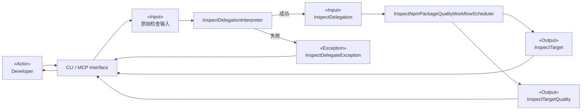

# 面向对象设计：检查 npm package 质量

## 参考资料

- [用例规约：检查 npm package 质量](use-case/inspect-npm-package-quality.md)
- [检查委托](glossary/inspect-delegation.md)
- [检查目标](glossary/inspect-target.md)
- [检查目标质量](glossary/inspect-target-quality.md)
- [检查目标依赖规模质量](glossary/raw-quality/inspect-target-dependency-scale-quality.md)
- [npm-plus 接入层设计](interfaces/spec.md)
- [InspectDelegationInterpreter](interfaces/workers/inspect-delegation-interpreter.md)
- [InspectTargetDeterminer](workers/inspect-target-determiner.md)

## 候选类说明

### InspectDelegationInterpreter

- **类名：**`InspectDelegationInterpreter`
- **职责：**将 CLI 或 MCP 协议层提取的原始检查输入解释为有效的检查委托；输入不满足委托约束时产生只包含稳定错误码和消息的委托解释异常，不向业务层提供部分委托。
- **协作者：**`CLI Interface`、`MCP Interface`、`InspectDelegation`、`InspectDelegateException`

### InspectDelegateException

- **类名：**`InspectDelegateException`
- **职责：**表示接入层无法建立有效检查委托时对外公开的稳定异常，只保留错误码和消息，不公开底层实现信息。
- **协作者：**`InspectDelegationInterpreter`、`CLI Interface`、`MCP Interface`

### InspectDelegation

- **类名：**`InspectDelegation`
- **职责：**表示开发者提交的 package 检查委托，保留 package 名称以及可选的精确版本号或 tag；未提供版本标识时表达使用 `latest` tag 的意图。
- **协作者：**`InspectDelegationInterpreter`、`InspectNpmPackageQualityWorkflowScheduler`、`InspectTargetDeterminer`、`PackageVersionIdentifierInterpreter`、`PackageExistenceChecker`、`ExactVersionExistenceChecker`、`PackageTagResolver`

### InspectTarget

- **类名：**`InspectTarget`
- **职责：**表示已经完成版本解释和存在性确认、由 package 名称与精确版本共同确定的实际检查目标；通过 tag 确定版本时保留该 tag。
- **协作者：**`InspectTargetDeterminer`、`InspectNpmPackageQualityWorkflowScheduler`、`InspectTargetQualityInspector`、`DependencyScaleQualityInspector`

### InspectTargetQuality

- **类名：**`InspectTargetQuality`
- **职责：**聚合检查目标各规定质量维度中能够获得的原始质量事实，以及无法获得维度数据时产生的稳定异常信息，不产生评分、评级或采用建议。
- **协作者：**`InspectNpmPackageQualityWorkflowScheduler`、`InspectTargetQualityInspector`、`InspectTargetQualityFabricator`、`InspectTargetDependencyScaleQuality`、`InspectTargetQualityException`

### InspectTargetDependencyScaleQuality

- **类名：**`InspectTargetDependencyScaleQuality`
- **职责：**表示检查目标在依赖规模维度上的客观事实，包括规范化后的直接依赖声明及与声明一致的分类数量。
- **协作者：**`DependencyScaleQualityInspector`、`InspectTargetQualityFabricator`

### InspectTargetQualityException

- **类名：**`InspectTargetQualityException`
- **职责：**表示某个质量维度无法顺利获得数据时对外公开的稳定异常事实，只保留异常名称和消息。
- **协作者：**`QualityDimensionFailureRecorder`、`InspectTargetQualityFabricator`、`InspectTargetQuality`

### InspectNpmPackageQualityWorkflowScheduler

- **类名：**`InspectNpmPackageQualityWorkflowScheduler`
- **职责：**协调检查 npm package 质量的完整用例：接受检查委托，先确定精确检查目标，再收集规定质量维度的客观事实，最终向开发者提供检查目标与检查目标质量。
- **协作者：**`Developer`、`InspectDelegation`、`InspectTargetDeterminer`、`InspectTargetQualityInspector`、`InspectTarget`、`InspectTargetQuality`

### InspectTargetDeterminer

- **类名：**`InspectTargetDeterminer`
- **职责：**协调检查目标确定子流程，解释版本标识，确认 package 与精确版本存在，并建立无版本不确定性的检查目标；任一目标确定规则失败时终止用例并产生对应的目标确定异常。
- **协作者：**`InspectNpmPackageQualityWorkflowScheduler`、`InspectDelegation`、`PackageVersionIdentifierInterpreter`、`PackageExistenceChecker`、`ExactVersionExistenceChecker`、`PackageTagResolver`、`InspectTarget`、`InspectTargetException`

### InspectTargetException

- **类名：**`InspectTargetException`
- **职责：**表示业务层无法确定检查目标时对外公开的稳定异常，只保留错误码和消息，不公开 Registry 或其他底层实现信息。
- **协作者：**`InspectTargetDeterminer`、`InspectNpmPackageQualityWorkflowScheduler`

### PackageVersionIdentifierInterpreter

- **类名：**`PackageVersionIdentifierInterpreter`
- **职责：**判断检查委托中的版本标识是精确版本号、tag 还是缺省值；缺省时将 `latest` 作为用于确定目标版本的 tag。
- **协作者：**`InspectDelegation`、`InspectTargetDeterminer`、`ExactVersionExistenceChecker`、`PackageTagResolver`

### PackageExistenceChecker

- **类名：**`PackageExistenceChecker`
- **职责：**确认检查委托指定的 package 是否存在；不存在时检测并报告 `PackageNotFound`。
- **协作者：**`InspectDelegation`、`InspectTargetDeterminer`

### ExactVersionExistenceChecker

- **类名：**`ExactVersionExistenceChecker`
- **职责：**确认直接指定或由 tag 得到的精确版本是否存在；直接指定的版本不存在时检测并报告 `ExactVersionNotFound`，tag 映射出的版本不存在时向 tag 解析职责提供不可解析事实。
- **协作者：**`InspectDelegation`、`InspectTargetDeterminer`、`PackageVersionIdentifierInterpreter`、`PackageTagResolver`

### PackageTagResolver

- **类名：**`PackageTagResolver`
- **职责：**将显式 tag 或缺省的 `latest` tag 确定为存在的精确版本，并保留用于确定版本的 tag；tag 不存在时报告 `TagNotFound`，映射出的精确版本不存在时报告 `TagUnresolvable`。
- **协作者：**`InspectDelegation`、`InspectTargetDeterminer`、`PackageVersionIdentifierInterpreter`、`ExactVersionExistenceChecker`

### InspectTargetQualityInspector

- **类名：**`InspectTargetQualityInspector`
- **职责：**协调所有规定质量维度的检查，保留每个成功维度的原始质量事实；单个维度失败时记录稳定异常并继续其他维度，最后形成检查目标质量。
- **协作者：**`InspectNpmPackageQualityWorkflowScheduler`、`InspectTarget`、`DependencyScaleQualityInspector`、`QualityDimensionFailureRecorder`、`InspectTargetQualityFabricator`、`InspectTargetQuality`

### DependencyScaleQualityInspector

- **类名：**`DependencyScaleQualityInspector`
- **职责：**根据检查目标精确版本的发布内容建立依赖规模质量：规范化运行时、可选和对等依赖声明，处理重叠声明、可选对等依赖和捆绑依赖标记，并计算与声明一致的非负分类数量；不检查间接依赖或开发依赖。
- **协作者：**`InspectTargetQualityInspector`、`InspectTarget`、`InspectTargetDependencyScaleQuality`

### QualityDimensionFailureRecorder

- **类名：**`QualityDimensionFailureRecorder`
- **职责：**将质量维度检查期间发生的异常转换为只包含稳定名称与消息的检查目标质量异常，使该维度以失败评估结束而不终止其他维度检查。
- **协作者：**`InspectTargetQualityInspector`、`InspectTargetQualityException`、`InspectTargetQualityFabricator`

### InspectTargetQualityFabricator

- **类名：**`InspectTargetQualityFabricator`
- **职责：**汇集成功获得的各维度原始质量事实与平铺的检查目标质量异常，省略失败维度的数据字段，并形成完整、客观的检查目标质量。
- **协作者：**`InspectTargetQualityInspector`、`InspectTargetDependencyScaleQuality`、`InspectTargetQualityException`、`InspectTargetQuality`

## 外部参与者

- **Developer——外部行动者：**通过 CLI 或 MCP 提交 package 名称和可选版本标识，接收已经确定的检查目标及各质量维度的客观事实，并自行评价该 package 是否适合使用。

## 候选类可视化

### 检查 npm package 质量

```mermaid
classDiagram
    direction LR

    class InspectNpmPackageQualityWorkflowScheduler
    <<Caller>> InspectNpmPackageQualityWorkflowScheduler
    class InspectDelegationInterpreter
    class InspectDelegateException
    class InspectDelegation
    <<Input>> InspectDelegation
    class InspectTargetDeterminer
    class InspectTargetQualityInspector
    class InspectTarget
    <<Output>> InspectTarget
    class InspectTargetQuality
    <<Output>> InspectTargetQuality

    InspectDelegationInterpreter ..> InspectDelegation
    InspectDelegationInterpreter ..> InspectDelegateException
    InspectNpmPackageQualityWorkflowScheduler ..> InspectDelegation
    InspectNpmPackageQualityWorkflowScheduler ..> InspectTargetDeterminer
    InspectNpmPackageQualityWorkflowScheduler ..> InspectTargetQualityInspector
    InspectNpmPackageQualityWorkflowScheduler ..> InspectTarget
    InspectNpmPackageQualityWorkflowScheduler ..> InspectTargetQuality
    InspectTargetDeterminer ..> InspectDelegation
    InspectTargetDeterminer ..> InspectTarget
    InspectTargetQualityInspector ..> InspectTarget
    InspectTargetQualityInspector ..> InspectTargetQuality
```

### 确定检查目标

当 package 不存在时，`PackageExistenceChecker` 检测 `PACKAGE_NOT_FOUND`。当直接指定的精确版本不存在时，`ExactVersionExistenceChecker` 检测 `EXACT_VERSION_NOT_FOUND`。当 tag 不存在或其映射版本不存在时，`PackageTagResolver` 分别检测 `TAG_NOT_FOUND` 或 `TAG_UNRESOLVABLE`。`InspectTargetDeterminer` 负责终止当前用例并产生包含对应稳定错误码的 `InspectTargetException`，不生成任何检查结果。

```mermaid
classDiagram
    direction LR

    class InspectNpmPackageQualityWorkflowScheduler
    <<Caller>> InspectNpmPackageQualityWorkflowScheduler
    class InspectDelegation
    <<Input>> InspectDelegation
    class InspectTargetDeterminer
    class PackageVersionIdentifierInterpreter
    class PackageExistenceChecker
    class ExactVersionExistenceChecker
    class PackageTagResolver
    class InspectTarget
    <<Output>> InspectTarget
    class InspectTargetException
    <<Exception>> InspectTargetException

    InspectNpmPackageQualityWorkflowScheduler ..> InspectTargetDeterminer
    InspectTargetDeterminer ..> InspectDelegation
    InspectTargetDeterminer ..> PackageVersionIdentifierInterpreter
    InspectTargetDeterminer ..> PackageExistenceChecker
    InspectTargetDeterminer ..> ExactVersionExistenceChecker
    InspectTargetDeterminer ..> PackageTagResolver
    InspectTargetDeterminer ..> InspectTarget
    InspectTargetDeterminer ..> InspectTargetException
    PackageVersionIdentifierInterpreter ..> InspectDelegation
    PackageVersionIdentifierInterpreter ..> ExactVersionExistenceChecker
    PackageVersionIdentifierInterpreter ..> PackageTagResolver
    PackageExistenceChecker ..> InspectDelegation
    ExactVersionExistenceChecker ..> InspectDelegation
    PackageTagResolver ..> InspectDelegation
    PackageTagResolver ..> ExactVersionExistenceChecker
```

### 汇集检查目标质量

当任一质量维度检查发生异常时，`InspectTargetQualityInspector` 将异常交给 `QualityDimensionFailureRecorder` 转换为 `InspectTargetQualityException`，随后继续检查其他规定维度。`InspectTargetQualityFabricator` 只纳入成功维度的数据，并将失败维度的异常平铺到最终结果中。

```mermaid
classDiagram
    direction LR

    class InspectNpmPackageQualityWorkflowScheduler
    <<Caller>> InspectNpmPackageQualityWorkflowScheduler
    class InspectTarget
    <<Input>> InspectTarget
    class InspectTargetQualityInspector
    class DependencyScaleQualityInspector
    class QualityDimensionFailureRecorder
    class InspectTargetQualityFabricator
    class InspectTargetDependencyScaleQuality
    class InspectTargetQualityException
    class InspectTargetQuality
    <<Output>> InspectTargetQuality

    InspectNpmPackageQualityWorkflowScheduler ..> InspectTargetQualityInspector
    InspectTargetQualityInspector ..> InspectTarget
    InspectTargetQualityInspector ..> DependencyScaleQualityInspector
    InspectTargetQualityInspector ..> QualityDimensionFailureRecorder
    InspectTargetQualityInspector ..> InspectTargetQualityFabricator
    InspectTargetQualityInspector ..> InspectTargetQuality
    DependencyScaleQualityInspector ..> InspectTarget
    DependencyScaleQualityInspector ..> InspectTargetDependencyScaleQuality
    QualityDimensionFailureRecorder ..> InspectTargetQualityException
    InspectTargetQualityFabricator ..> InspectTargetDependencyScaleQuality
    InspectTargetQualityFabricator ..> InspectTargetQualityException
    InspectTargetQualityFabricator ..> InspectTargetQuality
```

