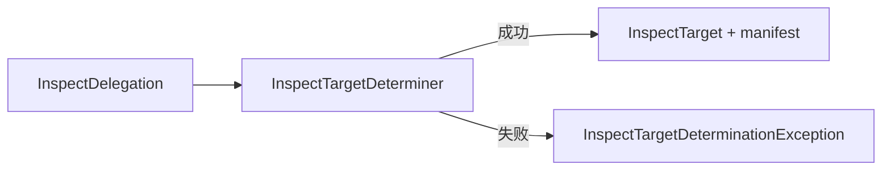

# InspectTargetDeterminer

## 参考资料

- [检查 npm package 质量](use-case/inspect-npm-package-quality.md)
- [InspectDelegation](glossary/inspect-delegation.md)
- [InspectTarget](glossary/inspect-target.md)
- [InspectTargetQuality](glossary/inspect-target-quality.md)
- [InspectDelegationInterpreter](interfaces/inspect-delegation-interpreter.md)

## 定义

`InspectTargetDeterminer` 是业务层 Worker，负责依据 **InspectDelegation** 确定实际接受质量检查的
package 及其精确版本，并建立不存在版本不确定性的 **InspectTarget**。

## 责任目标

解释检查委托中的版本标识，确认 package 与版本存在，为后续质量检查提供唯一的检查目标及其
发布 manifest。

## 输入与输出

输入是接入层已经建立的有效 **InspectDelegation**。

成功输出包括：

- 唯一的 **InspectTarget**。
- 与检查目标精确版本对应的 manifest。

Worker 无法确定检查目标时不产生部分输出，只产生目标确定异常。

## 职责

- 将缺省版本标识解释为 `latest` tag。
- 区分精确版本与 tag。
- 通过 Registry 确认 package 存在。
- 确认直接指定的精确版本存在。
- 将 tag 解析为存在的精确版本。
- 通过 tag 确定版本时，在 **InspectTarget** 中保留该 tag。
- 为成功确定的检查目标提供对应 manifest。

## 决策规则

1. 没有版本标识时，使用 `latest` tag 确定版本。
2. 版本标识是精确版本时，直接确认该版本存在。
3. 版本标识是 tag 时，先取得 tag 指向的精确版本，再确认该版本存在。
4. package、精确版本或 tag 无法确认时，不建立 **InspectTarget**。
5. Registry 无法提供有效数据时，不以不完整或推测数据建立 **InspectTarget**。

## 运行机制



### 成功

Worker 完成版本解释和存在性确认后，原子地提供 **InspectTarget** 及对应 manifest。后续质量维度
Worker 只处理已经成功确定的目标。

### 异常

目标确定异常是本 Worker 的失败产物，只包含固定语义的 `code` 和可变的 `message`：

```ts
interface InspectTargetDeterminationException {
  readonly code: InspectTargetDeterminationExceptionCode;
  readonly message: string;
}

enum InspectTargetDeterminationExceptionCode {
  PackageNotFound = "PACKAGE_NOT_FOUND",
  ExactVersionNotFound = "EXACT_VERSION_NOT_FOUND",
  TagNotFound = "TAG_NOT_FOUND",
  TagUnresolvable = "TAG_UNRESOLVABLE",
  RegistryRequestFailed = "REGISTRY_REQUEST_FAILED",
  RegistryResponseInvalid = "REGISTRY_RESPONSE_INVALID",
  InspectTargetDeterminationFailed = "INSPECT_TARGET_DETERMINATION_FAILED",
}
```

- `PACKAGE_NOT_FOUND`：指定 package 不存在。
- `EXACT_VERSION_NOT_FOUND`：指定的精确版本不存在。
- `TAG_NOT_FOUND`：指定或默认使用的 tag 不存在。
- `TAG_UNRESOLVABLE`：tag 指向的精确版本不存在。
- `REGISTRY_REQUEST_FAILED`：无法完成确定检查目标所需的 Registry 请求。
- `REGISTRY_RESPONSE_INVALID`：Registry 响应无法提供确定检查目标所需的有效数据。
- `INSPECT_TARGET_DETERMINATION_FAILED`：其他内部异常使 Worker 无法安全确定检查目标。

错误码是稳定契约，调用方不得根据 `message` 判断错误类型。公开异常不得包含 `stack`、`cause`、
原始网络错误、JSON 解析错误或 schema 校验详情。

Registry 是本 Worker 的外部依赖。Registry 失败必须转换为本 Worker 声明的异常代码，不得直接
穿透 Worker 边界。能够识别具体语义的失败不得转换为
`INSPECT_TARGET_DETERMINATION_FAILED`。

## 职责边界

- 原始输入到 **InspectDelegation** 的转换属于 **InspectDelegationInterpreter**。
- 本 Worker 不修正或重新解释无效的原始输入。
- 本 Worker 不检查任何质量维度，也不建立 **InspectTargetQuality**。
- 成功建立 **InspectTarget** 后发生的质量维度异常继续记录在
  `InspectTargetQuality.exceptions` 中，不转换为目标确定异常。
- 目标确定异常表示检查用例失败，不生成 `InspectResult`。

## 验收约束

- 每个有效 **InspectDelegation** 最多产生一个唯一 **InspectTarget**。
- 失败时不得产生部分 **InspectTarget** 或 manifest。
- Worker 只公开已经声明的目标确定异常代码。
- 未识别内部异常必须转换为 `INSPECT_TARGET_DETERMINATION_FAILED`。
- 公开异常只包含 `code` 和 `message`。
- 质量维度异常不得转换为目标确定异常。

## 非目标

- 建立或校验 **InspectDelegation**。
- 定义 CLI 或 MCP 的错误呈现格式。
- 定义固定错误消息。
- 增加重试、日志、telemetry 或诊断标识。
- 保存或公开原始异常的 `stack` 与 `cause`。
