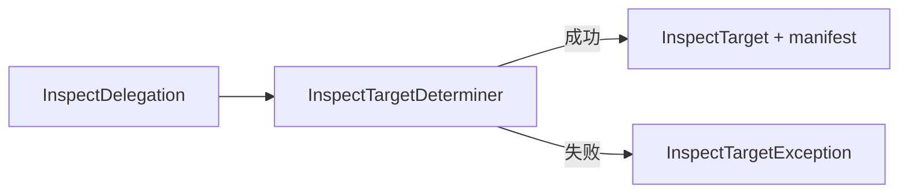

# InspectTargetDeterminer

## 关联文档

- [检查 npm package 质量](use-case/inspect-npm-package-quality.md)
- [InspectDelegation](glossary/inspect-delegation.md)
- [InspectTarget](glossary/inspect-target.md)

## 定义

业务层 `Worker`，负责依据 **InspectDelegation** 确定实际接受质量检查的 `package` 及其精确版本，并建立明确的 **InspectTarget**。

## 输入

接入层已经建立的有效 **InspectDelegation**。

## 输出产物

成功场景：**InspectTarget** 及对应的 `manifest`。
失败场景：**InspectTargetException**。

## 运行机制



### 构造成功

`Worker` 按照约定解释版本标识、确认 `package` 与精确版本存在，并实例化 **InspectTarget**。成功产物进入质量检查流程。

### 构造异常

```ts
interface InspectTargetException {
  readonly code: InspectTargetExceptionCode;
  readonly message: string;
}

enum InspectTargetExceptionCode {
  PackageNotFound = "PACKAGE_NOT_FOUND",
  ExactVersionNotFound = "EXACT_VERSION_NOT_FOUND",
  TagNotFound = "TAG_NOT_FOUND",
  TagUnresolvable = "TAG_UNRESOLVABLE",
  RegistryError = "REGISTRY_ERROR",
  InspectTargetDeterminationFailed = "INSPECT_TARGET_DETERMINATION_FAILED",
}
```

- `PACKAGE_NOT_FOUND`：指定的 `package` 不存在。
- `EXACT_VERSION_NOT_FOUND`：指定的精确版本不存在。
- `TAG_NOT_FOUND`：指定或默认使用的 `tag` 不存在。
- `TAG_UNRESOLVABLE`：`tag` 指向的精确版本不存在。
- `REGISTRY_ERROR`：Registry 请求失败或响应无效，无法提供确定检查目标所需的数据。
- `INSPECT_TARGET_DETERMINATION_FAILED`：未知内部异常，使 `Worker` 无法安全确定检查目标。

错误码是稳定契约，调用方不得根据 `message` 判断错误类型，且异常不得包含 `stack`、`cause`、
原始网络错误、JSON 解析错误、`schema` 校验详情或其他底层实现信息。

Registry 请求或响应异常必须转换为 `REGISTRY_ERROR`。其他未识别内部异常必须转换为
`INSPECT_TARGET_DETERMINATION_FAILED`。能够识别具体语义的失败不得转换为该兜底错误码。

成功建立 **InspectTarget** 后发生的质量维度异常继续记录在 `InspectTargetQuality.exceptions` 中，
不得转换为 **InspectTargetException**。
