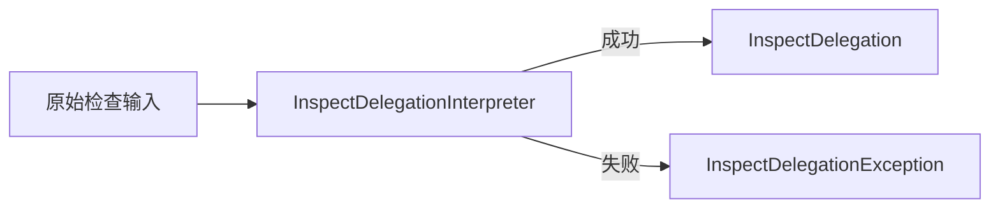

# InspectDelegationInterpreter

## 参考资料

- [npm-plus 接入层设计](spec.md)
- [CLI 接入层](cli.md)
- [MCP 接入层](mcp.md)
- [InspectDelegation](../glossary/inspect-delegation.md)
- [InspectTargetDeterminer](../inspect-target-determiner.md)

## 定义

`InspectDelegationInterpreter` 是接入层 Worker，负责将协议层提取的原始检查输入解释为有效的
**InspectDelegation**。

## 责任目标

保留使用方提交的 package 名称和可选版本标识，并确保只有满足检查委托约束的输入才能进入
业务层。

## 输入与输出

输入是 CLI 或 MCP 协议层已经提取的 package 名称和可选版本标识。协议本身无法解析的请求不
属于本 Worker 的输入。

成功输出是有效的 **InspectDelegation**。Worker 无法建立检查委托时不产生部分输出，只产生
委托解释异常。

## 职责

- 确认 package 名称存在且不为空。
- 确认调用方提供的版本标识不为空。
- 拒绝当前能力不支持的版本范围表达式。
- 保持有效 package 名称与版本标识的原始文本值。
- 建立 **InspectDelegation** 并交给业务层。

CLI 和 MCP 可以采用不同的协议解析方式，但必须共享本 Worker 的委托建立规则与异常语义。

## 决策规则

1. package 名称缺失或为空时，不建立 **InspectDelegation**。
2. 调用方没有提供版本标识时，建立不含版本标识的 **InspectDelegation**。
3. 调用方提供空版本标识时，不建立 **InspectDelegation**。
4. 版本标识是版本范围表达式时，不建立 **InspectDelegation**。
5. 其他有效版本标识按原始文本保留，具体类型与存在性由业务层判断。

## 运行机制



### 成功

Worker 完成输入规则判断后建立 **InspectDelegation**。接入层随后将委托交给
**InspectTargetDeterminer**，本 Worker 不参与目标确定。

### 异常

委托解释异常是本 Worker 的失败产物，只包含固定语义的 `code` 和可变的 `message`：

```ts
interface InspectDelegationException {
  readonly code: InspectDelegationExceptionCode;
  readonly message: string;
}

enum InspectDelegationExceptionCode {
  PackageNameRequired = "PACKAGE_NAME_REQUIRED",
  VersionIdentifierEmpty = "VERSION_IDENTIFIER_EMPTY",
  UnsupportedVersionRange = "UNSUPPORTED_VERSION_RANGE",
  InspectDelegationFailed = "INSPECT_DELEGATION_FAILED",
}
```

- `PACKAGE_NAME_REQUIRED`：package 名称缺失或为空，无法建立检查委托。
- `VERSION_IDENTIFIER_EMPTY`：调用方提供了版本标识，但值为空。
- `UNSUPPORTED_VERSION_RANGE`：版本标识是当前能力不支持的版本范围表达式。
- `INSPECT_DELEGATION_FAILED`：其他内部异常使 Worker 无法安全建立检查委托。

错误码是稳定契约，调用方不得根据 `message` 判断错误类型。公开异常不得包含 `stack`、`cause`、
原始 schema 校验详情或其他底层实现信息。

未识别内部异常必须转换为 `INSPECT_DELEGATION_FAILED`。能够识别具体语义的失败不得转换为该
兜底错误码。

## 职责边界

- CLI 与 MCP 负责提取各自协议中的输入，并呈现 Worker 结果。
- 本 Worker 不访问 Registry。
- 本 Worker 不判断 package、精确版本或 tag 是否存在。
- 本 Worker 不确定实际接受检查的精确版本。
- 目标确定期间发生的异常属于 **InspectTargetDeterminer**，不得转换为委托解释异常。
- 质量维度异常属于成功的 `InspectTargetQuality`，不得转换为委托解释异常。

## 接口传播

CLI 和 MCP 将委托解释异常映射到各自的错误通道，并完整保留 `code` 与 `message`：

- CLI 以非零状态结束，不向 `stdout` 输出 `InspectResult`。
- MCP 返回 error response，不产生成功结果的 `structuredContent`。
- 两个接口不得添加原始 `stack` 或其他底层异常数据。

具体呈现格式由 CLI 与 MCP 接口规约定义。

## 验收约束

- 每组有效原始输入最多产生一个 **InspectDelegation**。
- 失败时不得产生部分 **InspectDelegation**。
- Worker 只公开已经声明的委托解释异常代码。
- 未识别内部异常必须转换为 `INSPECT_DELEGATION_FAILED`。
- 公开异常只包含 `code` 和 `message`。
- 业务层与质量维度异常不得转换为委托解释异常。

## 非目标

- 确定 **InspectTarget**。
- 定义 CLI 的具体错误布局或细分退出码。
- 定义 MCP 错误内容的具体序列化格式。
- 定义固定错误消息。
- 增加重试、日志、telemetry 或诊断标识。
- 保存或公开原始异常的 `stack` 与 `cause`。
