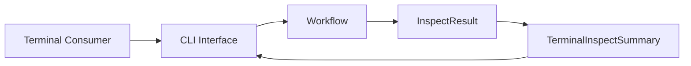
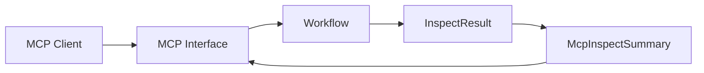

# npm-plus 接入层设计

## 相关文档

- [检查 npm package 质量](../use-case/inspect-npm-package-quality.md)
- [InspectDelegation](../glossary/inspect-delegation.md)
- [InspectResult](./glossary/inspect-result.md)

## 目的

接入层通过 `CLI` 和 `MCP` 适配器，对外提供检查 `npm package` 质量的能力，适配器共享核心工作流与原始 **InspectResult**。

接入层建立检查委托时遵循[接入层 Worker 异常契约](worker-exceptions.md)。

## 架构设计

## 适配器

- [CLI 接入层](cli.md)定义终端使用方如何调用该能力。
- [MCP 接入层](mcp.md)定义 AI 客户端如何调用该能力。
