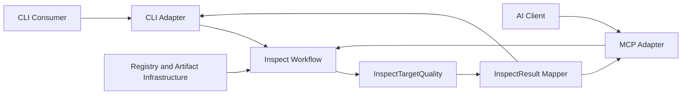

# npm-plus 接入层设计

## 参考资料

- [NPM 生态质量支持](../spec.md)
- [InspectDelegation](../glossary/inspect-delegation.md)
- [InspectResult](inspect-result.md)
- [获取 npm package 质量支撑数据](../use-case/get-npm-package-quality-support-data.md)

## 目的

接入层通过 `CLI` 和 `MCP` 适配器，对外提供获取 npm package 质量支撑数据的能力。两个适配器共享同一核心工作流，不包含目标确定、质量数据采集或质量评价逻辑。

## 架构设计

`composition root` 负责装配核心工作流与 Registry、package 制品读取等 infrastructure port，并向两个适配器提供可直接调用的 workflow。核心工作流将 **InspectDelegation** 转换为 **InspectTarget**；此过程中的任何错误直接抛出。目标确定成功后，工作流以 **InspectTargetQuality** 作为核心质量结构，将各质量维度的评估异常内建于对应维度结果。

接入层承担协议输入校验、**InspectDelegation** 映射、工作流调用、**InspectResult** 构造、结果序列化与协议错误封装。**InspectResult** 及其 mapper 均属于接入层，不进入核心业务模型。

## 结果与错误边界

接入层区分以下三类执行情况：

1. 输入不满足接口契约时，请求不进入核心工作流，由当前适配器通过协议错误通道报告。
2. 将 **InspectDelegation** 转换为 **InspectTarget** 时抛出的 package、精确版本、tag 或 Registry 访问错误继续传播，由当前适配器映射到协议错误通道，不构造 **InspectResult**。
3. 确定 **InspectTarget** 后，质量维度评估异常被内建于 **InspectTargetQuality**；接入层 mapper 仍构造 **InspectResult**，适配器将其作为成功请求呈现。

具体技术错误消息不属于稳定的跨接口契约。

## 适配器

- [CLI 接入层](cli.md)定义终端使用方如何调用该能力。
- [MCP 接入层](mcp.md)定义 AI 客户端如何调用该能力。

## 跨接口一致性

通过 CLI 与 MCP 提交的等价 **InspectDelegation** 必须产生语义一致的 **InspectResult**。CLI `--json` 输出与 MCP `structuredContent` 使用相同的字段名称、枚举值、可选字段规则和嵌套结构；CLI 人类可读报告与 MCP 文本摘要不属于该一致性约束。

## 验证要求

- 验证两个适配器对默认版本、精确版本和 tag 委托的映射语义一致。
- 验证两个适配器对 **InspectResult** 与各质量维度成功、失败评估使用相同的结构化序列化形式。
- 验证输入错误不会调用核心工作流。
- 验证目标确定错误分别进入 CLI 和 MCP 的错误通道，且不会产生 **InspectResult**。
- 验证质量维度评估异常内建于 **InspectTargetQuality**，且不会进入接口错误通道。
