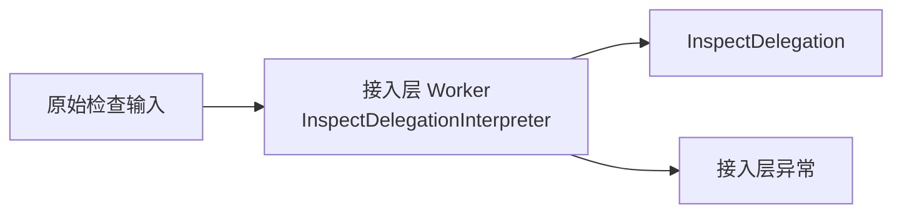

# npm-plus 接入层 Worker 异常契约

## 参考资料

- [npm-plus 接入层设计](spec.md)
- [CLI 接入层](cli.md)
- [MCP 接入层](mcp.md)
- [InspectDelegation](../glossary/inspect-delegation.md)
- [业务层 Worker 异常契约](../worker-exceptions.md)

## 目的

本文定义接入层 Worker **InspectDelegationInterpreter** 的稳定职责及其可能公开的异常。

本 Worker 使用**业务层 Worker 异常契约**规定的最小异常模型，只公开稳定的 `code` 与可变的
`message`。

## InspectDelegationInterpreter

**InspectDelegationInterpreter** 是接入层 Worker，负责将原始检查输入解释为有效的
**InspectDelegation**。

### 业务目标

保留使用方提交的 package 名称和可选版本标识，并确保只有满足检查委托约束的输入才能进入
业务层。

### 职责边界

- 接收协议层已经提取的 package 名称和可选版本标识。
- 校验建立 **InspectDelegation** 所需的输入规则。
- 成功时建立 **InspectDelegation**。
- 失败时公开接入层异常。
- 不访问 Registry。
- 不判断 package、精确版本或 tag 是否存在。
- 不确定实际接受检查的精确版本。

CLI 和 MCP 可以采用不同的协议解析方式，但必须共享本 Worker 规定的委托建立规则和异常
语义。协议本身无法解析的请求不属于本 Worker 的输入。

### 输入与输出

输入是协议层提取的原始检查输入。成功输出是 **InspectDelegation**；失败时不建立委托，只公开
一个接入层异常。



### 异常代码

```ts
enum InspectDelegationExceptionCode {
  PackageNameRequired = "PACKAGE_NAME_REQUIRED",
  VersionIdentifierEmpty = "VERSION_IDENTIFIER_EMPTY",
  UnsupportedVersionRange = "UNSUPPORTED_VERSION_RANGE",
  InspectDelegationFailed = "INSPECT_DELEGATION_FAILED",
}
```

- `PACKAGE_NAME_REQUIRED`：package 名称缺失或为空，无法建立检查委托。
- `VERSION_IDENTIFIER_EMPTY`：调用方提供了版本标识，但值为空。
- `UNSUPPORTED_VERSION_RANGE`：版本标识是当前能力不支持的版本范围表达式。
- `INSPECT_DELEGATION_FAILED`：发生其他未声明的内部异常，无法安全建立检查委托。

`INSPECT_DELEGATION_FAILED` 只用于阻止原始内部异常穿透接入层，不得替代已经能够识别的具体
错误码。

## 与业务层的边界

成功建立 **InspectDelegation** 后，接入层将其交给业务层 **InspectTargetDeterminer**。目标确定
期间发生的异常由**业务层 Worker 异常契约**定义，不得转换为接入层异常。

接入层负责把两个层级的 Worker 异常映射到具体接口的错误通道：

- CLI 以非零状态结束，不向 `stdout` 输出 `InspectResult`。
- MCP 返回 error response，不产生成功结果的 `structuredContent`。
- 两个接口必须保留异常的 `code` 与 `message`。
- 两个接口不得向错误响应添加原始 `stack` 或其他底层异常数据。

具体呈现格式由 CLI 与 MCP 接口规约另行定义，不属于本文范围。

## 验收约束

- 有效原始输入只能由 **InspectDelegationInterpreter** 建立为 **InspectDelegation**。
- 接入层输入失败只能公开 **InspectDelegationInterpreter** 声明的错误码。
- 任意未识别内部异常都必须转换为 `INSPECT_DELEGATION_FAILED`。
- 接入层公开的 Worker 异常只包含 `code` 和 `message`。
- 业务层异常经过接口传播时不得被改写为接入层异常。
- 质量维度异常不得被转换为 CLI 或 MCP 的接口错误。

## 非目标

- 定义业务层目标确定规则与异常。
- 定义错误消息的固定文本。
- 定义 CLI 的具体错误布局或细分退出码。
- 定义 MCP 错误内容的具体序列化格式。
- 增加重试、日志、telemetry 或诊断标识。
- 保存或公开原始异常的 `stack` 与 `cause`。
