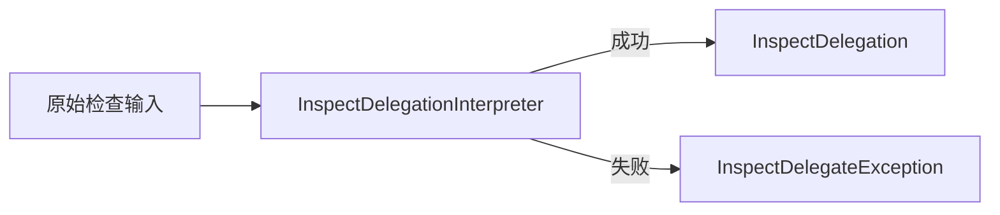

# InspectDelegationInterpreter

## 关联文档

- [检查 npm package 质量](../../use-case/inspect-npm-package-quality.md)
- [CLI 接入层](../cli.md)
- [MCP 接入层](../mcp.md)
- [InspectDelegation](../../glossary/inspect-delegation.md)
- [InspectTarget](../../glossary/inspect-target.md)

## 定义

接入层 `Worker`，负责将原始检查输入解释为有效的 **InspectDelegation**，确保只有满足条件的输入才能进入后续流程。

## 输入

`CLI` 或 `MCP` 协议层已经提取的 `package` 名称和可选版本标识。

## 输出产物

成功场景：**InspectDelegation**。
失败场景：**InspectDelegateException**

## 运行机制



### 构造成功

`Worker` 按照约定实例化 **InspectDelegation**。

### 构造异常

```ts
interface InspectDelegateException {
  readonly code: InspectDelegateExceptionCode;
  readonly message: string;
}

enum InspectDelegateExceptionCode {
  PackageNameRequired = "PACKAGE_NAME_REQUIRED",
  VersionIdentifierEmpty = "VERSION_IDENTIFIER_EMPTY",
  UnsupportedVersionRange = "UNSUPPORTED_VERSION_RANGE",
  InspectDelegationFailed = "INSPECT_DELEGATION_FAILED",
}
```

- `PACKAGE_NAME_REQUIRED`：`package` 名称缺失或为空，无法建立检查委托。
- `VERSION_IDENTIFIER_EMPTY`：调用方提供了版本标识，但值为空。
- `UNSUPPORTED_VERSION_RANGE`：版本标识是当前能力不支持的版本范围表达式。
- `INSPECT_DELEGATION_FAILED`：未知内部异常，使 `Worker` 无法安全建立检查委托。

错误码是稳定契约，调用方不得根据 `message` 判断错误类型。`message` 必须是已经脱敏且具备完整
语义的自然语言说明，使接入层可以直接聚合，不得要求接入层重新解释错误码。异常不得包含
`stack`、`cause`、原始 `schema` 校验详情或其他底层实现信息。

未识别内部异常必须转换为 `INSPECT_DELEGATION_FAILED`。能够识别具体语义的失败不得转换为该
兜底错误码。

该异常只在系统内部中断委托构造流程。CLI 和 MCP 接入层必须捕获异常，直接聚合已经具备完整
语义的 `message` 生成自然语言失败摘要，不得将异常对象直接抛给开发者或 agent，也不得构造
部分 **InspectDelegation**。
