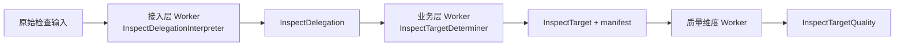

# npm-plus Worker 异常契约

## 参考资料

- [检查 npm package 质量](use-case/inspect-npm-package-quality.md)
- [InspectDelegation](glossary/inspect-delegation.md)
- [InspectTarget](glossary/inspect-target.md)
- [InspectTargetQuality](glossary/inspect-target-quality.md)
- [npm-plus 接入层设计](interfaces/spec.md)

## 目的

本文定义检查请求进入 `npm-plus` 后，由不同层级 Worker 承担的稳定职责，以及每个
Worker 可能公开的异常。异常契约为用户、CLI、MCP client 和 agent 提供固定语义，同时避免
直接暴露底层实现错误。

本文只规定 Worker 边界和异常事实，不规定错误文案、日志、重试、诊断标识或进程退出码的
具体策略。

## Worker 分层

本文使用 Worker 表达某一层级内部具有明确输入、输出和结果责任的稳定职责。Worker 不限定在
业务层：接入层负责建立有效检查委托，业务层负责根据委托确定检查目标。



每个 Worker 只对自身阶段的转换结果负责。前一阶段没有成功时，后一阶段不得开始。

## 异常模型

Worker 对外公开的异常只包含稳定错误码和可变消息：

```ts
interface WorkerException<TCode> {
  readonly code: TCode;
  readonly message: string;
}
```

错误码用于表达稳定语义，是调用方进行判断的依据。错误消息用于向当前使用方解释失败，可以在
不改变错误语义的前提下调整。

Worker 异常遵循以下约束：

1. 每个错误码必须由一个明确的 Worker 所有。
2. 每个 Worker 必须显式声明可能公开的错误码。
3. 调用方不得依据错误消息判断错误类型。
4. 公开异常不得包含 `stack`、`cause`、原始网络错误、schema 校验详情或其他底层实现信息。
5. 未声明的底层异常不得直接穿透 Worker 边界，必须转换为该 Worker 所有的兜底错误码。
6. Worker 异常表示当前阶段未能产生输出，不属于成功检查结果。

## 接入层 Worker

### InspectDelegationInterpreter

**InspectDelegationInterpreter** 负责将原始检查输入解释为有效的 **InspectDelegation**。

#### 业务目标

保留使用方提交的 package 名称和可选版本标识，并确保只有满足检查委托约束的输入才能进入
业务层。

#### 职责边界

- 接收协议层已经提取的 package 名称和可选版本标识。
- 校验建立 **InspectDelegation** 所需的输入规则。
- 成功时建立 **InspectDelegation**。
- 失败时公开接入层异常。
- 不访问 Registry。
- 不判断 package、精确版本或 tag 是否存在。
- 不确定实际接受检查的精确版本。

CLI 和 MCP 可以采用不同的协议解析方式，但必须共享本 Worker 规定的委托建立规则和异常
语义。协议本身无法解析的请求不属于本 Worker 的输入。

#### 输入与输出

输入是协议层提取的原始检查输入。成功输出是 **InspectDelegation**；失败时不建立委托，只公开
一个接入层异常。

#### 异常代码

```ts
enum InspectDelegationExceptionCode {
  PackageNameRequired = "PACKAGE_NAME_REQUIRED",
  VersionIdentifierEmpty = "VERSION_IDENTIFIER_EMPTY",
  UnsupportedVersionRange = "UNSUPPORTED_VERSION_RANGE",
  InspectDelegationFailed = "INSPECT_DELEGATION_FAILED",
}
```

- `PACKAGE_NAME_REQUIRED`：package 名称缺失或为空，无法建立检查委托。
- `VERSION_IDENTIFIER_EMPTY`：调用方提供了版本标识，但值为空。
- `UNSUPPORTED_VERSION_RANGE`：版本标识是当前能力不支持的版本范围表达式。
- `INSPECT_DELEGATION_FAILED`：发生其他未声明的内部异常，无法安全建立检查委托。

`INSPECT_DELEGATION_FAILED` 只用于阻止原始内部异常穿透接入层，不得替代已经能够识别的具体
错误码。

## 业务层 Worker

### InspectTargetDeterminer

**InspectTargetDeterminer** 负责将有效的 **InspectDelegation** 转换为不存在版本不确定性的
**InspectTarget**。

#### 业务目标

根据检查委托解释版本标识，确认 package 与版本存在，并为后续质量检查提供唯一的检查目标及
其发布 manifest。

#### 职责边界

- 接收有效的 **InspectDelegation**。
- 将缺省版本标识解释为 `latest` tag。
- 区分精确版本与 tag。
- 通过 Registry 确认 package、tag 和精确版本存在。
- 成功时建立 **InspectTarget**，并提供对应 manifest。
- 失败时公开目标确定异常。
- 不检查任何质量维度。
- 不建立 **InspectTargetQuality**。

#### 输入与输出

输入是有效的 **InspectDelegation**。成功输出是 **InspectTarget** 及其 manifest；失败时不建立
检查目标，只公开一个目标确定异常。

#### 异常代码

```ts
enum InspectTargetDeterminationExceptionCode {
  PackageNotFound = "PACKAGE_NOT_FOUND",
  ExactVersionNotFound = "EXACT_VERSION_NOT_FOUND",
  TagNotFound = "TAG_NOT_FOUND",
  TagUnresolvable = "TAG_UNRESOLVABLE",
  RegistryRequestFailed = "REGISTRY_REQUEST_FAILED",
  RegistryResponseInvalid = "REGISTRY_RESPONSE_INVALID",
  InspectTargetDeterminationFailed = "INSPECT_TARGET_DETERMINATION_FAILED",
}
```

- `PACKAGE_NOT_FOUND`：指定 package 不存在。
- `EXACT_VERSION_NOT_FOUND`：指定的精确版本不存在。
- `TAG_NOT_FOUND`：指定或默认使用的 tag 不存在。
- `TAG_UNRESOLVABLE`：tag 指向的精确版本不存在，无法形成有效检查目标。
- `REGISTRY_REQUEST_FAILED`：无法完成确定检查目标所需的 Registry 请求。
- `REGISTRY_RESPONSE_INVALID`：Registry 响应无法提供确定检查目标所需的有效数据。
- `INSPECT_TARGET_DETERMINATION_FAILED`：发生其他未声明的内部异常，无法安全确定检查目标。

Registry 是本 Worker 的外部依赖。其失败由 **InspectTargetDeterminer** 负责转换为自身声明的异常，
不得以原始网络错误、JSON 解析错误或 schema 校验错误的形式离开业务层。

`INSPECT_TARGET_DETERMINATION_FAILED` 只用于阻止原始内部异常穿透业务层，不得替代已经能够识别
的具体错误码。

## 与质量维度异常的边界

成功建立 **InspectTarget** 后，质量维度 Worker 才开始工作。此后发生的质量维度异常继续按照
**InspectTargetQuality** 契约记录，不转换为接入层或目标确定异常。

两类异常的语义不同：

- Worker 异常表示当前阶段没有产生必要输出，检查用例失败，不生成 **InspectResult**。
- 质量维度异常表示检查目标已经确定，但某个质量事实无法获得；它属于成功结果的一部分，记录在
  `InspectTargetQuality.exceptions` 中。

接入层不得将 `InspectTargetQuality.exceptions` 转换为 CLI 或 MCP 的接口错误。

## 接口传播约束

CLI 和 MCP 必须保留 Worker 异常中的 `code` 与 `message`，并映射到各自的错误通道：

- CLI 以非零状态结束，不向 `stdout` 输出 **InspectResult**。
- MCP 返回 error response，不产生成功结果的 `structuredContent`。
- 两个接口不得向错误响应添加原始 `stack` 或其他底层异常数据。

具体呈现格式由各接口规约另行定义，不属于本文范围。

## 验收约束

- 有效原始输入只能由 **InspectDelegationInterpreter** 建立为 **InspectDelegation**。
- 接入层输入失败只能公开 **InspectDelegationInterpreter** 声明的错误码。
- 有效 **InspectDelegation** 只能由 **InspectTargetDeterminer** 建立为 **InspectTarget**。
- 目标确定失败只能公开 **InspectTargetDeterminer** 声明的错误码。
- 任意未识别内部异常都必须转换为所属 Worker 的兜底错误码。
- Worker 异常的公开数据只包含 `code` 和 `message`。
- 质量维度异常继续记录在 `InspectTargetQuality.exceptions` 中，并保持成功结果语义。

## 非目标

- 定义错误消息的固定文本。
- 定义 CLI 的具体错误布局或细分退出码。
- 定义 MCP 错误内容的具体序列化格式。
- 增加重试、日志、telemetry 或诊断标识。
- 保存或公开原始异常的 `stack` 与 `cause`。
- 改变 **InspectTargetQuality** 的结构或成功语义。
